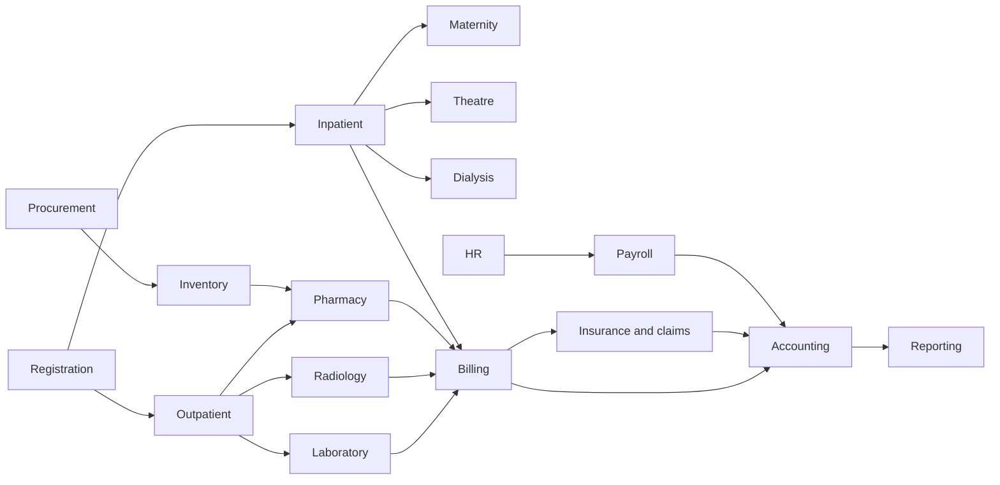

# Module catalogue

| Field | Value |
| --- | --- |
| Document | MODULE_CATALOGUE |
| Version | 1.0 |
| Last reviewed | 2026-11-18 |
| Applies to | JaliCare HMIS 0.1.0, commit `9d7274c` |
| Audience | Everyone evaluating or operating the system |
| Status | Verified against `src/components/modules/`, the API inventory and the schema inventory |

## How to read this catalogue

Each entry states the module's purpose, its implementation status, the screen that hosts it, the
API prefixes it owns, the tables that hold its data and the permission codes that open it. Route
counts come from [`docs/evidence/API_ROUTE_INVENTORY.json`](../evidence/API_ROUTE_INVENTORY.json);
table names come from [`docs/evidence/DATABASE_SCHEMA_INVENTORY.json`](../evidence/DATABASE_SCHEMA_INVENTORY.json).

A module is **switchable** when it appears in the facility module list
(`src/config/facility-modules.ts`) and can be turned off per facility. Switching it off hides its
navigation and makes its API answer `403` with the module disabled.

Status uses the [library vocabulary](../README.md#status-vocabulary). "Verified" for a module means
its API and data model were checked against source and its services are exercised by at least one
test; screen-level behaviour is **PARTIALLY VERIFIED** where no browser run was possible.

## Clinical and front-desk modules

| Module | Purpose | Switchable | Status | Screen | API prefixes (routes) | Core tables |
| --- | --- | --- | --- | --- | --- | --- |
| Patient registration | Register patients, allocate MRNs, capture identifiers, consent and allergies, detect duplicates | `registration` | **VERIFIED** | `PatientRegistrationModule` | `patients` (12), `patient-documents` (11) | `patients`, `patient_identifiers`, `patient_facilities`, `patient_consents`, `patient_allergies`, `patient_record_access_logs`, `patient_signed_documents` |
| Reception and appointments | Appointment diary, categories, queueing, check-in, website booking | `reception`, `website_booking` | **VERIFIED** | `ReceptionQueueModule`, `AppointmentDiary`, `AppointmentCategoryManager` | `appointments` (10), `queues` (3), `booking` (11, public) | `appointments`, `appointment_categories`, `appointment_events`, `appointment_requests`, `queues`, `website_booking_slots`, `website_booking_clients`, `external_bookings` |
| Outpatient care | Encounter, triage vitals, consultation notes, diagnoses, procedures | `opd` | **VERIFIED** | `OutpatientModule` | `encounters` (4), `observations` (2), `diagnoses` (2), `procedures` (2), `nursing-notes` (3), `vitals` (2) | `encounters`, `observations`, `diagnoses`, `procedures`, `clinical_notes` |
| Inpatient care | Admissions, wards, beds, transfers, discharges, nursing notes, bed billing | `inpatient` | **VERIFIED** | `InpatientModule`, `NursingPanel` | `admissions` (12), `beds` (6), `wards` (4), `inpatient` (4) | `admissions`, `admission_transfers`, `wards`, `beds`, `inpatient_bed_occupancies`, `inpatient_bed_nights`, `nursing_notes` |
| Maternity | Antenatal register, labour and partograph, deliveries, postnatal care, birth immunisation | `maternity` | **VERIFIED** | `MaternityModule`, `PartographChart` | `maternity` (18) | `maternity_pregnancies`, `anc_visits`, `labour_records`, `partograph_entries`, `deliveries`, `delivery_babies`, `postnatal_visits` |
| Theatre | Rooms, case scheduling, case list, change of case, scheduling report | `theatre` | **VERIFIED** | `TheatreModule` | `theatre` (12), `theatre-cases` (3) | `theatre_rooms`, `theatre_cases`, `theatre_bookings`, `theatre_schedule_events` |
| Dialysis | Machines, schedules, sessions, facility protocols | `dialysis` | **VERIFIED** | `DialysisModule` | `dialysis` (16) | `dialysis_machines`, `dialysis_schedules`, `dialysis_sessions`, `dialysis_treatment_plans`, `dialysis_patient_assessments`, `dialysis_adverse_events`, `dialysis_consumable_usages` |
| Specialty clinic | Specialty service encounters | `specialty` | **PARTIALLY VERIFIED** | `SpecialtyModule` | Uses clinical prefixes | Clinical tables |

## Diagnostic and supply modules

| Module | Purpose | Switchable | Status | Screen | API prefixes (routes) | Core tables |
| --- | --- | --- | --- | --- | --- | --- |
| Laboratory | Orders, specimens, result entry, review and release | `laboratory` | **VERIFIED** | `LaboratoryModule`, `ReviewedLabSpecimens` | `lab-orders` (5), `lab-results` (3), `lab-tests` (1) | `lab_orders`, `lab_order_batches`, `lab_specimen_orders`, `lab_specimens`, `lab_results`, `lab_tests` |
| Radiology | Imaging orders, consent policy and verification, report documents | `radiology` | **PARTIALLY VERIFIED** | `RadiologyModule`, `RadiologyConsentPanel`, `RadiologyConsentPolicyPanel` | `radiology-orders` (3), `compliance` (2), `patient-documents` consent routes | `radiology_orders`, `radiology_order_requests`, `radiology_consent_policies`, `radiology_consent_decisions`, `patient_signed_documents` |
| Pharmacy | Stock, dispensing, medication records, interaction checks | `pharmacy` | **VERIFIED** | `PharmacyModule` | `pharmacy` (2), `medications` (6) | `pharmacy_dispense_requests`, `pharmacy_dispense_allocations`, `pharmacy_dispensations`, `medications`, `medication_status_events`, `inventory_items` |
| Inventory | Items, stock control, movements, suppliers | `inventory` | **VERIFIED** | `InventoryModule` | `inventory` (25), `suppliers` (4) | `inventory_items`, `inventory_batches`, `inventory_movements`, `inventory_movement_allocations`, `inventory_transfers`, `inventory_stock_counts`, `suppliers` |
| Procurement | Requisitions, purchase orders, receiving, three-way matching | `procurement` | **VERIFIED** | `ProcurementModule` | `procurement` (25), `purchase-orders` (8) | `procurement_requisitions`, `procurement_requisition_items`, `purchase_orders`, `purchase_order_items`, `goods_received_notes`, `supplier_invoice_matches`, `supplier_invoices` |

## Revenue, finance and payer modules

| Module | Purpose | Switchable | Status | Screen | API prefixes (routes) | Core tables |
| --- | --- | --- | --- | --- | --- | --- |
| Billing and cashier | Invoices, charges, receipts, refunds, payment allocation, tariffs | `finance` | **VERIFIED** | `BillingCashierModule`, `RefundsPanel`, `RefundRequestWorkflow`, `PaymentSettlementWork` | `billing` (16), `invoices` (10), `facility-services` (10), `facility-tariffs` (8), `service-tariff-links` (3) | `billing_invoices`, `billing_items`, `billing_payments`, `billing_payment_requests`, `billing_payment_attributions`, `billing_refunds`, `billing_refund_requests`, `facility_services`, `facility_service_tariffs`, `service_tariff_links` |
| Insurance and claims | Eligibility, benefits, preauthorisation, SHA eClaims, private payer claims, remittances | `insurance` | **PARTIALLY VERIFIED** | `InsuranceClaimsModule` | `insurance` (91), `claims` (7), `payer-hub` (15) | `insurance_payer_definitions`, `insurance_member_policies`, `insurance_benefit_validations`, `insurance_preauthorizations`, `insurance_claims`, `sha_eclaims`, `private_insurance_claims`, `insurance_remittances` |
| Accounting | Chart of accounts, journals, periods, expenses, banking, exports | `accounting` | **VERIFIED** | `AccountingModule` | `accounting` (37), `bank-payments` (9) | `chart_of_accounts`, `journal_entries`, `journal_lines`, `financial_periods`, `expense_requests`, `bank_accounts`, `bank_statement_imports`, `bank_transactions`, `bank_reconciliations` |
| Fixed assets | Asset register, depreciation, maintenance, disposal | `accounting` | **VERIFIED** | `FixedAssetsModule` | `fixed-assets` (22) | `fixed_assets`, `fixed_asset_categories`, `fixed_asset_movements`, `fixed_asset_maintenance`, `fixed_asset_transfers`, `fixed_asset_tax_rates` |
| Partner equity | Partner capital, statements, workflow, exports | `accounting` | **PARTIALLY VERIFIED** | Accounting module panels | `partner-equity` (13) | `equity_partner_register`, `equity_statements`, `equity_events` |
| Budget planning | Budget drafts, imports, approvals, resets | `accounting` | **VERIFIED** | Accounting module panels | `budget-planning` (35) | `planning_plans`, `planning_items`, `planning_months`, `planning_categories`, `planning_financial_budgets`, `planning_import_batches`, `planning_reports`, `planning_events` |

## Workforce modules

| Module | Purpose | Switchable | Status | Screen | API prefixes (routes) | Core tables |
| --- | --- | --- | --- | --- | --- | --- |
| HR and workforce | Employees, departments, job titles, attendance, leave | `hr` | **VERIFIED** | `WorkforceModule` | `hr` (24), `departments` (1), `staff-roles` (6), `staff-invitations` (9) | `hr_employees`, `hr_departments`, `hr_designations`, `hr_attendance`, `hr_shifts`, `hr_roster_entries`, `hr_leave_requests`, `hr_leave_types`, `staff_professional_credentials` |
| Payroll | Payroll runs, statutory rules, payslips, ledger posting | `payroll` | **VERIFIED** (rates are configured, not seeded) | `PayrollModule` | `payroll` (25) | `payroll_runs`, `payroll_periods`, `payroll_payslips`, `payroll_payslip_lines`, `payroll_employee_components`, `payroll_statutory_versions`, `payroll_statutory_bands`, `payroll_account_settings` |

## Reporting, integration and platform modules

| Module | Purpose | Switchable | Status | Screen | API prefixes (routes) | Core tables |
| --- | --- | --- | --- | --- | --- | --- |
| Reporting centre | Catalogue of 144 reports, 28 runnable, exports | `analytics` | **PARTIALLY VERIFIED** | `ReportsModule`, `report-centre/*` | `reporting` (7), `analytics` (2), `dashboard` (2) | Queries existing tables; no report store |
| Public health | Public-health register and immunisation | `public_health` | **PARTIALLY VERIFIED** | `PublicHealthModule` | `public-health` (4), `immunisation` (5) | `public_health_reports`, `immunisation_records` |
| Interoperability | DHA, provider registry and integration status | `interoperability` (superadmin only) | **PARTIALLY VERIFIED** | `InteroperabilityModule`, `DhaCompliancePanel` | `interop` (2), `integrations` (7) | `dha_api_calls`, `dha_service_mappings`, `professional_verification_events`, `staff_professional_credentials` |
| Patient portal (staff view) | Portal accounts, invitations, policy, audit | `patient_portal` | **VERIFIED** | `PatientPortalModule` | `portal` (42) | `patient_portal_accounts`, `patient_portal_invitations`, `patient_portal_sessions`, `patient_portal_settings` |
| Patient portal (patient view) | Own records, released documents, appointment requests | `patient_portal` | **PARTIALLY VERIFIED** | `components/portal/PortalApp`, `PortalDocuments` | `portal` (public mount, portal bearer token) | Same tables, patient projection |
| Documents and branding | Clinical documents, letterheads, patient document release | Always available with the owning module | **VERIFIED** | `PatientDocumentsPanel`, `BrandingDocumentsPanel` | `documents` (8), `patient-documents` (11), `facility-branding` (8) | `patient_signed_documents`, `patient_document_events`, `patient_document_releases`, `facility_letterheads`, `facility_letterhead_events` |
| Payment hub | Provider registry, facility integrations, collections, bank payments | `finance` + superadmin provider administration | **PARTIALLY VERIFIED** | Payment hub panels, `FacilityIntegrationHub` | `payment-hub` (28) | `payment_hub_transactions`, `payment_hub_reconciliations`, `payment_hub_webhook_events`, `payment_provider_definitions`, `payment_provider_environments`, `facility_payment_integrations`, `facility_payment_secrets` |
| Platform administration | Tenants, facilities, facility administrators, subscriptions, RBAC, payers | Not switchable (platform level) | **VERIFIED** | `PlatformAdministrationModule`, `SuperAdminDashboardModule` | `platform` (21), `tenants` (2), `facilities` (4) | `tenants`, `facilities`, `facility_subscription_periods`, `facility_subscription_payments`, `facility_admin_invitations`, `roles`, `role_permissions`, `permissions` |
| Facility configuration | Facility profile, module switches, staff and roles, integrations, tariffs, approval policies | `configuration` (always on) | **VERIFIED** | `ConfigurationModule`, `FacilityRbacEditor`, `ApprovalPoliciesPanel` | `facilities` (4), `staff-roles` (6), `facility-tariffs` (8), `approval-policies` (4) | `facilities`, `roles`, `facility_role_permission_overrides`, `approval_policies` |
| Audit and monitoring | Audit log review, operational status | `audit` | **VERIFIED** | `AuditLogModule` | `audit-logs` (1), `ops` (1) | `audit_logs` (operational status is computed at request time from the pool and the schema) |
| Dashboard | Role-aware landing page with ward, queue and revenue signals | Always on | **PARTIALLY VERIFIED** | `DashboardModule`, `HospitalDashboard` | `dashboard` (2) | Reads existing tables |

## Module dependencies

Read the arrows as "feeds": a billing charge can originate in any clinical module, and every posted
charge can reach the ledger. The dependencies are data flows, not code couplings; disabling a
module does not break the others, but it removes their ability to raise that kind of charge.

## Limitations

- Status reflects implementation and test evidence, not screen polish. Column-level UI verification
  was not performed in this documentation pass (no browser runtime available), so screen behaviour
  is **PARTIALLY VERIFIED** everywhere it is claimed.
- Route counts are per API prefix, and some prefixes are shared by more than one module (for example
  `patient-documents` serves radiology consent as well as general documents). Counts are indicative,
  not an allocation of effort.
- Modules marked **PARTIALLY VERIFIED** have a specific gap stated in their manual or integration
  document; they are not partially built from scratch.

## Related documents

- [Product scope](PRODUCT_SCOPE.md)
- [User roles and personas](USER_ROLES_AND_PERSONAS.md)
- [Permissions matrix](../05-administration/PERMISSIONS_MATRIX.md)
- [Feature traceability matrix](../DOCUMENTATION_TRACEABILITY_MATRIX.md)
