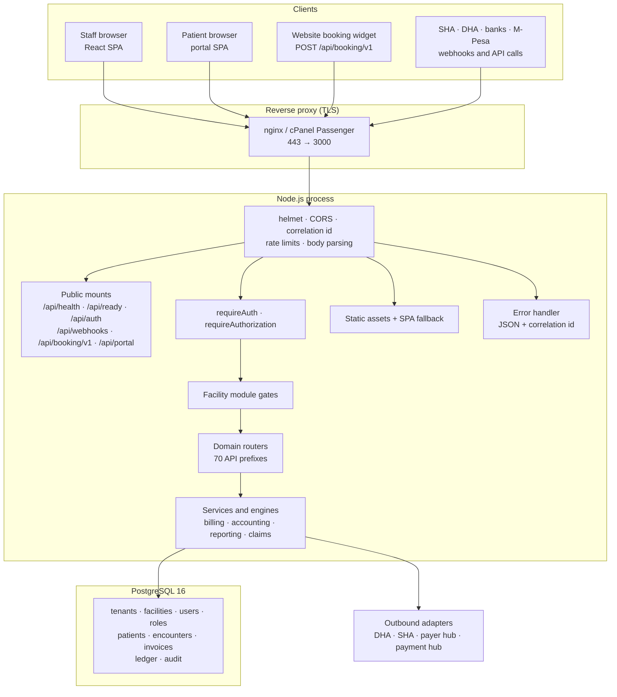
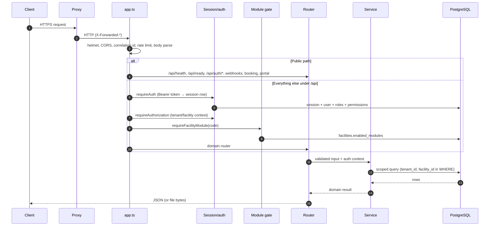
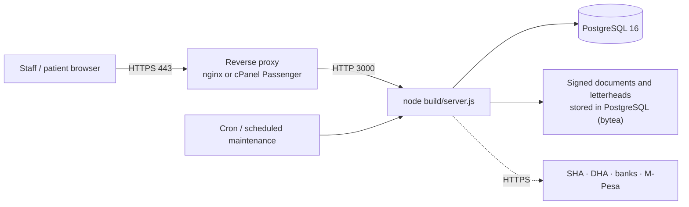

# System architecture

| Field | Value |
| --- | --- |
| Document | SYSTEM_ARCHITECTURE |
| Version | 1.0 |
| Last reviewed | 2026-11-18 |
| Applies to | JaliCare HMIS 0.1.0, commit `9d7274c` |
| Audience | Engineers, architects, security reviewers, technical evaluators |
| Status | Verified against `server.ts`, `src/app.ts`, `src/routes/index.ts`, the schema and the deployment scripts |

## Architectural summary

One Node.js process serves the JSON API and the compiled React application on a single port.
PostgreSQL holds all state. External systems are reached through adapter modules that degrade to
mock behaviour when credentials are absent. Everything in a request — identity, tenant, facility,
module entitlement, permission — is decided on the server; the client receives only what the
server already scoped.

### Why one process

A Kenyan facility frequently deploys on shared hosting with a single application slot and a single
port. A single process removes cross-origin configuration, produces one artifact to upload, and
gives one log stream. The accepted cost is a shared failure domain between API and UI: they are
released together and a client that cannot reach the API cannot work anyway.

## Layers

| Layer | Location | Responsibility | Does not |
| --- | --- | --- | --- |
| Entry point | `server.ts` | Reads `PORT`/`HOST`, applies the configured timezone, starts HTTP, handles `SIGTERM` | Contain routes or business rules |
| Application | `src/app.ts` | Middleware order, public mounts, auth mounts, module gates, SPA fallback, JSON 404, error handler | Register domain routes |
| Route composition | `src/routes/index.ts` | `createApiRoutes()` (relative prefixes and module gates) and `createDomainRoutes()` (routers declaring full `/api/...` paths) | Contain business rules |
| Routers | `src/routes/**`, `src/*/*.routes.ts` | HTTP shape: validation, permission guards, status codes, error mapping | Decide entitlement or compute money |
| Services and engines | `src/*/*.service.ts`, `src/*/*.engine.ts` | Business rules, scoping, transactions, calculations | Import routers |
| Data | `src/db/` | Pool, Drizzle schema (`src/db/schema/`), query modules (`src/db/queries/`) | Import services |
| Client | `src/App.tsx`, `src/components/` | Routes between modules, renders screens, calls the API | Enforce access (server decides) |
| Cross-cutting | `src/middleware/`, `src/logging/`, `src/security/` | Security headers, rate limits, correlation, structured logs, encryption helpers | Hold domain logic |

The dependency direction is one-way: router → service → data. A service never imports a router;
the data layer never imports a service.

## Request lifecycle

Two ordering decisions are load-bearing:

1. **Correlation id before the body parser.** Otherwise a malformed JSON body produces an error with
   nothing to search for in the logs.
2. **Health, readiness and login before the session check.** A proxy probe cannot authenticate;
   moving them behind auth would make every readiness check a `401`.

## Tenancy and scope

A **tenant** is an organisation; a **facility** is a site inside it. Both appear in the schema:
189 of 257 relations carry `tenant_id` and 192 carry `facility_id`.

- Tenant isolation is enforced in the `WHERE` clause, not by filtering after the read.
- Facility scoping is resolved from the authenticated session. A `facilityId` supplied in a body or
  query is accepted only when it equals the session's facility; a mismatch is a `403`.
- Platform administrators (`SUPER_ADMIN`) are the only role that may operate without a tenant and
  facility assignment, and they are barred from facility financial operations that require one.

The property is tested against a real PostgreSQL in
`src/tests/vitest/tenant-isolation.db.spec.ts`. Details: [MULTITENANCY_ARCHITECTURE.md](../06-technical/MULTITENANCY_ARCHITECTURE.md).

## Data architecture

- **Migrations** are numbered SQL files in `drizzle/` (0000–0102, 103 applied) with a journal at
  `drizzle/meta/_journal.json`. Apply with `npm run db:migrate`; the application never migrates on
  start.
- **Schema modules**: 46 files under `src/db/schema/` grouped by domain, re-exported through
  `src/db/schema.ts`.
- **Encryption at rest** for patient identifiers and provider credentials uses
  `FIELD_ENCRYPTION_KEY` (AES-GCM helpers under `src/security/`). Losing the key means losing the data.
- **Audit trail**: `audit_logs`, `patient_document_events`, ledger event tables and configuration
  audit tables record who did what, to which record, and when.
- **Idempotency**: money-moving operations carry idempotency keys (payments, claims, ledger posting)
  so a retried request cannot double-post.

## Integration architecture

| System | Direction | Mode control | Where |
| --- | --- | --- | --- |
| SHA eClaims | Outbound + inbound webhook | Credentials + `SHA_*` settings; webhook secret | `src/integrations/sha/`, `/api/webhooks/sha` |
| DHA / AfyaConnect | Outbound | `DHA_MODE=mock\|sandbox\|production`; production requires `DHA_ALLOW_PRODUCTION=true` | `src/integrations/dha/` |
| Payment hub (bank collections, M-Pesa) | Outbound + webhook | Per-facility provider integrations in the database; adapters declare readiness | `src/payment-hub/` |
| Private payers (Britam, Pacis, Smartlink) | Outbound | Payer adapters and per-facility credentials | `src/integrations/` payer adapters |
| Website booking | Inbound public API | Public mount with its own validation and rate limiting | `/api/booking/v1` |

Adapters never silently fall back to a working-looking success: mock results are marked simulated,
and providers without production approval refuse production calls.

## Deployment topology

The build produces two artifacts: `dist/` (client) and `build/server.js` (bundled server). The
deployment procedure is in [DEPLOYMENT_PROCEDURE.md](../09-deployment-and-maintenance/DEPLOYMENT_PROCEDURE.md).

## Architectural constraints and known edges

| Constraint | Effect |
| --- | --- |
| Single process | API and UI share a failure domain; vertical scaling only unless a shared session store is introduced. |
| Documents are stored in the database | `patient_signed_documents.original_bytes` and `facility_letterheads` hold bytes in PostgreSQL, so database size grows with document volume and backups carry documents with the data. See [FILE_STORAGE_AND_RETENTION.md](../06-technical/FILE_STORAGE_AND_RETENTION.md). |
| Reporting is query-time | Large reports run against the live database; there is no warehouse or pre-aggregation layer. |
| Report coverage | 116 of 144 catalogue entries have no engine (see [reporting](../08-reporting/README.md)). |
| Low measured test coverage | About 20% of statements; the legacy suites include source-text assertions. See [QUALITY_GATES.md](../11-testing-and-acceptance/QUALITY_GATES.md). |

## Limitations

- The Mermaid diagrams describe the deployed structure at commit `9d7274c`; they are not a
  network diagram of a specific facility.
- Scaling characteristics (connections, throughput) were not benchmarked in this documentation
  exercise; no performance figures are claimed.

## Related documents

- [Application architecture](../06-technical/APPLICATION_ARCHITECTURE.md)
- [Multitenancy architecture](../06-technical/MULTITENANCY_ARCHITECTURE.md)
- [API reference](../06-technical/API_REFERENCE.md)
- [Deployment procedure](../09-deployment-and-maintenance/DEPLOYMENT_PROCEDURE.md)
