# Syrona Medical Center HMIS — Complete System Documentation

**AfyaHub Kenya · Health Information Management System**

| Field | Value |
| --- | --- |
| Document identifier | JC-DOC-001 |
| Version | 1.0 |
| Date | 19 November 2026 |
| Base commit | `0111b5502e1a8d8a21faf53845360122275727df` |
| Branch | `arena/e088f11d-afyahub-hmis-kenya` |
| Classification | Internal — facility operations and technical support |

> This Markdown file is the readable master of the Word volume of the same name. It is assembled
> from the chapter sources in `docs/documentation/source/`. Screenshots are browser captures of the
> running application recorded as acceptance evidence; diagrams are explanatory drawings. Test
> results are those recorded in the Test and Verification Report for this issue.

## Contents

- Chapter 1 — Introduction
  - 1.1 Purpose of the system
  - 1.2 System overview
  - 1.3 Intended facilities and users
  - 1.4 Scope of this volume
  - 1.5 Capability map
  - 1.6 What this document will not claim
- Chapter 2 — System Architecture
  - 2.1 Deployment shape
  - 2.2 Frontend
  - 2.3 Backend request path
  - 2.4 Database
  - 2.5 API structure
  - 2.6 Authentication and session handling
  - 2.7 Authorization and multi-tenancy
  - 2.8 Storage and file handling
  - 2.9 Background work
  - 2.10 Dependencies
  - 2.11 Deployment
  - 2.12 What the architecture means in practice
- Chapter 3 — Login, Authentication and User Management
  - 3.1 The sign-in screen
  - 3.2 What happens after sign-in
  - 3.3 Users, roles and permissions
  - 3.4 Separation of duties
  - 3.5 Sessions and revocation
  - 3.6 Audit of access
- Chapter 4 — Dashboard and Notifications
  - 4.1 The dashboard
  - 4.2 Every figure on the dashboard, and its source
  - 4.3 The operational overview
  - 4.4 Charts and their caveats
  - 4.5 Notifications
  - 4.6 Accounting dashboard
  - 4.7 Other viewports
- Chapter 5 — Patient Management
  - 5.1 Registration
  - 5.2 Duplicate prevention
  - 5.3 The patient profile
  - 5.4 Allergies and clinical alerts
  - 5.5 Patient documents
  - 5.6 Consent records
  - 5.7 Document audit
  - 5.8 The patient portal
  - 5.9 On a phone
- Chapter 6 — Reception and Outpatient Department
  - 6.1 Check-in and the queue
  - 6.2 The outpatient workspace
  - 6.3 Encounters
  - 6.4 Diagnoses and the responsible doctor
  - 6.5 Clinical notes
  - 6.6 Orders, prescriptions and charges
  - 6.7 Workflow sequence: one outpatient visit
  - 6.8 Referrals and follow-up
- Chapter 7 — Inpatient and Ward Management
  - 7.1 Admission
  - 7.2 Wards and beds
  - 7.3 Transfers
  - 7.4 Nursing records
  - 7.5 Daily bed charges
  - 7.6 Discharge
  - 7.7 What the ward screen shows, and why it is empty here
- Chapter 8 — Laboratory
  - 8.1 Ordering and charging
  - 8.2 The laboratory workspace
  - 8.3 Order states
  - 8.4 Verification control
  - 8.5 Reference ranges and flags
  - 8.6 Billing integration
  - 8.7 What is not in this build
  - 8.8 On a tablet
- Chapter 9 — Radiology
  - 9.1 The radiology workspace
  - 9.2 The consent gate
  - 9.3 Consent on a phone
  - 9.4 Reports and release
  - 9.5 What is not implemented
- Chapter 10 — Pharmacy
  - 10.1 The pharmacy queue
  - 10.2 Medicine catalogue versus service tariff
  - 10.3 Stock movement table
  - 10.4 Expiry and recalls
  - 10.5 What is not in this build
- Chapter 11 — Maternity and Maternal-Child Health
  - 11.1 What exists
  - 11.2 The MCH report is not available
  - 11.3 Charges
  - 11.4 Why no maternity screenshot is included
- Chapter 12 — Operating Theatre
  - 12.1 Case lifecycle
  - 12.2 What the module does not do
  - 12.3 Charges
  - 12.4 Evidence
- Chapter 13 — Dialysis
  - 13.1 What a session records
  - 13.2 Revenue is not partner capital
  - 13.3 What is not in this build
  - 13.4 Evidence
- Chapter 14 — Billing and Revenue
  - 14.1 The billing workspace
  - 14.2 Two price sources
  - 14.3 From charge to invoice
  - 14.4 Payment methods
  - 14.5 Refunds and credit notes
  - 14.6 On a phone
  - 14.7 Worked example — one invoice, start to report (synthetic)
  - 14.8 Billing settlement
- Chapter 15 — Accounting and the General Ledger
  - 15.1 Chart of accounts
  - 15.2 Periods
  - 15.3 Journals
  - 15.4 Worked example 1 — a clinical charge (synthetic, KES)
  - 15.5 Worked example 2 — a cash receipt and a bank deposit (synthetic, KES)
  - 15.6 Expenses and payables
  - 15.7 Payroll accounting
  - 15.8 Banking and reconciliation
  - 15.9 Trial balance
  - 15.10 Reading the ledger as a reviewer
  - 15.11 Read-only access
- Chapter 16 — Financial Statements
  - 16.1 How statements are produced
  - 16.2 Statement of financial position (balance sheet)
  - 16.3 Income statement
  - 16.4 Cash flow statement
  - 16.5 Statement of changes in partners' equity
  - 16.6 Financial year
  - 16.7 Monthly, annual and comparative reporting
  - 16.8 Exports
  - 16.9 How the figures in this chapter were verified
- Chapter 17 — Partners' Equity
  - 17.1 What the module is, and what it is not
  - 17.2 The dashboard
  - 17.3 Contribution types
  - 17.4 The capital equation
  - 17.5 The five partners (synthetic)
  - 17.6 Journal patterns
  - 17.7 Approval, reversal and audit
  - 17.8 Workflow sequence: a monthly contribution
  - 17.9 Reconciliation to the ledger
  - 17.10 What a user without the permission sees
  - 17.11 What the screens refuse to do
- Chapter 18 — Payroll and Statutory Deductions
  - 18.1 Employee payroll configuration
  - 18.2 Effective-dated statutory versions
  - 18.3 The calculation order
  - 18.4 Worked example (synthetic, KES)
  - 18.5 Review, approval and posting
  - 18.6 Ledger mapping
  - 18.7 Employer contributions
  - 18.8 Payslips and reports
  - 18.9 Limits
- Chapter 19 — Fixed Assets and Depreciation
  - 19.1 The register
  - 19.2 Asset detail, categories and maintenance
  - 19.3 Depreciation formula and convention
  - 19.4 Depreciation preview
  - 19.5 Transfers, disposals and gains
  - 19.6 Reports
- Chapter 20 — Inventory and Procurement
  - 20.1 Requisition, order, receipt, invoice
  - 20.2 Workflow sequence (start → entry → processing → success → history)
  - 20.3 Three-way matching
  - 20.4 Stock control
  - 20.5 Stock movement report
  - 20.6 Valuation
- Chapter 21 — Human Resources and Workforce
  - 21.1 What the module holds
  - 21.2 Employee data protection
  - 21.3 Not implemented
- Chapter 22 — Insurance and Integrations
  - 22.1 SHA eClaims
  - 22.2 Private insurance
  - 22.3 M-Pesa and banking
  - 22.4 Configuration, sandbox and production
  - 22.5 KHIS and FHIR
  - 22.6 What this chapter does not claim
- Chapter 23 — Reporting Centre
  - 23.1 The catalogue is a menu, not a promise
  - 23.2 Categories and their coverage
  - 23.3 The twenty engines
  - 23.4 Filters and execution
  - 23.5 Results and the empty state
  - 23.6 Worked sequence: catalogue to exported report
  - 23.7 Exports
  - 23.8 Clinical documents
  - 23.9 MOH and regulatory returns
- Chapter 24 — Administration and Configuration
  - 24.1 The configuration module
  - 24.2 Module switches
  - 24.3 Users, roles and the permission matrix
  - 24.4 Financial years and periods
  - 24.5 Tariffs
  - 24.6 Branding and documents
  - 24.7 Approval policies
- Chapter 25 — Security, Privacy and Audit
  - 25.1 Authentication
  - 25.2 Authorization
  - 25.3 Tenant and facility isolation
  - 25.4 Patient data protection
  - 25.5 Field-level protection
  - 25.6 Audit logging
  - 25.7 Backup and restoration
  - 25.8 What this chapter does not claim
- Chapter 26 — Deployment and Maintenance
  - 26.1 Requirements
  - 26.2 Configuration
  - 26.3 Installation
  - 26.4 Database migrations
  - 26.5 Running the service
  - 26.6 Backup and restore
  - 26.7 Monitoring and logs
  - 26.8 Troubleshooting the failures people actually meet
  - 26.9 Upgrades
- Chapter 27 — Testing and Verification
  - 27.1 How to read this chapter
  - 27.2 Test environment
  - 27.3 Static checks
  - 27.4 Full automated suite
  - 27.5 The 36 failures, and what happened to them
  - 27.6 Database and domain tests: partners' equity
  - 27.7 Independent numerical verification
  - 27.8 Application and browser tests
  - 27.9 Reports, exports and permissions
  - 27.10 BLOCKED and NOT TESTED
  - 27.11 Defects found and corrected during the work
- Chapter 28 — Known Limitations and Completion Register
  - 28.1 Classification
  - 28.2 Verified
  - 28.3 Partial
  - 28.4 Implemented, not exercised in this issue
  - 28.5 Not implemented
  - 28.6 Blocked
  - 28.7 Behaviours that surprise users
  - 28.8 External dependencies
  - 28.9 Required next work
- Chapter 29 — Glossary and Reference
  - 29.1 Clinical terms
  - 29.2 Accounting terms
  - 29.3 Formulas used in this document
  - 29.4 System terms
  - 29.5 API reference
  - 29.6 Database reference
  - 29.7 Source references
  - 29.8 Revision history
- Appendix A — Evidence appendix

---

# Syrona Medical Center HMIS — Complete System Documentation

**AfyaHub Kenya · Health Information Management System**

| Field | Value |
| --- | --- |
| Document title | Syrona Medical Center HMIS — Complete System Documentation |
| Document identifier | JC-DOC-001 |
| Version | 1.0 |
| Document date | 19 November 2026 |
| System version | 0.1.0 (package manifest) |
| Repository | `fetronix/afyahub-hmis-kenya` |
| Branch documented | `arena/e088f11d-afyahub-hmis-kenya` |
| Base commit | `0111b5502e1a8d8a21faf53845360122275727df` |
| Database platform | PostgreSQL 16 |
| Runtime | Node.js 22 |
| Classification | Internal — facility operations and technical support |

> **How this document was produced.** Every statement about implemented behaviour was checked against source code, the database schema and migrations, or the running application. Where a feature could not be verified it is marked **Not verified** or **Not implemented** rather than described as working. Screenshots are browser captures recorded in this repository as acceptance evidence; their origin is listed in `docs/documentation/SCREENSHOT_PROVENANCE.md`. Diagrams are explanatory drawings, and each caption says whether it describes the intended process or an evidenced one. No figure, table or test result in this document was written from memory or assumed.

## Document control

| Version | Date | Author | Change |
| --- | --- | --- | --- |
| 1.0 | 19 Nov 2026 | Engineering documentation task | First complete issue: 29 chapters, module inventory, screenshot library, report catalogue, traceability matrix. |

## Audience

This document is written for facility management, hospital administrators, clinicians, nursing staff, laboratory and radiology staff, pharmacists, accountants, procurement and stores staff, HR and payroll staff, system administrators, developers and support engineers. Each chapter opens with the roles it addresses. Chapters 1–2 and 25–26 address administrators and technical staff; the clinical chapters address the staff who use those screens.

## Reading conventions

- **Verified** — observed in the running application and/or asserted by an automated test whose output is recorded in Chapter 27.
- **Implemented, not exercised** — source code and schema exist and the screen renders, but no end-to-end run with data was performed for this issue.
- **Not implemented** — the feature is absent; the report catalogue or the screen says so explicitly.
- **Not verified** — no evidence either way was available. Treated as a gap, never as a capability.
- Amounts are in Kenya Shillings (KES) unless stated. The database stores money as integer **cents** (`*_cents` columns); the interface divides by 100 for display.
- Dates are ISO `YYYY-MM-DD` unless a screen is described, in which case the screen's own format is quoted.
- "The synthetic facility" means **Syrona Medical Center (Synthetic)**, facility code `SYN-SMC-01`, tenant `syrona-synthetic-company`. Every figure in this document is synthetic test data. It is not a real facility's accounts and must never be presented as audited records.

---

# Chapter 1 — Introduction

**Roles:** all. **Purpose:** what the system is, what it covers, and how to read the rest of this volume.

## 1.1 Purpose of the system

Syrona Medical Center HMIS (AfyaHub Kenya) is a multi-tenant hospital information management system for Kenyan health facilities. It covers the patient journey from registration through outpatient and inpatient care, diagnostics, pharmacy, billing and payment, and it carries the facility's accounting through to financial statements and partners' equity. It also carries workforce records and payroll, fixed assets, procurement and stock, insurance claims, budget planning and a reporting centre.

The system is a single Node.js process serving a React single-page application and a JSON API, backed by PostgreSQL. It is designed for facilities that must produce auditable financial records alongside clinical records, and it enforces that separation: a clinical action that creates a charge posts through the billing module, and a financial posting is only made through the accounting service with an open period, a balanced journal and an audit trail.

## 1.2 System overview

| Layer | Technology | What it does |
| --- | --- | --- |
| Presentation | React 18 + TypeScript, Vite | Single-page application, role-aware navigation, facility switcher, patient portal |
| API | Express + TypeScript (`server.ts`, `src/app.ts`, `src/routes/*`) | JSON API, request context, authorization, module gates |
| Domain services | TypeScript modules under `src/*` | Clinical workflows, billing, accounting, payroll, assets, procurement, reporting |
| Persistence | PostgreSQL 16, Drizzle ORM and SQL migrations | 108 migrations; every record, including clinical narrative and financial postings |
| Documents | Server-side PDF rendering (`src/documents`, `src/financial-statements/export.ts`) | Payslips, statements, receipts, reports |
| Exports | XLSX and PDF generation returned by the API | Partner statements, annual statements, report-centre exports |

The API exposes **571 route handlers across 57 route files**, listed with method, path and source file in `docs/documentation/api-inventory.csv`.

## 1.3 Intended facilities and users

The system targets private clinics, medical centres and small hospitals: facilities with a handful of clinical departments, a cashier, an accountant, and partners who contribute capital. The synthetic reference facility is a medical centre with five partners, an outpatient department, a maternity unit, a theatre list, a dialysis unit, a laboratory, a radiology room and a pharmacy.

Roles in the permission catalogue and staff-role policy include facility administrators, clinicians (doctors and clinical officers), nurses, laboratory technologists, radiographers, pharmacists, cashiers, accountants, finance controllers and approvers, auditors, HR officers, payroll officers, stores and procurement officers, and platform administrators. The permission model is described in Chapter 3; the full catalogue of **226 permissions** is in `docs/documentation/permission-catalogue.csv`.

## 1.4 Scope of this volume

| In scope | Out of scope |
| --- | --- |
| The build in this repository and the running instance used for evidence | Any other version, branch or deployment |
| Every module reachable in the navigation rail | Third-party systems the facility connects to |
| Financial records, statements and partners' equity | Tax filing, statutory certification and audit opinions |
| Reports that have an engine | The 116 catalogue reports that do not |
| Controls that exist in code and schema | Compliance attestations of any standard |

## 1.5 Capability map

| Area | Chapters | State |
| --- | --- | --- |
| Authentication, roles, permissions | 3, 25 | Verified |
| Patient registration and records | 5 | Screens verified; data path evidenced by acceptance suites |
| Reception, outpatient, inpatient | 6, 7 | Screens verified; ward configuration absent in the synthetic dataset |
| Laboratory, radiology | 8, 9 | Screens verified; no analyser or PACS integration |
| Pharmacy, inventory, procurement | 10, 20 | Verified through the Phase 5 evidence run |
| Maternity, theatre, dialysis | 11–13 | Implemented; screens and endpoints present, workflow not exercised in this issue |
| Billing and payments | 14 | Verified |
| Accounting, statements | 15, 16 | Verified figures as at 19 Nov 2026 |
| Partners' equity | 17 | Verified: 24/24 comparisons, zero difference |
| Payroll and statutory deductions | 18 | Calculation verified against configured versions; no statutory filing |
| Fixed assets | 19 | Verified through the Phase 5 evidence run |
| Human resources | 21 | Verified screens; training, appraisal and recruitment absent |
| Insurance and integrations | 22 | Claim preparation verified; live submission not verified |
| Reporting centre | 23 | 24 engines of 144 catalogue entries |
| Administration | 24 | Verified |
| Deployment and maintenance | 26 | Procedures documented; no production deployment performed |
| Testing | 27 | Executed and recorded, with gaps named |

## 1.6 What this document will not claim

It does not claim that the system is complete, that it conforms to any accounting standard, that its statutory rates are legally certified, that it is compliant with the Data Protection Act or any other regulation, or that it has been load-tested, penetration-tested or audited. Those claims would need evidence this issue does not hold; Chapter 25 sets out the controls that do exist, and Chapter 28 sets out everything that does not.


# Chapter 2 — System Architecture

**Roles:** technical staff, administrators, reviewers. **Purpose:** how a request travels, where data lives, how the deployment is shaped, and what the dependencies are.

## 2.1 Deployment shape

The application is one Node.js process. It serves the built React client as static files and mounts the JSON API under `/api`. PostgreSQL is the only stateful dependency. PDF and Excel generation run inside the same process; there is no queue, no worker and no second service.


## 2.2 Frontend

| Aspect | Implementation | Evidence |
| --- | --- | --- |
| Framework | React 18 with TypeScript, bundled by Vite | `package.json`, `vite.config.ts` |
| Entry | `index.html` → `src/main.tsx` → `src/App.tsx` | Source |
| Navigation | Sidebar rail with sections (Clinical care, Diagnostics, Pharmacy & supplies, Workforce, Revenue & payers, Intelligence & reporting, Administration) | `src/components/Sidebar.tsx` |
| Module routing | Active module held in context; each module component mounts on selection | `src/context/HmisContext.tsx` |
| Portal | Separate authenticated surface for patients (`src/components/portal/*`) | Source |
| Responsiveness | Rail collapses; tables scroll rather than clip | Captures in Chapter 26 |

## 2.3 Backend request path

Every API request passes the same chain:

| Order | Stage | What it does | Source |
| --- | --- | --- | --- |
| 1 | Security headers and CORS | Sets HSTS, frame and content-type policies; allows only configured origins | `src/middleware/http-security.middleware.ts` |
| 2 | Body limits and rate limits | Caps payload size; 300 requests/minute per IP, 10 failed sign-ins per 15 minutes | same |
| 3 | Correlation id | Attaches an id used in every log line for that request | `src/logging/logger.ts` |
| 4 | Authentication | Validates the bearer session, its expiry (8 hours) and revocation | `src/auth/auth.middleware.ts` |
| 5 | Authorization | Checks the required permission against the caller's roles and facility overrides | `src/auth/authorization.middleware.ts` |
| 6 | Module gate | Refuses domains whose facility module is switched off | facility module service |
| 7 | Handler | Validates input, calls a domain service, returns JSON | `src/routes/**` |

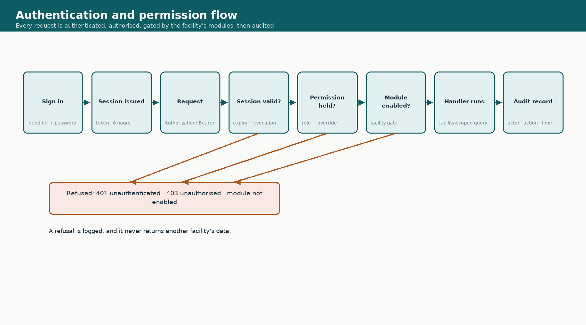

## 2.4 Database

| Aspect | Detail |
| --- | --- |
| Engine | PostgreSQL 16 |
| Migrations | 108 SQL files in `drizzle/`, applied by `npm run db:migrate` |
| Tables | Every clinical, financial, workforce and configuration record, including audit logs |
| Money | Integer cents in `*_cents` columns; bigint values returned as strings |
| Audit | `audit_logs` is append-only: a database trigger refuses UPDATE and DELETE |
| Posting control | A journal can only be written into an open period, with balanced debits and credits |
| Isolation | Every tenant-owned row carries `tenant_id`; facility rows carry `facility_id`; queries are scoped by both |

## 2.5 API structure

| Aspect | Detail |
| --- | --- |
| Base path | `/api` |
| Mount points | Domain routers registered in `src/routes/index.ts` (`/patients`, `/billing`, `/accounting`, `/reports`, `/payroll`, …) |
| Handlers | 571 route handlers in 57 files (`docs/documentation/api-inventory.csv`) |
| Authentication | `Authorization: Bearer <sessionToken>` |
| Error shape | `{ "success": false, "error": "<CODE>", "message": "<text>" }` |
| Idempotency | Financial mutations accept an idempotency key; the partner capital module additionally enforces a natural-key constraint |

## 2.6 Authentication and session handling

| Setting | Value | Source |
| --- | --- | --- |
| Session lifetime | 8 hours | `src/auth/session.service.ts` |
| Failed sign-in lockout | 15 minutes after repeated failures | `src/auth/login.service.ts` |
| Rate limit on sign-in | 10 failed attempts per 15 minutes per IP | `src/middleware/http-security.middleware.ts` |
| Session revocation | Sessions can be revoked; a revoked token fails authentication immediately | `src/auth/session.service.ts` |
| Password storage | Salted hash (bcrypt-family), never reversible | `src/utils/password.ts` |
| MFA | Schema and flags exist; enrolment flow absent | Chapter 28 |

## 2.7 Authorization and multi-tenancy

Authorization is permission-based, not role-name-based. A request names a permission such as `accounting.equity.read`; the middleware resolves the caller's roles, the permissions attached to those roles, and any facility-level override, then decides. Several routes additionally enforce separation of duties by comparing the acting user with the user who created the record.

Multi-tenancy has two levels. A tenant is the operating organisation and the isolation boundary. A facility is a site inside a tenant. A user is bound to one tenant and usually to one facility; a platform administrator has no tenant and manages tenants and facilities.

## 2.8 Storage and file handling

Documents — consent forms, radiology reports, letters, uploaded scans — are stored as files on a configured volume, with a database row holding the metadata, the owner (patient or facility) and the audit trail. Retrieval passes an authorization check; there is no public path to a document.

## 2.9 Background work

There is none. Exports, statements, payslips and reports are generated inside the request that asks for them. Consequences are stated in Chapter 28: a large export holds the request open, and nothing runs on a schedule.

## 2.10 Dependencies

| Dependency | Version or constraint | Why |
| --- | --- | --- |
| Node.js | 22.x | Runtime |
| PostgreSQL | 16.x | Data |
| React / Vite | 18 / 5 | Client |
| Express | 4 | API |
| Drizzle ORM | as pinned in `package.json` | Query layer and migrations |
| PDF and XLSX libraries | as pinned | Documents and exports |

## 2.11 Deployment

| Aspect | Detail |
| --- | --- |
| Container | `Dockerfile` builds the client and server and runs `node build/server.js` |
| Orchestration | `docker-compose.yml` runs the application beside PostgreSQL |
| Configuration | Environment variables validated at boot; a missing required variable stops startup |
| Health | `GET /api/health` returns status, system name and readiness flags |

## 2.12 What the architecture means in practice

- **One process means one failure domain.** An export that crashes can take the API with it; there is no isolation between a report and a clinical request.
- **The database is the audit record.** Anything not written to a table did not happen, and the audit log cannot be edited.
- **The module switches are real.** Switching a module off removes the navigation entry and closes the API, so the rail is not the only control.

# Chapter 3 — Login, Authentication and User Management

**Roles:** all staff; administrators for user management. **Purpose:** how to sign in, what a session is, how roles and permissions decide what you see.

## 3.1 The sign-in screen

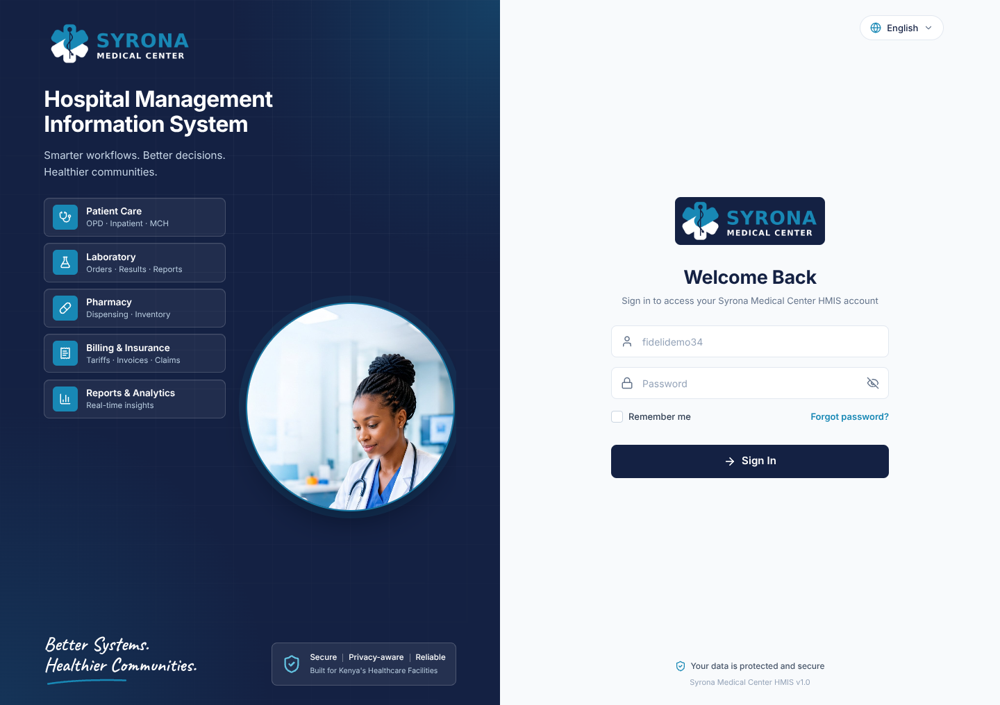

Sign-in takes a username or email and a password. A successful sign-in issues a session token valid for eight hours. Ten failed attempts from one address in fifteen minutes are refused for the rest of the window.

## 3.2 What happens after sign-in

The application loads the session, the user's roles and permissions, and the facilities the user may enter. The rail then renders only the modules the facility has enabled **and** the user may read. A module missing from the rail has one of three causes: the facility switched it off (Chapter 24), the role lacks the permission, or the user is signed in to a different facility.

## 3.3 Users, roles and permissions

| Concept | Meaning | Where it is managed |
| --- | --- | --- |
| User | A person, bound to a tenant and usually a facility | System Configuration → Staff & Roles |
| Role | A named set of permissions inside the tenant | same |
| Permission | A dotted code such as `patients.read` or `accounting.equity.read` | seeded in `src/seeds/permissions.ts`; 226 codes |
| Facility override | A grant or removal applied at one facility | staff role policy |
| Scope | The tenant and facility every query is restricted to | enforced in middleware |

## 3.4 Separation of duties

Financial approvals compare the acting user with the creator. Creating partner terms does not let you approve them; recording a contribution does not let you post it; a payroll run needs a reviewer who did not prepare it. The refusals carry the code `SEPARATION_OF_DUTIES`.

## 3.5 Sessions and revocation

A session can be revoked before it expires — on password change, on a role change, or by an administrator. A revoked token fails the next request. Session records carry the issue time, the last activity and the expiry, so an administrator can see who is signed in.

## 3.6 Audit of access

Sign-ins, sign-in failures and session revocations are written to the audit trail, with the actor, address, time and result. Chapter 25 describes the audit controls; Chapter 27 records the tests that exercised them.

# Chapter 4 — Dashboard and Notifications

**Roles:** all staff. **Purpose:** what each dashboard figure means, where it comes from, and why a zero is not always a zero.

## 4.1 The dashboard


## 4.2 Every figure on the dashboard, and its source

| Figure | Definition | Source of the number | Note |
| --- | --- | --- | --- |
| Patients registered | Patients created in the selected period | `patients.created_at` | Counts registrations, not distinct people |
| Net recorded receipts | Receipts recorded minus refunds recorded, in the period | billing receipt tables | "Recorded" — not verified bank settlement |
| Invoices created | Non-void invoices created in the period | `invoices` | Creation dates; billed amount is not payment |
| Admission records | Admissions opened in the period | admissions | Clinical counter; zero without clinical data |
| Queue tickets | Queue entries waiting or in progress | reception queue | Live state, not period-bound |
| Triage wait | Average wait where recorded | triage timestamps | Shows "—" when nothing has been timed |
| Occupied beds | Beds with a live admission | ward and bed tables | Zero when no wards exist |
| Vitals overdue | Observations past their ward rule | observation schedule | Zero when no admissions |
| Theatre scheduled | Scheduled cases in the period | theatre case records | — |
| Lab pending | Orders not yet resulted | laboratory order states | — |
| Low stock / out | Items at or below reorder level | inventory balances | — |
| Expiry alerts | Batches expired or expiring within 30 days | batch expiry dates | — |

## 4.3 The operational overview

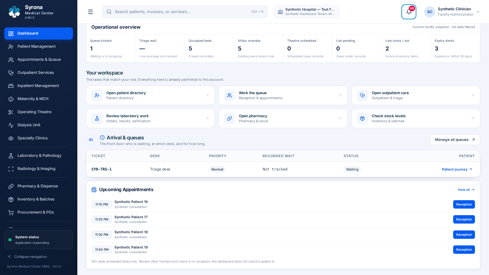

The overview states in its own header that it is a current snapshot and not date-filtered. That distinction matters: the four cards above it *are* date-filtered, and reading one as the other produces a false comparison.

## 4.4 Charts and their caveats

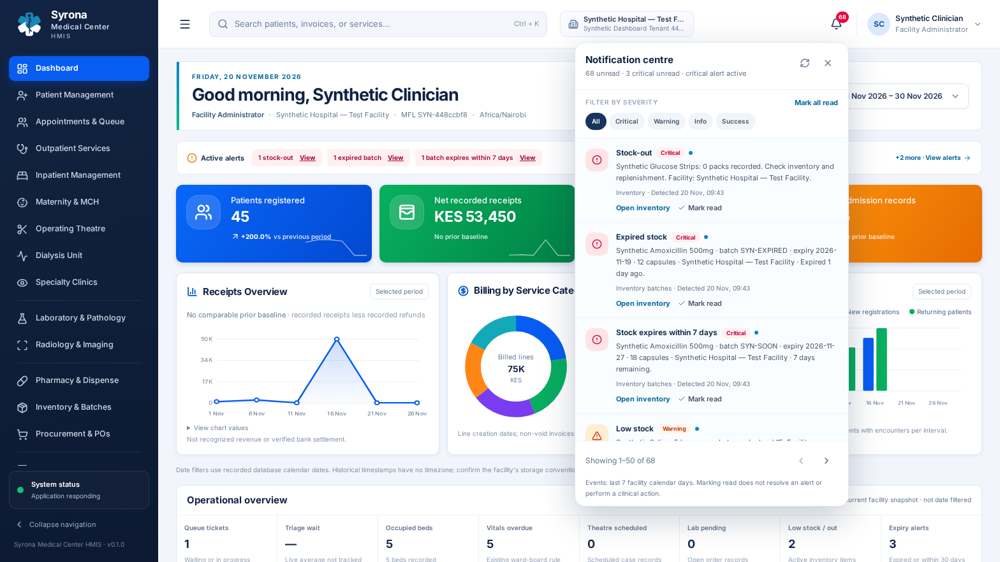

## 4.5 Notifications

Notifications are in-application records: an approval waiting, a stock item expiring, a result awaiting verification. They are not emails or SMS messages — there is no outbound gateway in this build (Chapter 28).

## 4.6 Accounting dashboard

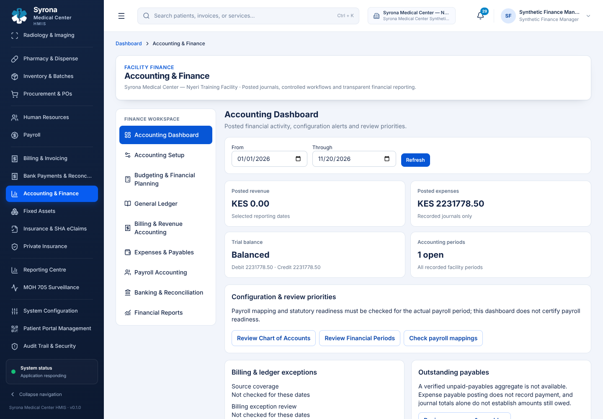

## 4.7 Other viewports

The dashboard is captured at three widths in the responsive evidence run: desktop (Figure 4.1), tablet and mobile. On narrow screens the cards stack and the operational row scrolls horizontally rather than clipping.

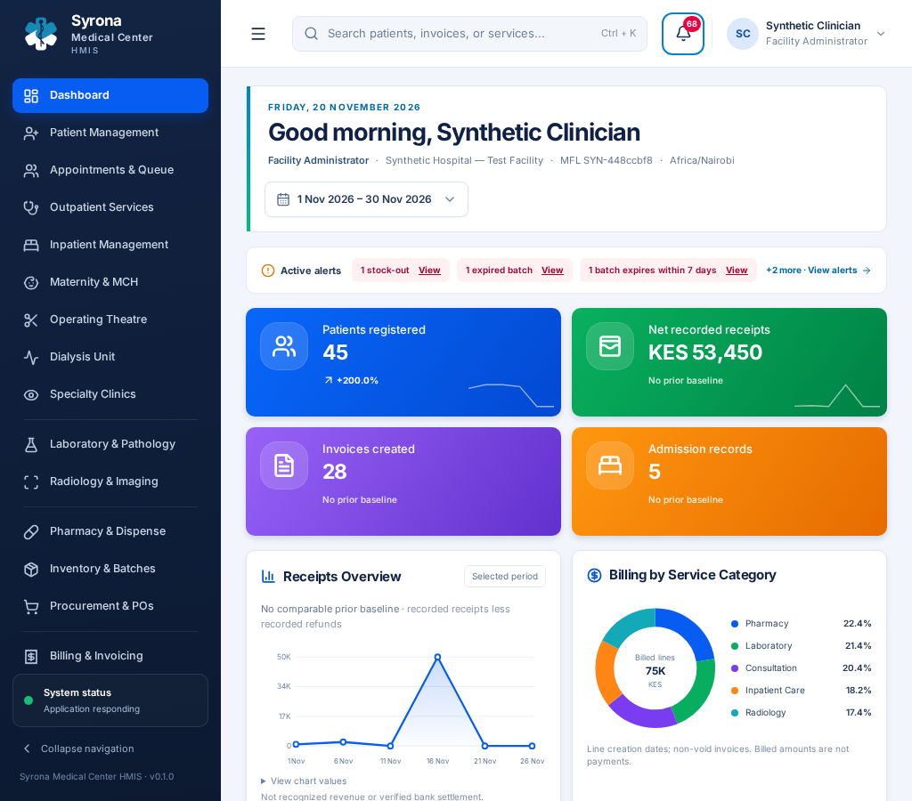

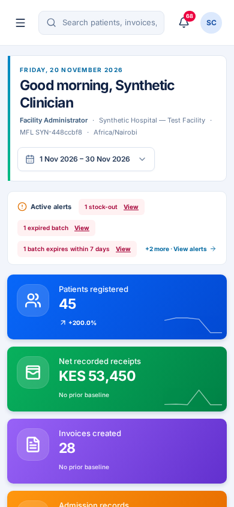


# Chapter 5 — Patient Management

**Roles:** reception, records, clinicians, nurses. **Purpose:** registering a patient, finding the right record, and keeping the record's documents under control.

## 5.1 Registration

Registration creates the patient record: names, date of birth, sex, contacts, county and sub-county, next of kin, payer type (cash, SHA, private insurance), allergies and chronic conditions. The record is created in the active facility but belongs to the tenant, so a patient can be seen at another facility in the same tenant without a second record.

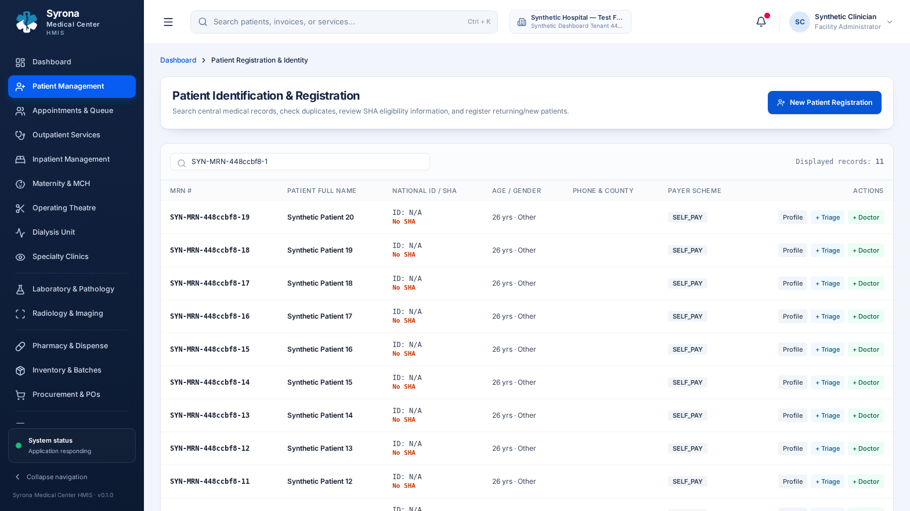

| Field group | Stored in | Notes |
| --- | --- | --- |
| Identity | `patients.first_name`, `middle_name`, `last_name`, `date_of_birth`, `gender` | Date of birth drives the age shown |
| Identifiers | `mrn`, `national_id`, `sha_number` | MRN is unique within the tenant |
| Contact | `phone`, `email`, `county`, `sub_county`, `residential_address` | Used by the portal and by claims |
| Clinical baseline | `allergies`, `chronic_conditions`, `blood_group` | Displayed on the patient banner |
| Payer | `payer_type`, `insurance_provider`, `policy_number` | Determines the billing path |
| Next of kin | emergency contact name, phone, relationship | Printed on documents |

## 5.2 Duplicate prevention

Two mechanisms apply. The MRN is unique within the tenant. The registration flow also checks the identifiers supplied — national ID, phone, and name with date of birth — and warns before a second record is created. The check is advisory; the audit record preserves who overrode it. A duplicate patient is a clinical safety problem, not only a data-quality one, because a second record fragments allergies and results.

## 5.3 The patient profile

The profile gathers encounters (outpatient and inpatient), diagnoses, observations, laboratory and radiology orders, prescriptions and dispensations, invoices and documents in one place. History is read from the transactional tables; there is no summary table that could drift from the source.

## 5.4 Allergies and clinical alerts

Allergies and chronic conditions are recorded text, displayed on the patient banner and carried into the encounter view for clinicians and pharmacists. There is no coded allergy dictionary and no interaction-checking engine in this build: the alert is the recorded text, shown prominently (Chapter 28).

## 5.5 Patient documents

Documents are uploaded against a patient and stored with metadata: type, source, uploader, timestamp and, where applicable, a link to the originating record such as a radiology report. Retrieval passes an authorization check; documents are not served from a public path.

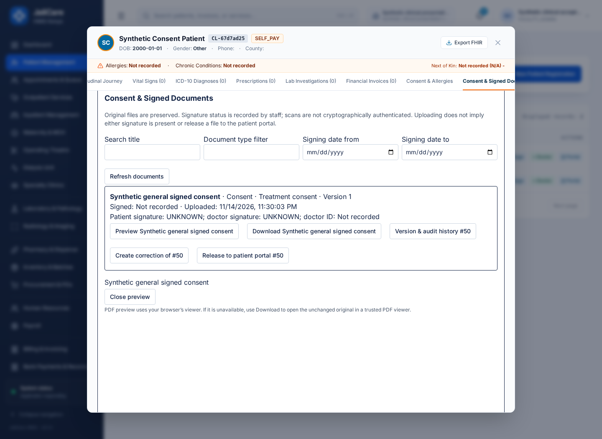

## 5.6 Consent records

Consent is a patient document plus a consent record carrying the purpose, the person who gave it, the date and the staff member who witnessed it. Radiology uses consent before certain procedures (Chapter 9).

## 5.7 Document audit

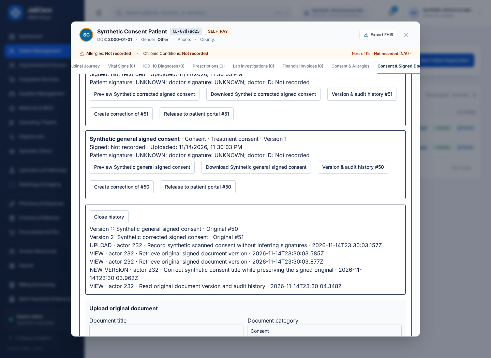

Every view, download and release of a patient document is written to the audit trail. This is the control that makes "who has seen this file?" an answerable question.

## 5.8 The patient portal

The portal is a separate client surface, authenticated for the patient rather than for staff. It shows only that patient's own released documents and results.

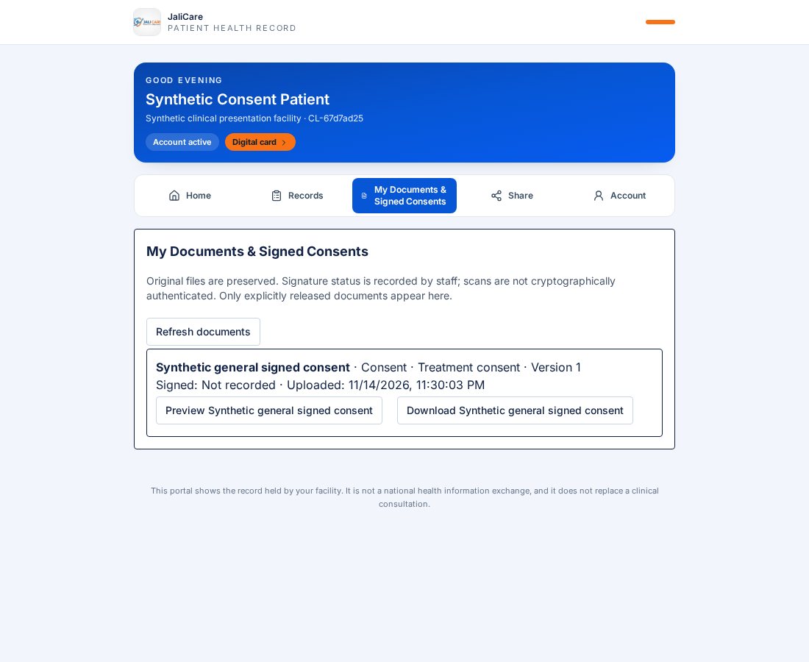

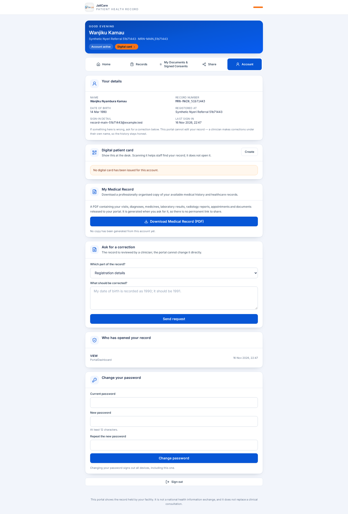

Access rules observed in the code:

- A portal user sees only records belonging to their own patient identity and tenant.
- A document must be explicitly released; uploading does not publish it.
- Release and revocation are audited.
- The portal never exposes another patient's identifiers, even in an error message.

## 5.9 On a phone

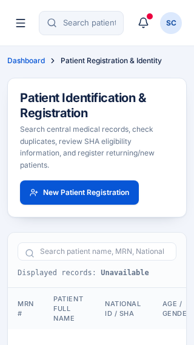

# Chapter 6 — Reception and Outpatient Department

**Roles:** reception, triage nurses, clinicians. **Purpose:** the visit from arrival to close, and where the record is written at each step.

## 6.1 Check-in and the queue

Reception finds the patient, confirms the payer and opens a visit. The queue shows who is waiting, who is with a clinician, and who has left. Queue state is live, not period-bound, which is why it is on the operational row of the dashboard.

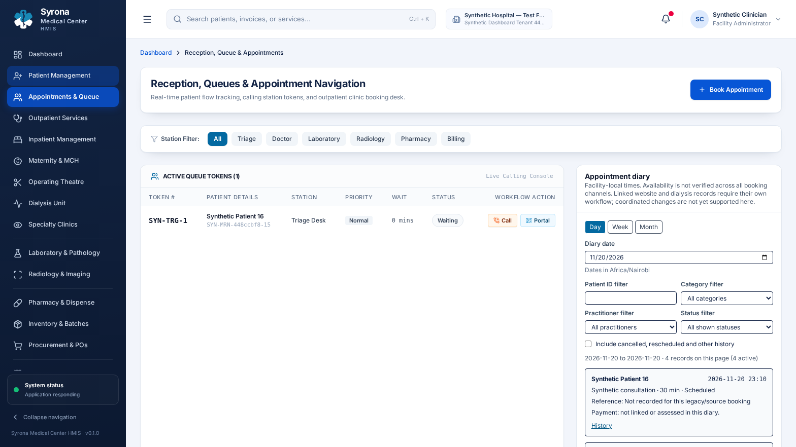

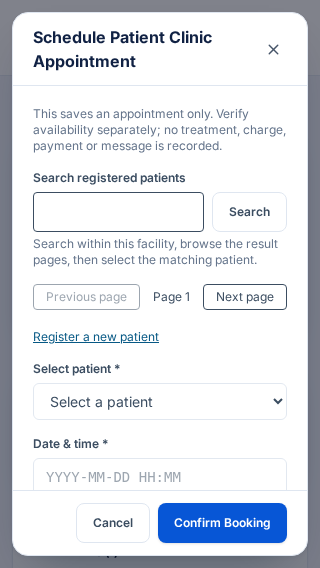

## 6.2 The outpatient workspace

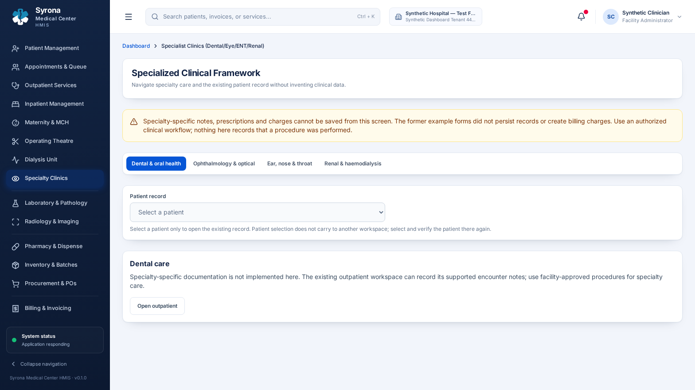

## 6.3 Encounters

An encounter is opened when the patient is seen. It holds the clinician, the time, the presenting complaint, the note, the diagnosis and the orders raised in that visit. An encounter is the anchor for observations, orders, prescriptions and charges.

## 6.4 Diagnoses and the responsible doctor

Diagnoses are coded against the ICD-11 catalogue loaded into the system; a free-text diagnosis is also accepted where coding is not possible.

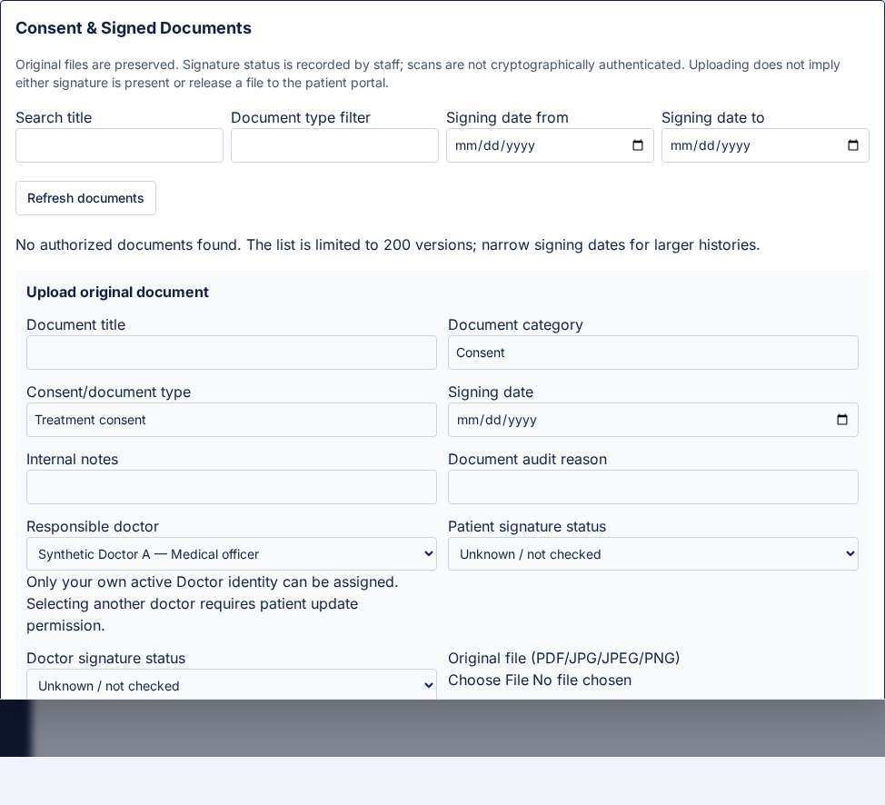

The responsible-doctor feature decides which clinician's name appears on the encounter, the orders and the documents. A second capture in the same run shows the same record after the responsible doctor changed, so the behaviour is evidenced rather than asserted.

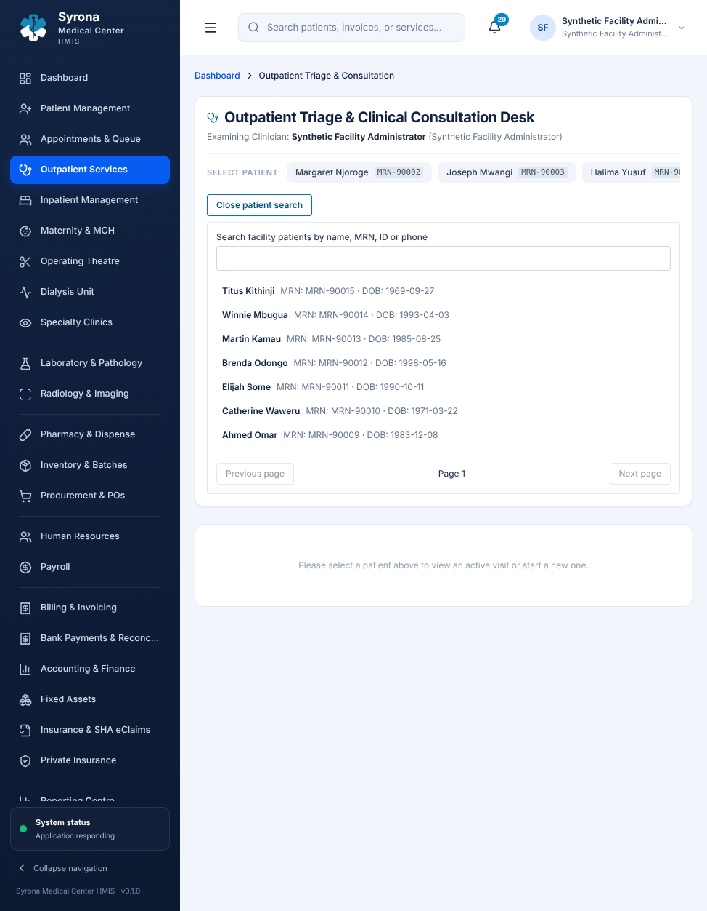

## 6.5 Clinical notes

Notes are free-text and belong to the encounter. They are patient-identifiable and are protected by the same access control as results: a user without `clinical.read` cannot read them, and the attempt is logged.

## 6.6 Orders, prescriptions and charges

| Order type | Raised from | Charge |
| --- | --- | --- |
| Laboratory | Encounter → orders | Service tariff at order time (Chapter 8) |
| Radiology | Encounter → orders | Service tariff at order time (Chapter 9) |
| Pharmacy | Prescription | Medicine catalogue at dispense time (Chapter 10) |
| Procedure | Encounter or theatre | Service tariff (Chapters 12, 14) |

## 6.7 Workflow sequence: one outpatient visit

| Step | What happens | Evidence |
| --- | --- | --- |
| 1. Start | Reception confirms the patient and opens the visit | Figure 6.1 |
| 2. Entry | Clinician records vitals, note and diagnosis | Figures 6.3, 6.4 |
| 3. Processing | Orders raised and charged to the invoice | Chapter 14 |
| 4. Success | Encounter saved and closed; queue row clears | Chapter 6 (state description) |
| 5. History / report | Visit appears in the patient history and in the OPD reports | Chapter 23 |

**Not captured.** The synthetic dataset used for this issue contains registered patients but no encounters, so steps 4 and 5 are described from the code and the report definitions rather than photographed. No screen was staged to fill the gap.

## 6.8 Referrals and follow-up

A referral records the destination, the reason and the clinician; a follow-up books the next appointment. Neither creates a charge by itself.

# Chapter 7 — Inpatient and Ward Management

**Roles:** ward nurses, admitting clinicians, billing. **Purpose:** admission, the bed board, daily charging and discharge.

## 7.1 Admission

An admission links a patient to a ward and a bed, records the admitting clinician, the admission diagnosis and the expected stay. Admission requires the `inpatient` facility module and a configured ward.

| Admission field | Stored in | Notes |
| --- | --- | --- |
| Patient | `admissions.patient_id` | Must exist and belong to the tenant |
| Ward and bed | `wards`, `beds`, `admissions.bed_id` | A bed cannot hold two live admissions |
| Clinician | `admissions.practitioner_id` | Responsible doctor |
| Diagnosis | admission diagnosis | Distinct from encounter diagnoses |
| Dates | `admitted_at`, `discharged_at` | Drive daily charging |

## 7.2 Wards and beds

Wards carry a name, a class and a daily charge; beds belong to wards with a status (available, occupied, cleaning). Allocation is transactional: the bed is marked occupied and the admission linked in one database transaction, so two admissions cannot take the same bed.

## 7.3 Transfers

A transfer records the from-bed, the to-bed, the reason, the time and the author, and moves the admission's current bed. History is preserved as transfer rows; the original bed is not overwritten.

## 7.4 Nursing records

Nursing notes, observations and medication administration are recorded against the admission. Ward observations are the same observation records the outpatient department uses, tagged to the encounter.

## 7.5 Daily bed charges

Ward charges accrue per day of stay at the ward's daily rate, from the admitted date to the discharged date inclusive. The charge is raised on the admission and reaches the ledger through the ordinary billing posting path. A later rate change does not re-price days already charged.

## 7.6 Discharge

Discharge closes the admission, records the outcome and the discharge summary, frees the bed, raises the final day's charge and presents the outstanding balance. A patient with an unpaid balance can still be discharged — clinically the bed must be freed — but the invoice remains outstanding and stays on the billing worklist. The system does not silently write off the balance.

## 7.7 What the ward screen shows, and why it is empty here

**No inpatient screenshot is included, and none was staged.** The synthetic dataset used for this issue has no wards configured, so the screen correctly shows its empty state and tells the user that admission is impossible until a ward and its beds exist. That is the honest capture of the build in this environment; a discharge photograph would have required inventing a ward, a patient stay and a bill.

The workflow above is documented from the schema and the inpatient service. A facility that configures wards will see the same screen populated, with the discharge panel carrying the outstanding balance and the payment options.

| Step | Screen | Permission |
| --- | --- | --- |
| Configure a ward and beds | Inpatient management → ward setup | `inpatient.wards.create` |
| Admit | Inpatient management → admit patient | `inpatient.write` |
| Record notes and vitals | Nursing and bedside care | `inpatient.write` |
| Transfer | Bed board → transfer | `inpatient.write` |
| Discharge | Roster → discharge | `inpatient.discharge` |
| Review the discharge bill | Billing → invoice for the admission | `billing.read` |


# Chapter 8 — Laboratory

**Roles:** clinicians ordering, laboratory technologists, verifiers. **Purpose:** the order lifecycle, the charge, and the control on who may release a result.

## 8.1 Ordering and charging

A clinician orders a test from the encounter. The order is created against the patient and the requesting clinician, and the test charge is raised at order time through the billing module's `chargeSafely` path. The laboratory never posts to the ledger itself; the accounting side receives the charge through the ordinary billing posting.

## 8.2 The laboratory workspace

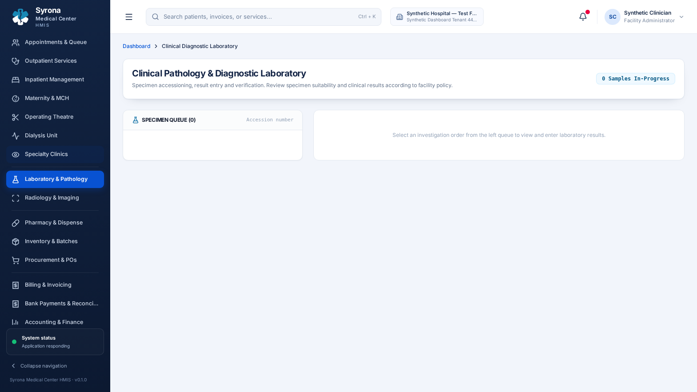

## 8.3 Order states

| State | Meaning | Allowed next states |
| --- | --- | --- |
| Ordered | Raised by a clinician | Collected, Cancelled |
| Collected | Specimen taken and accessioned | Processing |
| Processing | In the laboratory | Resulted |
| Resulted | Values entered | Verified, Rejected |
| Verified | Released to the requesting clinician | (final) |
| Rejected | Sample or result refused | Re-collected |

## 8.4 Verification control

A result is entered by one user and verified by another. Verification requires `laboratory.result.verify`, and the acting user must differ from the user who entered the result; the same rule is applied to amendments. The control exists because a released result is acted on clinically, and a single pair of hands should not be able to both write and release it.

## 8.5 Reference ranges and flags

Each test carries a reference range; a result outside it is flagged for the reviewer rather than silently accepted. The range is data, not a hard-coded clinical rule — a facility configures it per test.

## 8.6 Billing integration

The charge is at order time, so a cancelled order needs a credit rather than a deleted invoice line. Chapter 14 describes refunds and credit notes; the rule is that a finalised invoice is corrected by a credit note, never by editing history.

## 8.7 What is not in this build

There is no analyser interface and no HL7 feed from laboratory instruments: results are entered in the application. There is no coded result dictionary for every analyte; the test catalogue carries the name, unit and range. These gaps are repeated in Chapter 28.

## 8.8 On a tablet

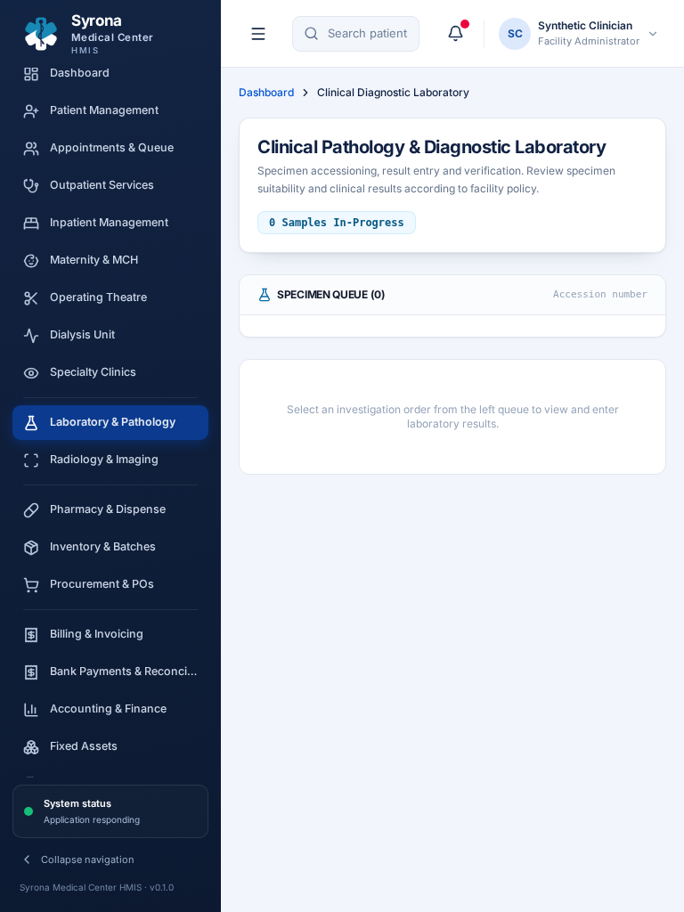

# Chapter 9 — Radiology

**Roles:** requesting clinicians, radiographers, radiologists. **Purpose:** requests, the consent gate, reports and release.

## 9.1 The radiology workspace

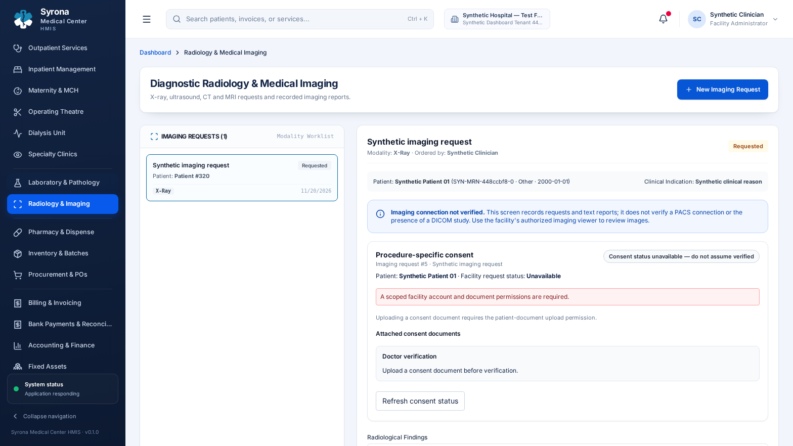

## 9.2 The consent gate

Certain examinations require recorded consent before performance or reporting. The gate is enforced in the service, not only in the screen: an attempt to report or perform without consent returns `RADIOLOGY_CONSENT_REQUIRED`. A facility may record a policy-authorised exception instead of consent, and the exception is audited.

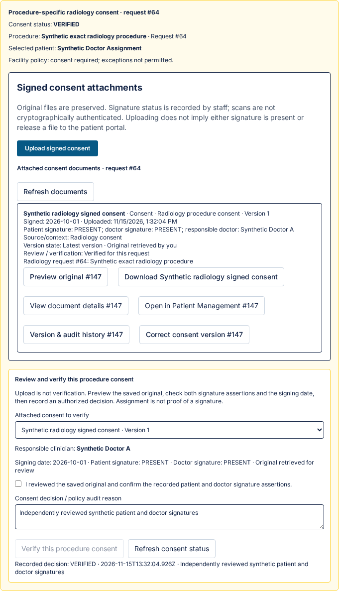

## 9.3 Consent on a phone

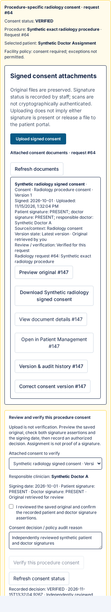

## 9.4 Reports and release

A radiologist writes findings and an impression; the report is verified and can be released to the patient portal as a document. Release is a separate, audited action: verification does not itself publish anything to the patient.

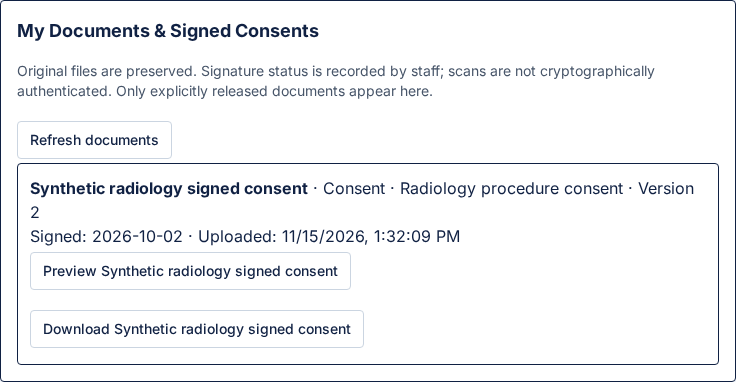

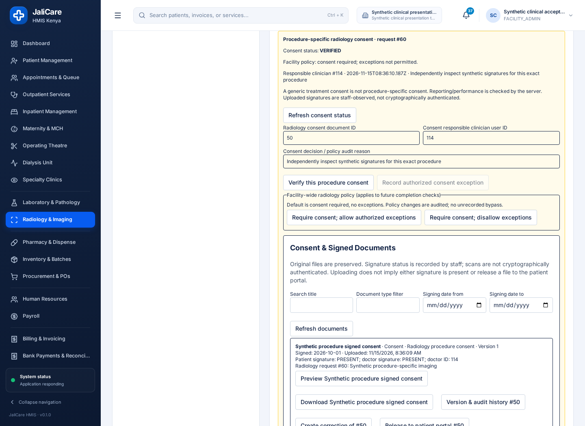

## 9.5 What is not implemented

There is no PACS, no DICOM store and no worklist integration. Images are uploaded files attached to the patient, with the same access control and audit as any other document. Anyone reading "radiology" as "imaging archive" should read this paragraph twice.

# Chapter 10 — Pharmacy

**Roles:** pharmacists, pharmacy technologists, cashier. **Purpose:** dispensing, batch control and the charge.

## 10.1 The pharmacy queue

Prescriptions raised in an encounter appear in the pharmacy queue. The pharmacist checks stock, selects a batch (earliest expiry first) and dispenses.

| Step | Record written | Ledger effect |
| --- | --- | --- |
| Dispense | Dispensation row against the prescription; batch quantity reduced | None yet |
| Stock movement | Movement row (issue) with quantity, batch and reason | Inventory valuation only |
| Charge | Invoice line at the medicine catalogue price | Dr receivable / Cr pharmacy revenue |
| Receipt | Receipt row | Dr cash / Cr receivable |

## 10.2 Medicine catalogue versus service tariff

Pharmacy prices come from the medicine catalogue, which carries pack size, unit price and batch. Facility services — consultations, procedures, bed days — come from the service tariff. They are different records with different maintenance screens, which is why a price change in one does not move the other. Chapter 14 sets the two side by side.

## 10.3 Stock movement table

| Event | Effect on quantity | Posted to inventory ledger |
| --- | --- | --- |
| Goods received | Increase | Yes |
| Dispense or issue | Decrease | Yes |
| Adjustment (increase or decrease) | Change, with a reason | Yes |
| Transfer between stores | Move, no net change | Yes, both sides |
| Return to supplier | Decrease | Yes |
| Stock count correction | Change, with the count reference | Yes |

## 10.4 Expiry and recalls

Batches carry expiry dates; the dashboard counts batches expired or expiring within 30 days. A dispense selects the earliest-expiring batch first, which is a stock-rotation control rather than a guarantee that nothing expires.

## 10.5 What is not in this build

There is no automated interaction check against the patient's other medicines, and no dose-range validation by weight. The pharmacist's check is the control.

# Chapter 11 — Maternity and Maternal-Child Health

**Roles:** midwives, clinicians, MCH nurses. **Purpose:** the antenatal, delivery and postnatal records, and what is missing.

## 11.1 What exists

The maternity module exposes 18 endpoints covering antenatal visits, the labour record and partograph, delivery, postnatal visits and child-health visits (immunisation and growth). The partograph is a component that charts the labour observations over time.

| Area | Records | State |
| --- | --- | --- |
| Antenatal | Visit, gestation, fundal height, blood pressure, investigations | Implemented; screen renders |
| Labour | Partograph observations, membranes, descent | Implemented; not exercised in this issue |
| Delivery | Mode, outcome, Apgar where recorded, complications | Implemented; not exercised |
| Postnatal | Mother and baby reviews | Implemented; not exercised |
| Child health | Immunisation and growth points | Implemented; not exercised |

## 11.2 The MCH report is not available

The catalogue lists the MCH returns — antenatal register, deliveries, postnatal and child health — and marks them not implemented. There is no national MCH register transmission in this build. A facility needing those returns must produce them from the records by another route, and should plan for that before go-live.

## 11.3 Charges

A delivery raises the configured service charges; antenatal and postnatal visits raise their consultation charges. Billing follows the ordinary path (Chapter 14).

## 11.4 Why no maternity screenshot is included

The synthetic dataset has no maternity activity, and this issue does not stage clinical records to photograph them. The module's routes and schema are the evidence for what it can record; no figure is presented as evidence of a delivery.

# Chapter 12 — Operating Theatre

**Roles:** surgeons, anaesthetists, theatre nurses, billing. **Purpose:** the case list, the procedure record and the limits.

## 12.1 Case lifecycle

A theatre case is booked against a patient and a procedure, scheduled to a theatre and a time, and moved through scheduled, in-progress, completed and cancelled states. The case record carries the surgical team, the anaesthetic record and the procedure note.

## 12.2 What the module does not do

| Not implemented | Consequence |
| --- | --- |
| Theatre utilisation analytics beyond the case list | Utilisation must be computed elsewhere |
| Implant and consumable traceability to a specific case | Stock is issued to the theatre, not to the implant record |
| Instrument sterilisation cycle logging | No sterile-services record |
| Recovery-room observations as a separate record | Recorded as ordinary observations |

## 12.3 Charges

The procedure raises the configured service charge; consumables issued from the theatre store raise inventory movements and their charges. A cancelled case may still carry charges for consumables already used, and reversing them is an explicit credit rather than a deletion.

## 12.4 Evidence

The module's screen and endpoints exist; no theatre case was created in this issue, and no photograph is offered in place of one.

# Chapter 13 — Dialysis

**Roles:** renal nurses, clinicians, billing. **Purpose:** sessions, treatment records and charging.

## 13.1 What a session records

A dialysis session links a patient to a machine and a shift, and records the treatment parameters, the consumables used and any adverse event. Sessions are authorised against a treatment plan.

| Element | Recorded |
| --- | --- |
| Authorisation | Treatment plan and authorising clinician |
| Session | Date, machine, shift, duration |
| Clinical | Pre- and post-weights, observations, adverse events |
| Consumables | Items issued from stock |
| Charge | Session charge plus consumables |

## 13.2 Revenue is not partner capital

Dialysis revenue is ordinary facility income. It reaches the ledger through the billing posting and then, at year end, to the profit or loss that is allocated to partners under their approved shares. It is never posted straight to a partner's capital account, and no session creates a partner movement. Chapter 17 states the same rule from the equity side.

## 13.3 What is not in this build

There is no renal registry transmission and no dialysis-machine integration; treatment parameters are entered, not read from the machine.

## 13.4 Evidence

The routes and schema exist; the synthetic dataset contains no dialysis sessions, so no session screen is shown and no figure is presented as a treatment record.


# Chapter 14 — Billing and Revenue

**Roles:** cashiers, billing officers, accountants. **Purpose:** how a charge becomes an invoice, how a payment settles it, and why pharmacy and facility prices come from different records.

## 14.1 The billing workspace

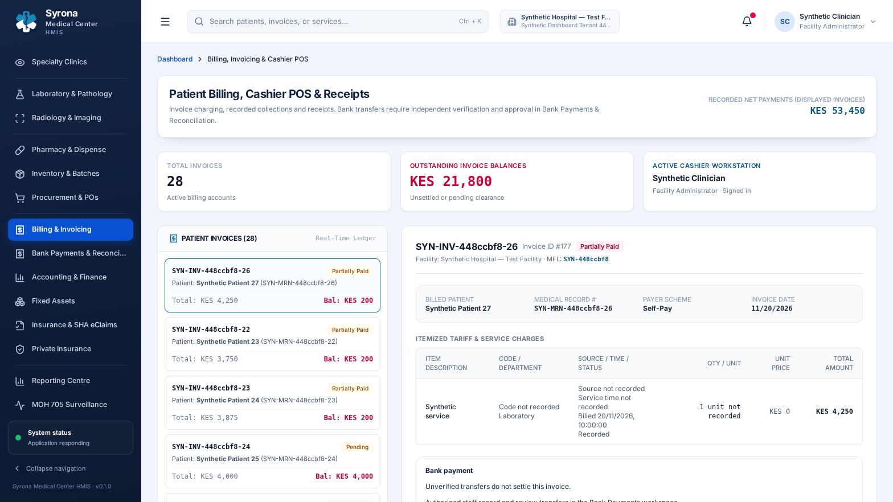

## 14.2 Two price sources

| Source | Covers | Maintained in | Identified by |
| --- | --- | --- | --- |
| Service tariff | Consultations, procedures, bed days, laboratory and radiology tests, theatre and dialysis sessions | Configuration → Facility services & tariffs | Service code |
| Medicine catalogue | Drugs and consumables dispensed | Inventory and pharmacy catalogue | Item code, batch, pack size |

The distinction matters in practice: a tariff change does not re-price medicines, and a supplier price change does not move a consultation fee. Where a facility wants both in one invoice — which is the normal case — the invoice carries lines from both sources and the ledger sees a single receivable.

## 14.3 From charge to invoice

| Stage | Record | Ledger effect |
| --- | --- | --- |
| Charge raised by a clinical module | Invoice line (draft) | None |
| Invoice finalised | Invoice with a number | Dr receivable / Cr revenue |
| Payment received | Receipt | Dr cash or bank / Cr receivable |
| Refund approved and paid | Refund record plus credit | Dr revenue or receivable / Cr cash |

Revenue is recognised when the invoice is finalised, not when cash arrives. A receipt settles a receivable and is never revenue; posting it to income double-counts the sale.

## 14.4 Payment methods

| Method | Recorded as | Verified? |
| --- | --- | --- |
| Cash | Receipt with method cash | Yes, in the accounting evidence run |
| M-Pesa | Receipt with a transaction reference | Recording verified; live STK push and callbacks not verified |
| Bank transfer | Receipt, later matched to a bank line | Manual matching verified; bank file import not verified |
| Insurance / SHA | Claim or preauthorisation reduces the patient share | Claim preparation verified; live submission not verified |
| Card | Receipt with method card | Recording only; no acquirer integration |

## 14.5 Refunds and credit notes

A finalised invoice is corrected by a credit note or a refund, never by editing the original. The refund path requires approval by a user other than the one who requested it, and the approval, the payment and the reversal all appear in the audit trail.

## 14.6 On a phone

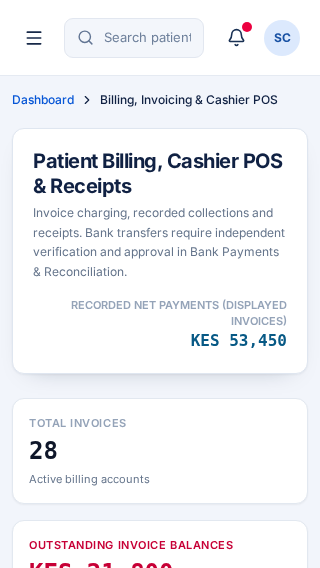

## 14.7 Worked example — one invoice, start to report (synthetic)

| Step | Amount (KES) | Ledger effect |
| --- | --- | --- |
| 1. Charge raised | 4,500.00 | Dr Trade receivables 4,500.00 / Cr Revenue 4,500.00 |
| 2. Invoice finalised | 4,500.00 | Nothing further: the invoice is the document, the journal is the posting |
| 3. Payment received | 4,500.00 | Dr Cash 4,500.00 / Cr Trade receivables 4,500.00 |
| 4. Receipt issued | 4,500.00 | Nothing: printing does not post |
| 5. Report | — | Cashier daily summary shows 4,500.00; the receivable ages to zero |

If the receipt were posted to revenue instead of the receivable, revenue would read 9,000.00 for a single 4,500.00 sale. That is the double-count the billing-to-ledger tie-out exists to catch.

## 14.8 Billing settlement

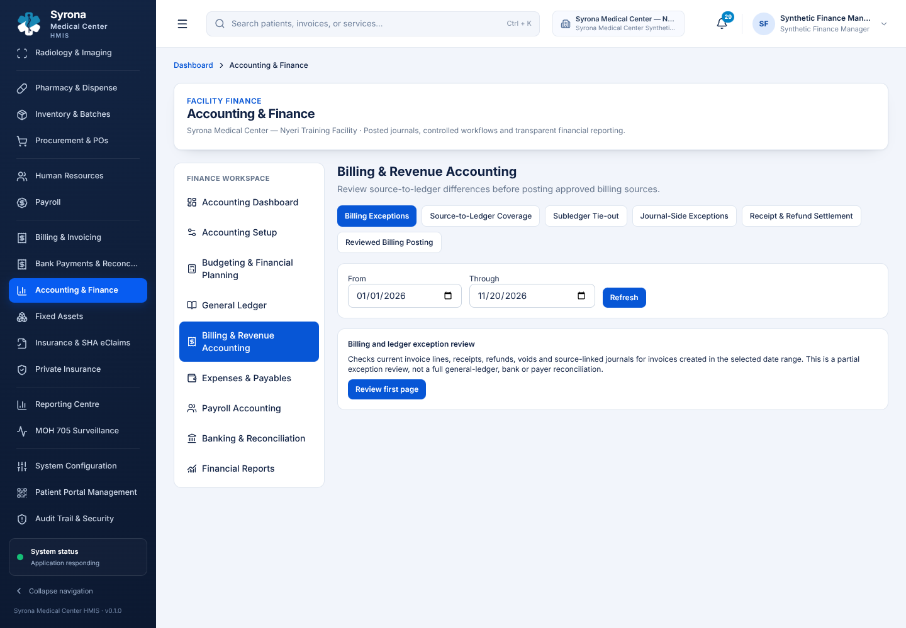

The screenshot is explicit that a balanced ledger is not proof that billing has posted. The tie-out compares the billing sub-ledger with the ledger and reports the difference instead of adjusting it away.

# Chapter 15 — Accounting and the General Ledger

**Roles:** accountants, finance controllers, auditors. **Purpose:** the chart of accounts, how a journal is written, what the system refuses, and how to read a trial balance.

## 15.1 Chart of accounts


| Type | Normal balance | Examples in the synthetic facility |
| --- | --- | --- |
| Asset | Debit | 1000 Cash at bank, 1010 Cash on hand, 1100 Trade receivables, 1200 Pharmacy inventory |
| Liability | Credit | 2000 Trade payables, 2100 Statutory liabilities |
| Equity | Credit | 3000 Capital, 3100 Drawings (contra), 3300 Appropriation |
| Revenue | Credit | 4000 Pharmacy revenue, 4100 Consultation revenue, 4200 Laboratory revenue |
| Expense | Debit | 5000 Salaries, 5100 Drugs and supplies, 5200 Depreciation |

The chart is data, not code: an account is a row with a type, a code and a name. Statements group accounts, so a new account appears in the statements through its type and group rather than through a code change.

## 15.2 Periods

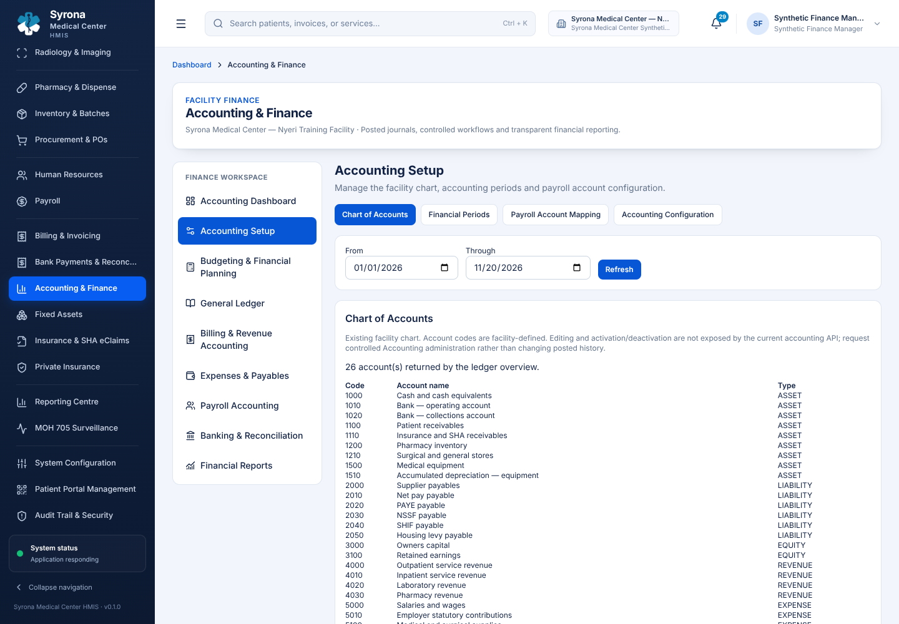

A journal can only be posted into an open period. Posting into a closed period is refused rather than moved to today; the refusal code is `OPEN_PERIOD_REQUIRED`. That is a control, and it surprises users who expect "reverse now".

## 15.3 Journals

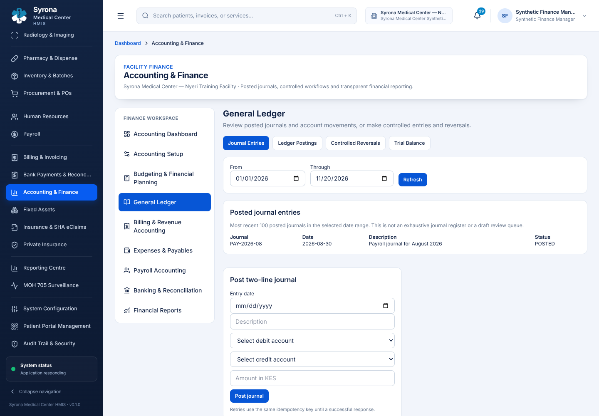

Every journal is written through one service, `postJournalScoped`, which enforces:

| Rule | Refusal when broken |
| --- | --- |
| Debits equal credits | `UNBALANCED_JOURNAL` |
| The period is open | `OPEN_PERIOD_REQUIRED` |
| Accounts exist, belong to the tenant, are not control accounts used by sub-ledgers | `INVALID_ACCOUNT` |
| A source type and idempotency key are present | `SOURCE_REQUIRED` |
| The same idempotency key is not posted twice | `DUPLICATE_POSTING` |

## 15.4 Worked example 1 — a clinical charge (synthetic, KES)

**Formula:** invoice total = Σ (quantity × unit price). **Inputs:** one consultation at 3,000.00 and one full blood count at 1,500.00. **Calculation:** 3,000.00 + 1,500.00 = 4,500.00. **Result:**

| Account | Debit | Credit |
| --- | --- | --- |
| 1100 Trade receivables | 4,500.00 | |
| 4100 Consultation revenue | | 3,000.00 |
| 4200 Laboratory revenue | | 1,500.00 |
| **Total** | **4,500.00** | **4,500.00** |

## 15.5 Worked example 2 — a cash receipt and a bank deposit (synthetic, KES)

**Inputs:** the 4,500.00 above is paid in cash, then banked the same day. **Calculation:** cash on hand rises by 4,500.00 and falls by 4,500.00, so it ends where it started; the bank rises by 4,500.00.

| Step | Account | Debit | Credit |
| --- | --- | --- | --- |
| Receipt | 1010 Cash on hand | 4,500.00 | |
| Receipt | 1100 Trade receivables | | 4,500.00 |
| Banking | 1000 Cash at bank | 4,500.00 | |
| Banking | 1010 Cash on hand | | 4,500.00 |

Note what did **not** happen: no revenue account was touched by either step. Revenue was recognised when the invoice was finalised, and repeating it here would double-count the same 4,500.00.

## 15.6 Expenses and payables

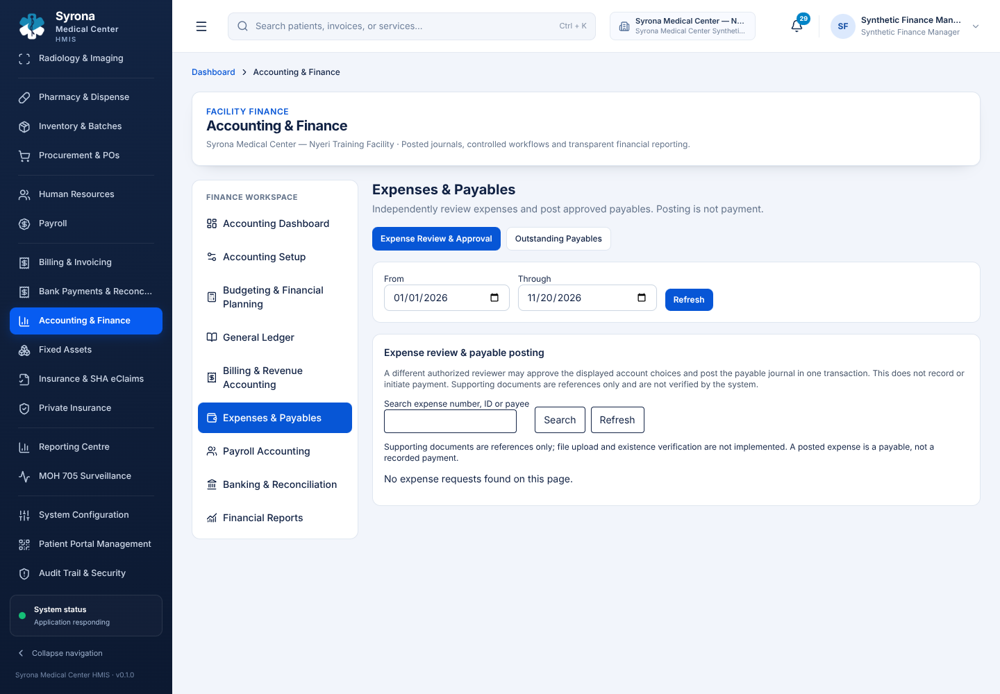

A supplier invoice is posted as Dr expense / Cr trade payables. Paying it is Dr trade payables / Cr bank. The payable and the payment are two postings, either of which may be wrong on its own, which is why the payables schedule is reconciled separately.

## 15.7 Payroll accounting

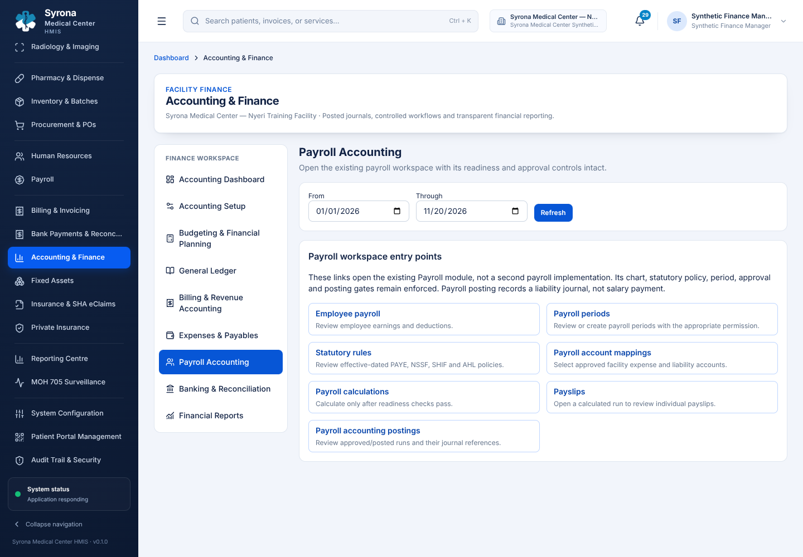

A payroll run will not post while a salary component has no ledger account. The screen names the blocker rather than posting a partial journal.

## 15.8 Banking and reconciliation

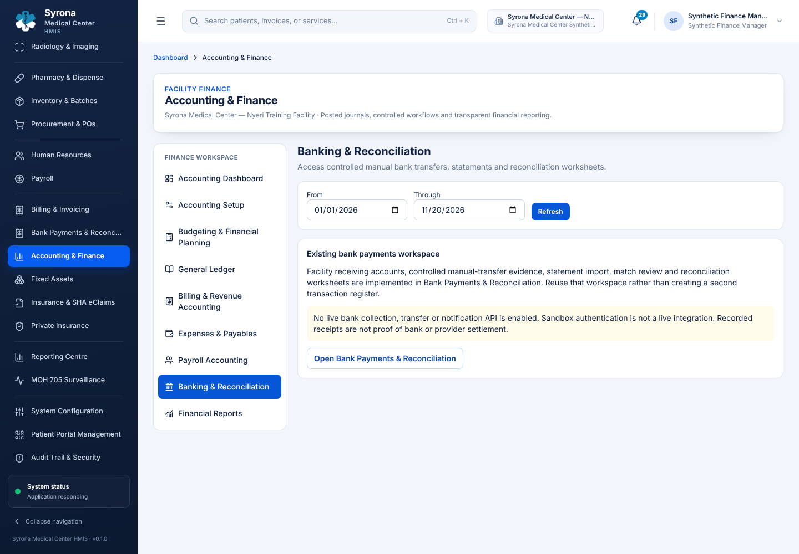

Reconciliation matches recorded receipts and payments against bank lines. Where a line cannot be matched, it stays unmatched and visible; nothing is forced to agree.

## 15.9 Trial balance

The trial balance lists each posted account with its debit and credit movement for the period and proves the two totals are equal:

**Formula:** Σ debits = Σ credits. **Inputs:** posted journal lines for the selected window. **Calculation:** the synthetic period totals 2,552,484.98 on each side. **Result:** balanced.

The accounting evidence run captured the trial-balance view with its own caveat printed on screen: *"Posted journal entries only — unposted billing sources, unrecorded expenses and unverified allocations are not included. A balanced statement is not proof of reconciliation."* That sentence is part of the product, and it is the most useful thing to read on the page.

## 15.10 Reading the ledger as a reviewer

1. Start at the trial balance and confirm it balances — necessary, not sufficient.
2. Compare billing sub-ledger totals with the receivable control account.
3. Compare payroll posted totals with the payroll register for the period.
4. Check the reconciliation tab for any unmatched item.
5. Only then read the statements; a statement built on an unreconciled ledger is a tidy-looking guess.

## 15.11 Read-only access

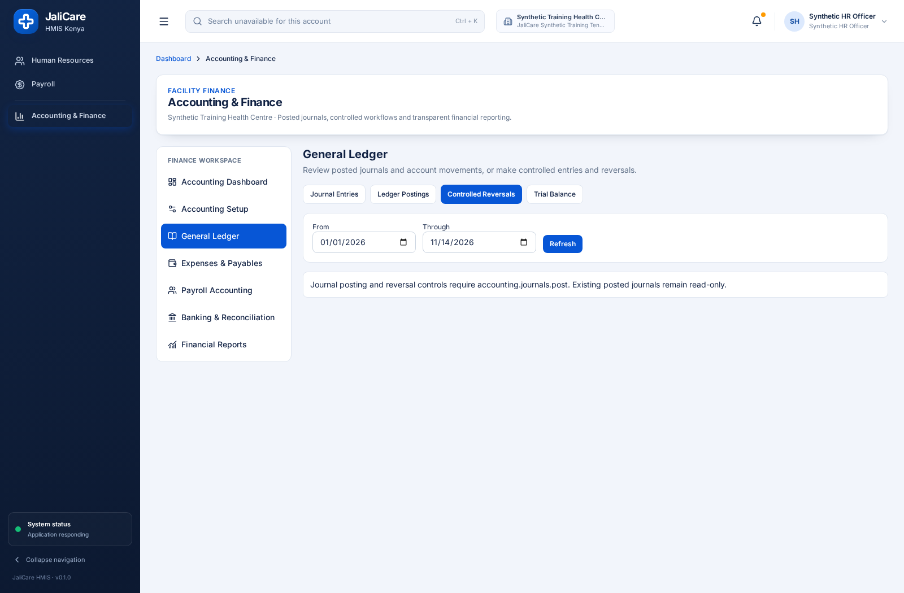

# Chapter 16 — Financial Statements

**Roles:** accountants, controllers, partners, auditors. **Purpose:** what each statement contains, how each figure is derived, and how the statements were verified for this issue.

## 16.1 How statements are produced

A statement run takes a period, a facility and a financial year, gathers posted ledger lines grouped by statement lines, and renders the statement set. A run can be marked provisional or approved; a provisional statement is watermarked in the PDF so it cannot be mistaken for a final one.

## 16.2 Statement of financial position (balance sheet)

**Formula:** assets = liabilities + equity. **Inputs:** closing balances of each account at the period end, grouped by statement line. **Verified synthetic figures:**

| Line | KES |
| --- | --- |
| Total assets | 7,710,651.50 |
| Total liabilities | 906,000.00 |
| Total equity | 6,804,691.50 |
| Liabilities + equity | 7,710,651.50 |
| **Difference** | **0.00** |

Contributing accounts: cash at bank and cash on hand (assets), trade receivables (asset), pharmacy inventory (asset), trade payables and statutory liabilities (liabilities), capital, drawings and appropriation (equity). The equity total includes the year's result, which is why the balance sheet agrees with the income statement through the equity section rather than through a separate closing entry.

## 16.3 Income statement

**Formula:** gross profit = revenue − cost of sales; net profit = gross profit − operating expenses. **Verified synthetic result:** net profit **327,058.50** for the period covered by the run.

| Line | Derivation |
| --- | --- |
| Revenue | Sum of posted revenue accounts (4xxx) |
| Cost of sales | Sum of posted cost accounts for medicines and consumables |
| Gross profit | Revenue − cost of sales |
| Operating expenses | Salaries, rent, utilities, depreciation, professional fees |
| Net profit | Gross profit − operating expenses |

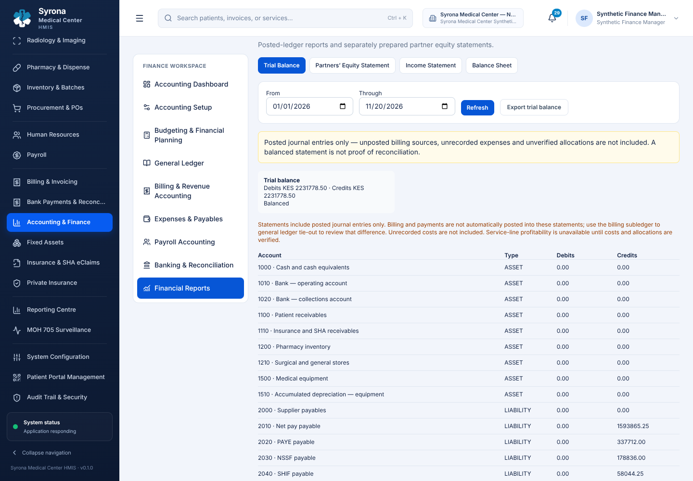

## 16.4 Cash flow statement

The statement of cash flows is generated by the financial statements engine and is available as a tab in the workspace, alongside the balance sheet, income statement and statement of changes in equity. It is built from movements in cash and bank accounts classified into operating, investing and financing sections.

**Not captured separately.** No screenshot of the cash-flow tab exists in this repository's evidence, and this issue did not stage one. The engine and export path exist in `src/financial-statements/engine.ts` and `src/financial-statements/export.ts`; the chapter says what it computes rather than showing a picture of it.

## 16.5 Statement of changes in partners' equity

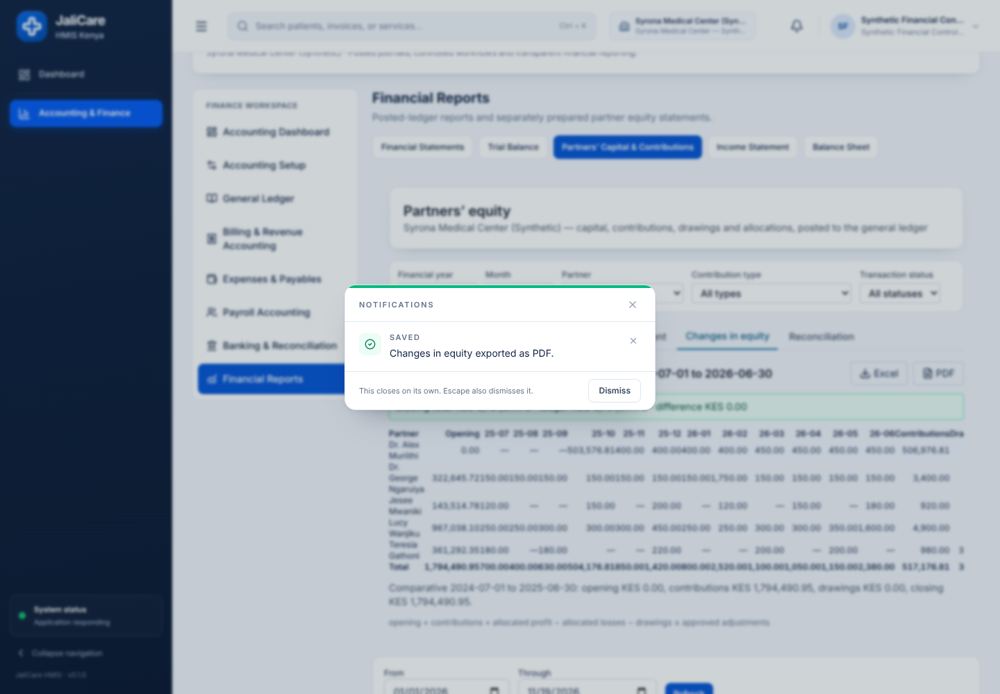

**Formula per partner:** closing = opening + contributions + profit − loss − drawings ± adjustments. Chapter 17 works the same equation with the five synthetic partners and reconciles the closing column to the ledger.

## 16.6 Financial year

The financial year start month is a facility setting; the synthetic facility uses July, so FY2025 runs from 1 July 2025 to 30 June 2026. Every statement window derives from that setting rather than from the calendar year, and a statement printed for a year shows the year's own dates in its header.

## 16.7 Monthly, annual and comparative reporting

| Run type | Window | Comparative |
| --- | --- | --- |
| Monthly | One calendar month within the financial year | Prior month, when posted |
| Annual | The financial year | Prior financial year, when posted |
| Ad hoc | Any window the user selects | None unless the same window exists in the prior year |

A comparative is only shown when the prior period has posted data; the engine does not invent a zero column and label it a comparison.

## 16.8 Exports

Statements export to PDF and Excel. The Excel export writes each statement to its own sheet with the same line definitions as the screen, so a reviewer can trace a printed figure to a cell. Export payloads are generated by the API and returned to the client; they are not assembled in the browser.

## 16.9 How the figures in this chapter were verified

| Check | Result |
| --- | --- |
| Balance sheet identity | Assets 7,710,651.50 = liabilities 906,000.00 + equity 6,804,691.50; difference 0.00 |
| Net profit | 327,058.50, agreeing with the equity movement for the period |
| Partners' closing balances | Five partners sum to 3,790,067.76, equal to the ledger capital plus drawings control |
| Trial balance | 2,552,484.98 debits = 2,552,484.98 credits |
| Independent recomputation | 24 partner comparisons recomputed in SQL outside the module, 0 failures |

These are synthetic figures from the verification fixture. They are not a real facility's accounts, and they are not an audit.

# Chapter 17 — Partners' Equity

**Roles:** partners, finance controller, accountant, auditor. **Purpose:** what the module records, how capital moves, and how the register is proved against the ledger.

## 17.1 What the module is, and what it is not

It is a register of partner capital movements — contributions, drawings, profit allocations, loss allocations and adjustments — each approved, posted as a balanced journal and reconciled to the ledger. It is not a partnership agreement: it does not decide ownership, it records what an authorised user approved. Ownership percentages are entered and must total 100%; the system refuses to allocate on percentages that do not.

## 17.2 The dashboard

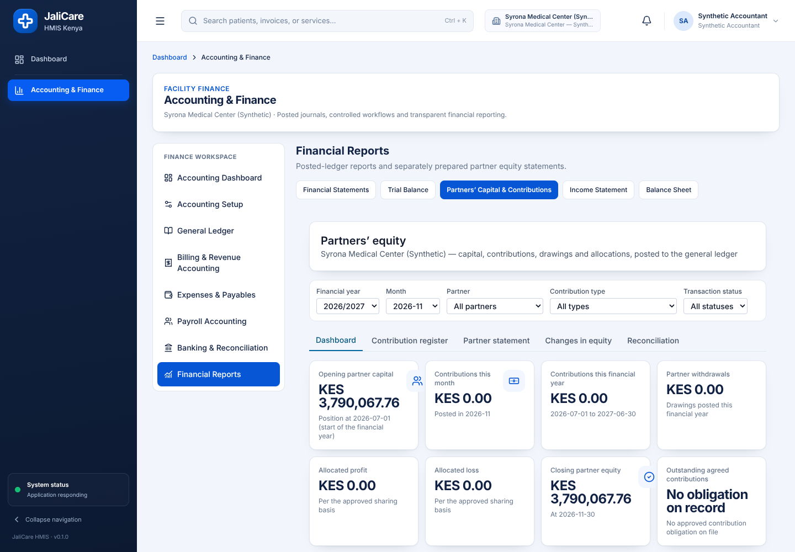

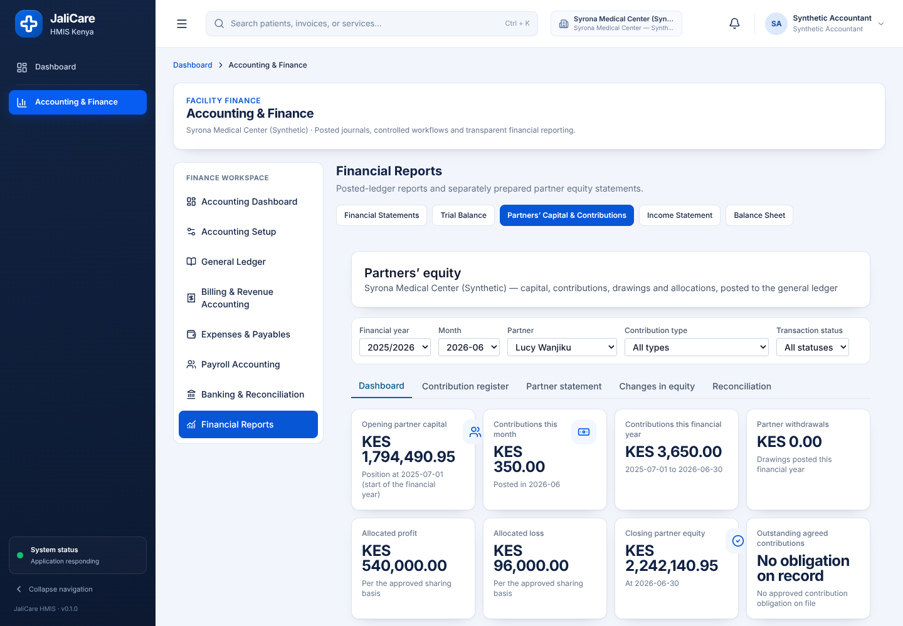

## 17.3 Contribution types

| Type | Meaning | Effect on capital |
| --- | --- | --- |
| Capital contribution | Cash or assets introduced by a partner | Increase |
| Additional contribution | Further capital during the year | Increase |
| Drawings | Amounts withdrawn by a partner | Decrease |
| Profit allocation | Share of the year's profit | Increase |
| Loss allocation | Share of the year's loss | Decrease |
| Adjustment | Approved correction, with a reason | Either |

A partner loan is not a contribution: it is a liability of the facility to the partner and is recorded as such. Ordinary facility revenue is not a partner contribution either — it reaches equity only through an approved profit allocation.

## 17.4 The capital equation

**Closing capital = opening + contributions + profit allocated − losses allocated − drawings ± adjustments.**

The synthetic financial year (FY2025, 1 July 2025 to 30 June 2026) works as follows:

| Element | KES |
| --- | --- |
| Opening capital | 1,794,490.95 |
| Contributions | 515,926.81 |
| Profit allocated | 1,800,000.00 |
| Loss allocated | (320,000.00) |
| Drawings | (350.00) |
| **Closing capital** | **3,790,067.76** |

## 17.5 The five partners (synthetic)

Balances are at 30 June 2026, the end of FY2025. Ownership is the approved percentage recorded for each partner and totals 100.00%.

| Partner | Code | Ownership | Brought forward at 1 Jul 2025 | Closing capital at 30 Jun 2026 (KES) |
| --- | --- | --- | --- | --- |
| Lucy Wanjiku | PTR-001 | 30% | 967,038.10 | 1,414,688.10 |
| Jesee Mwaniki | PTR-002 | 15% | 143,514.78 | 366,394.78 |
| Dr. Alex Muriithi | PTR-003 | 25% | 0.00 | 876,976.81 |
| Teresia Gathoni | PTR-004 | 18% | 361,292.35 | 628,362.35 |
| Dr. George Ngaruiya | PTR-005 | 12% | 322,645.72 | 503,645.72 |
| **Total** | | **100.00%** | **1,794,490.95** | **3,790,067.76** |

The brought-forward column is derived from the verification artifact: each partner's closing balance less that partner's lifetime contributions, profit, losses and drawings. It equals the "opening" line of the financial-year equation above, which is how the two views are tied together. The allocation arithmetic uses the approved percentages; the system never falls back to an equal split.

## 17.6 Journal patterns

| Movement | Debit | Credit |
| --- | --- | --- |
| Cash contribution | Bank | Partner capital |
| Contribution of an asset | Asset at agreed value | Partner capital |
| Drawings | Partner drawings | Bank |
| Profit allocation | Appropriation | Each partner capital, by share |
| Loss allocation | Each partner capital, by share | Appropriation |
| Reversal | Exactly the opposite of the original | Exactly the opposite of the original |

## 17.7 Approval, reversal and audit

- Creating a partner's terms and approving them are different authorities (`SEPARATION_OF_DUTIES`).
- A movement is recorded as a draft; only approval posts the journal, in the same transaction that marks it posted. There is no "approved but unposted" state.
- A reversal creates an offsetting journal and marks the original reversed. The original journal stays in the ledger.
- A partner capital row cannot be deleted, and a posted amount cannot be updated: a database trigger refuses both. A reversal is a new row.
- Audit records create, approve, reject, reverse and setting changes with actor, reason and time.

## 17.8 Workflow sequence: a monthly contribution

| Step | Screen | What changes | Figure |
| --- | --- | --- | --- |
| 1. Start | Dashboard | Nothing; read-only | 17.1 |
| 2. Entry | Contribution form | Draft row; no journal | 17.3 |
| 3. Processing | Approve and post by a second user | Posted row; balanced journal; audit entry | 17.4 |
| 4. Success | Register filtered to the movement | Running balance increases | 17.5 |
| 5. History / report | Partner statement and reconciliation | Register total equals the ledger | 17.6, 17.7 |

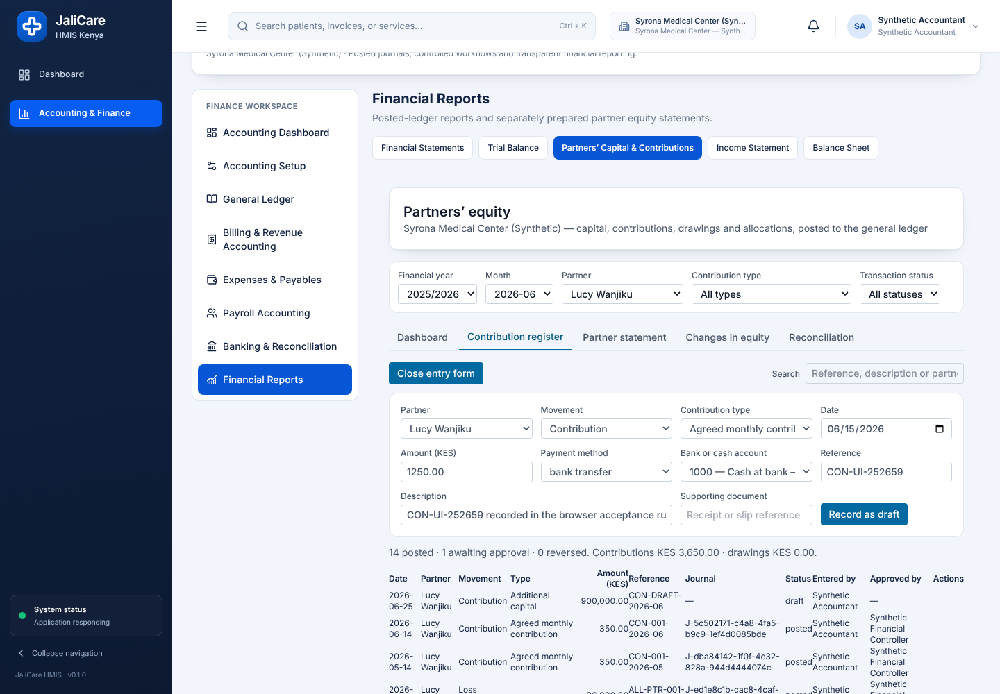

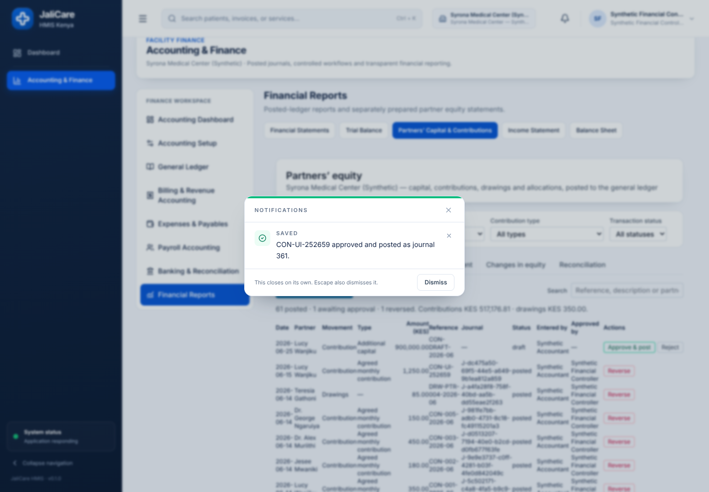

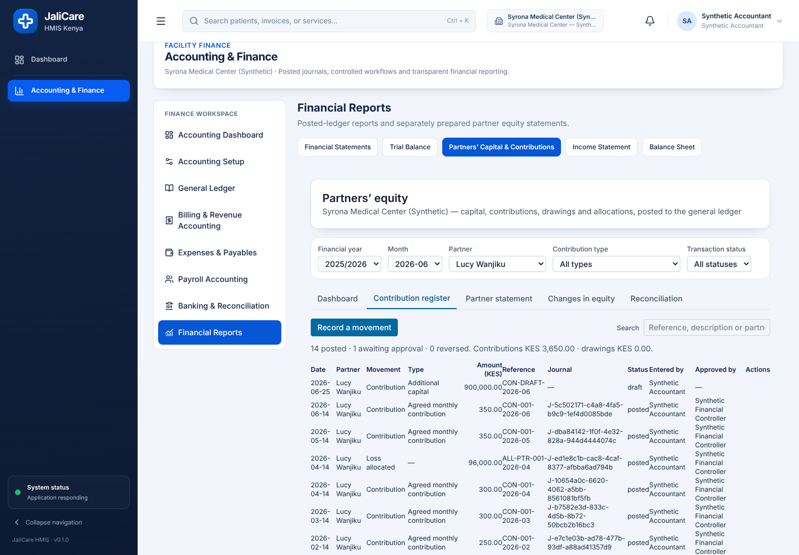

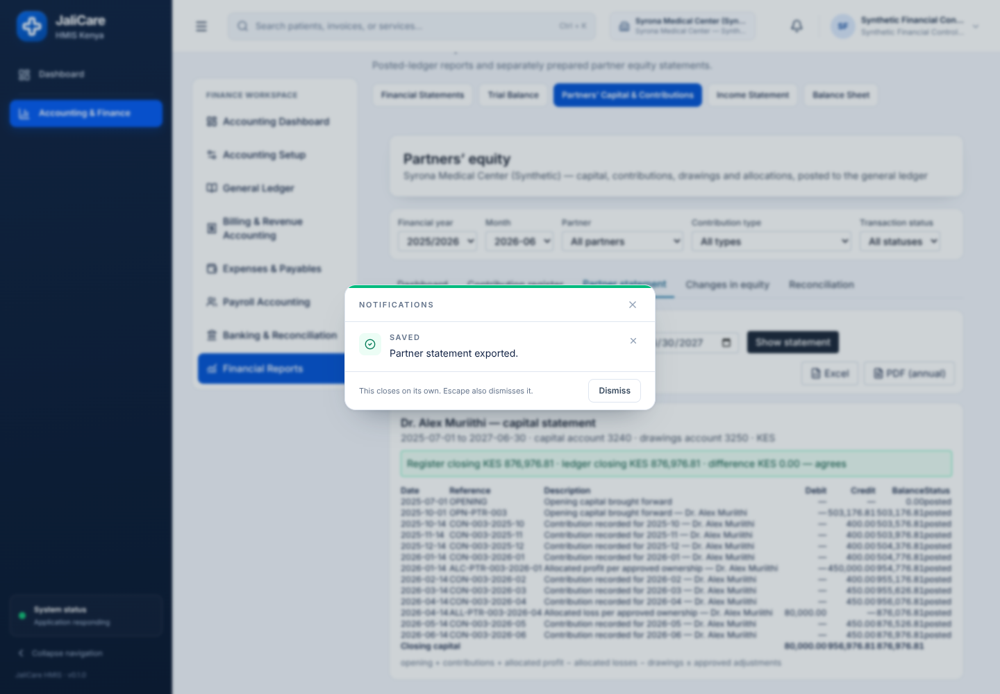

## 17.9 Reconciliation to the ledger

**Formula:** for each partner, ledger balance = capital account net credit + drawings account net credit. **Result:** every partner's register balance equals the ledger balance, and the five partners sum to 3,790,067.76, the same total the ledger reports. The difference column reads 0.00 throughout.

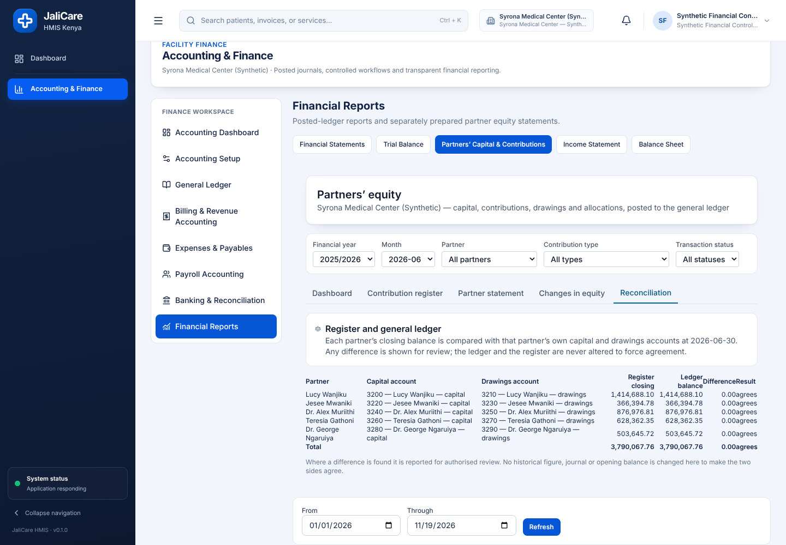

Two totals appear in the evidence and they are both correct. The verification artifact (taken before the browser run) shows register and ledger at **3,790,067.76**. The browser run then posted an additional 1,250.00 contribution through the user interface, so its own reconciliation tab shows **3,791,317.76 against a ledger of 3,791,317.76, difference 0.00** — both sides moved by the same 1,250.00, and the run reversed that contribution at its end. A reader comparing the two figures should read the 1,250.00 difference between them as the user-interface test movement, not as a discrepancy.

An independent script recomputed the same figures with SQL that does not call the module and reported 0 failures across 24 comparisons. Where a capital journal is posted outside the module, the reconciliation reports the difference for authorised review; it never adjusts either side to force agreement.

## 17.10 What a user without the permission sees

The module refuses to render for an account without `accounting.equity.read` rather than showing a zero balance, which would be misread as "no capital".

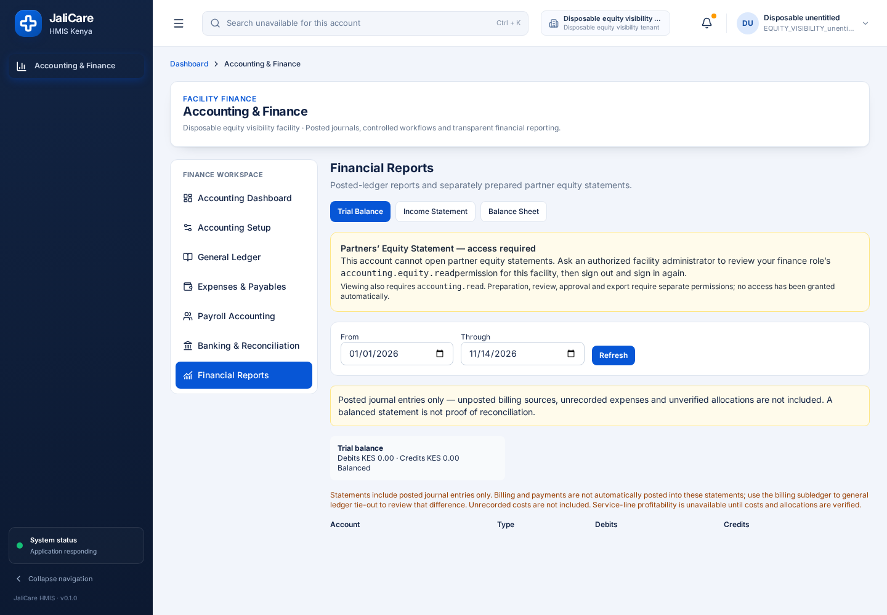

## 17.11 What the screens refuse to do

| Situation | Behaviour |
| --- | --- |
| No approved contribution obligation | The outstanding-obligations figure says "no obligation on record" rather than inventing a target |
| Ownership does not total 100% | Allocation preview unavailable; no allocation posted |
| Ownership missing for a partner | Allocation refuses; it never falls back to equal shares |
| Draft movement | Excluded from capital and from the ledger |
| Duplicate reference with the same partner, date and amount | Refused by a database constraint |
| Register and ledger disagree | Difference reported; nothing altered to force agreement |
| Reversal date has no open period | Refused; the date is never silently moved |
| Deletion or edit of a posted row | Refused by a database trigger |


# Chapter 18 — Payroll and Statutory Deductions

**Roles:** HR, payroll officers, finance, auditors. **Purpose:** how gross pay becomes net pay, which statutory version applies to which period, and what the system does and does not certify.

## 18.1 Employee payroll configuration

Pay is built from salary components: basic, allowances, benefits, and statutory deductions. Each employee's structure names the components and their amounts.

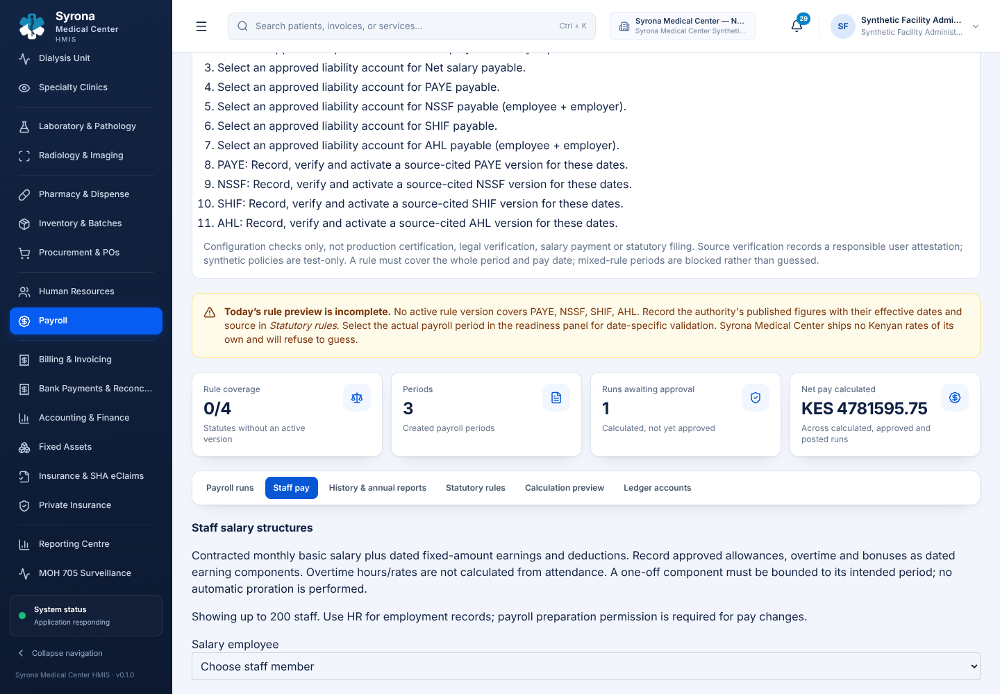

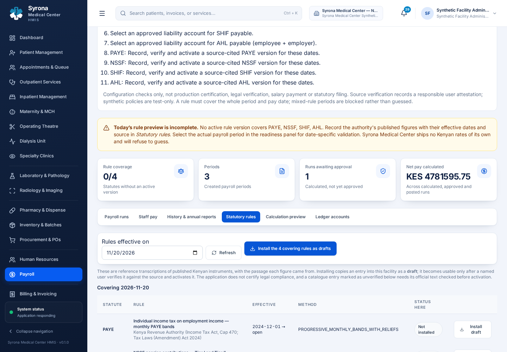

## 18.2 Effective-dated statutory versions

Deductions are not hard-coded. Each rule set is a version with an effective date, installed by a seed and then verified and activated by a named user:

| Rule set | Version | Effective from | Source recorded in the seed |
| --- | --- | --- | --- |
| PAYE | 2023-07 | 1 July 2023 | Income Tax Act bands as configured |
| PAYE | 2024-12 | 1 December 2024 | Tax Laws (Amendment) Act 2024 in force 27 December 2024 |
| NSSF | 2026-02 | 1 February 2026 | NSSF Year-4 rate notice |
| SHIF | 2024-10 | 1 October 2024 | Social Health Insurance Fund statutory instrument |
| AHL | 2024-03 | 19 March 2024 | Affordable Housing Levy notice |

The application computes with whichever version is in force for the payroll period and **refuses to run when no verified, active version covers the period**. It does not certify that a rate is lawful or current: that is the responsibility of the user who verifies and activates it.

## 18.3 The calculation order

1. Gross pay = Σ (component quantity × rate) for the period.
2. Pension and insurance reliefs are applied within their caps, as configured in the version.
3. PAYE is computed on the taxable pay after reliefs, band by band, then the personal relief is deducted.
4. NSSF, SHIF and AHL are computed on the configured base for the version, respecting the floor and ceiling recorded in it.
5. Employer contributions are computed separately and are never deducted from the employee.
6. Net pay = gross pay − employee deductions.

## 18.4 Worked example (synthetic, KES)

**Formula → inputs → calculation → result**, using illustrative figures for the *method*, not as a statement of current law:

| Line | Calculation | Result |
| --- | --- | --- |
| Gross pay | Basic 60,000.00 + house allowance 15,000.00 | 75,000.00 |
| NSSF (employee) | 6% of pensionable pay within the version's floor and ceiling | see configured version |
| SHIF | 2.75% of gross, subject to the version's minimum | see configured version |
| AHL (employee) | 1.5% of gross | see configured version |
| Taxable pay | Gross − allowable reliefs | computed |
| PAYE | Band arithmetic on taxable pay − personal relief | computed |
| Net pay | Gross − employee statutory deductions − PAYE − other deductions | computed |

The chapter deliberately does not print arithmetic for NSSF, SHIF and PAYE: those depend on the activated version and its caps, and printing a number here would be read as a legal statement the application does not make. The payroll screen shows every intermediate figure for the run, and the payslip repeats them for the employee.

## 18.5 Review, approval and posting

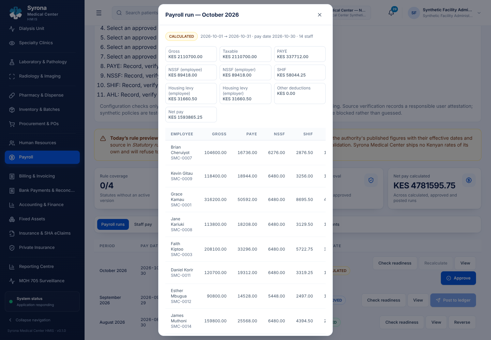

A run is calculated, reviewed by a second user, then approved. Approval posts one journal: salaries expense, statutory liabilities and net pay payable. Payslips are generated after approval.

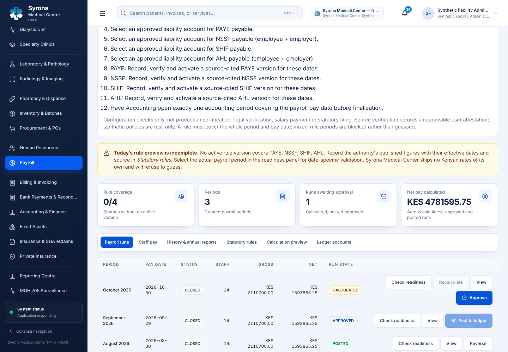

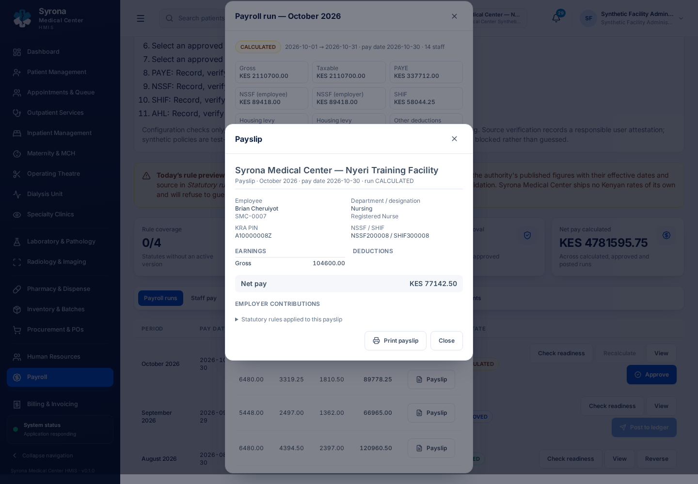

## 18.6 Ledger mapping

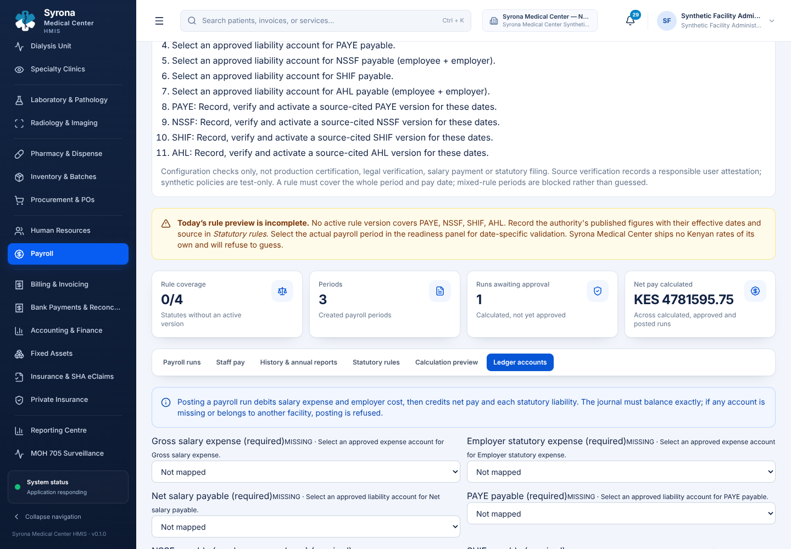

## 18.7 Employer contributions

Employer NSSF, SHIF and AHL are expenses, not deductions. They are posted as Dr employer statutory expense / Cr statutory liabilities, separately from the employee deductions, so a reader of the payroll register can see what the employee paid and what the facility paid on their behalf.

## 18.8 Payslips and reports

Payslips render as PDFs on the facility letterhead with year-to-date figures. Payroll reports include the run summary, the statutory schedule and the annual extract.

## 18.9 Limits

- No statutory filing, no P9 or P10 generation to KRA, no NSSF or SHA submission.
- No bank payment file for salaries.
- No leave-to-payroll linkage beyond what the leave record states.
- No load test of a payroll run for a large headcount.

# Chapter 19 — Fixed Assets and Depreciation

**Roles:** stores, finance, administrators. **Purpose:** registering assets, running depreciation, and the convention that decides when depreciation starts.

## 19.1 The register


| Field | Detail |
| --- | --- |
| Asset code | Facility-unique tag |
| Description and category | Drives the default useful life |
| Location and custodian | Who holds it and where |
| Acquisition date and cost | Cost capitalised, not expensed |
| Residual value and life | Residual may be zero; life in months |
| Accumulated depreciation | Grows monthly |
| Status | In use, idle, disposed |

## 19.2 Asset detail, categories and maintenance


## 19.3 Depreciation formula and convention

**Monthly depreciation = (cost − residual value) ÷ useful life in months.**

**Convention:** depreciation commences in the month **after** acquisition. An asset acquired on 15 March has no March charge; it is charged from April. This convention is a setting of the module, applied consistently, and it is the reason a year's charge for a newly acquired asset can be eleven months rather than twelve.

**Worked example (synthetic):** an X-ray unit is acquired for 1,200,000.00 with zero residual and a sixty-month life.

| Element | Value |
| --- | --- |
| Cost | 1,200,000.00 |
| Residual | 0.00 |
| Life | 60 months |
| Monthly charge | (1,200,000.00 − 0.00) ÷ 60 = 20,000.00 |
| Charge in the acquisition month | 0.00 (commences the following month) |
| Net book value after 12 charges | 1,200,000.00 − 240,000.00 = 960,000.00 |

**Journal per month:** Dr depreciation expense 20,000.00 / Cr accumulated depreciation 20,000.00.

## 19.4 Depreciation preview


The preview exists so a controller can see the effect before posting. Posting is period-bound like any other journal, and a run into a closed period is refused.

## 19.5 Transfers, disposals and gains

A transfer changes location or custodian and writes a transfer row. A disposal records the date, the proceeds and the reason, stops depreciation, and posts the gain or loss as proceeds minus net book value. An asset cannot be disposed of twice, and a disposed asset cannot be depreciated further.

## 19.6 Reports

The fixed-asset register, the depreciation schedule for a period and the net-book-value listing are available as schedules in the statements workspace; the asset reports in the catalogue are described in Chapter 23.

# Chapter 20 — Inventory and Procurement

**Roles:** stores, procurement, department heads, finance. **Purpose:** requisition to payment, with the ledger entry at each step.

## 20.1 Requisition, order, receipt, invoice


| Step | Record | Ledger effect |
| --- | --- | --- |
| Requisition raised | Requisition with lines and justification | None |
| Approved | Approval record with approver and time | None |
| Purchase order issued | Order to a supplier | None — a commitment, not a liability |
| Goods received | Receipt with batch, expiry and quantity | Dr inventory / Cr accrued purchases |
| Supplier invoice matched | Invoice matched to order and receipt | Dr accrued purchases / Cr trade payables |
| Payment | Payment against the payable | Dr trade payables / Cr bank |

## 20.2 Workflow sequence (start → entry → processing → success → history)

| Step | Screen | Figure |
| --- | --- | --- |
| 1. Start | Procurement workspace | 20.1 |
| 2. Entry | Requisition form completed | 20.2 |
| 3. Processing | Requisition saved and submitted | 20.3 |
| 4. Success | Goods received with batch and expiry | 20.4 |
| 5. History / report | Stock movements, transfers, valuation | 21.2–21.5 |


## 20.3 Three-way matching

The supplier invoice is matched to the purchase order and the goods receipt. A quantity or price difference becomes an exception that must be approved, not an automatic adjustment. Where a facility pays before matching, the payable is recorded and the exception is still visible.

## 20.4 Stock control


## 20.5 Stock movement report


## 20.6 Valuation

Inventory is valued from the movements recorded, at the cost recorded on receipt. There is no revaluation feature and no weighted-average recalculation beyond what the receipt costs produce; a facility needing a different costing method should know that before go-live (Chapter 28).

# Chapter 21 — Human Resources and Workforce

**Roles:** HR officers, administrators. **Purpose:** employee records, attendance, leave and what is absent.

## 21.1 What the module holds


| Area | Records |
| --- | --- |
| Employees | Identity, contacts, job title, department, employment dates |
| Departments and roles | Structure used by payroll and by reports |
| Attendance and roster | Daily attendance and shift assignment |
| Leave | Applications, approvals and balances |


## 21.2 Employee data protection

Employee records contain personal data: identity numbers, salaries, bank details and, where recorded, health information for sick leave. Access is permission-controlled (`hr.read`, `payroll.read`), and the same audit rules apply as for patients. Salary information is not visible to a user with HR permission but without payroll permission.

## 21.3 Not implemented

| Area | Status |
| --- | --- |
| Recruitment and applicant tracking | Absent |
| Performance appraisal | Absent |
| Training records and certification expiry | Absent |
| Disciplinary process | Absent |
| Leave-to-payroll deduction automation | Absent; leave affects pay only through manual input |

These absences are stated in the completion register as well, because a facility that expects them will otherwise buy the system on an assumption.

# Chapter 22 — Insurance and Integrations

**Roles:** billing, claims officers, finance, administrators. **Purpose:** what is integrated, what is only prepared, and what is not connected at all.

## 22.1 SHA eClaims


| Step | Implemented | Verified in this issue |
| --- | --- | --- |
| Member eligibility check | Yes, against configured fixtures | No live call |
| Preauthorisation request | Yes, prepared and stored | No live submission |
| Claim preparation | Yes, with evidence documents | Yes — screens and records |
| Claim submission to SHA | No live endpoint exercised | No |
| Remittance reconciliation | Recording only | No |

The distinction matters: a prepared claim is not a filed claim, and nothing in this build proves SHA has accepted one.

## 22.2 Private insurance


Provider records, member policies, preauthorisation and claims are recorded. No insurer exchange has been exercised.

## 22.3 M-Pesa and banking

M-Pesa transactions can be recorded with their reference and matched to receipts. The STK push, the callback endpoint and settlement confirmation are **not verified**: the code paths exist, but without merchant credentials and provider connectivity they could not be exercised. Bank payments are recorded and reconciled manually; there is no bank-file import.

## 22.4 Configuration, sandbox and production

The integration hub lists providers with their status ("not requested", "sandbox", "production") and states plainly that a sandbox authorisation is not a real transaction. Provider credentials are configuration, not documents: no key, token or secret appears in this documentation package.

## 22.5 KHIS and FHIR

FHIR-shaped patient resources and a DHA readiness view exist. There is no transmission to KHIS or DHIS2: the readiness screen reports what is implemented and what is not, rather than implying a live connection.

## 22.6 What this chapter does not claim

No integration in this build is proven to work against a live provider. Anything that reads like reassurance about M-Pesa, SHA, banks or KHIS should be read against this paragraph.


# Chapter 23 — Reporting Centre

**Roles:** managers, clinicians, finance, auditors. **Purpose:** which reports can be produced, which cannot, and how to read a report's status.

## 23.1 The catalogue is a menu, not a promise

The report catalogue contains **144 entries in ten categories**. Each entry states its status:

| Status | Count | Meaning |
| --- | --- | --- |
| Available | 24 | An engine answers the request with a scoped, documented subset |
| Existing document | 4 | The entry opens a document workflow that already exists (invoice, laboratory report, radiology report, discharge summary) |
| Not implemented | 116 | No engine and no workflow; the entry names what is missing |


## 23.2 Categories and their coverage

| Category | Entries | Available | Existing document | Not implemented |
| --- | --- | --- | --- | --- |
| Clinical & Patient | 41 | 9 | 1 | 31 |
| Laboratory & Radiology | 13 | 2 | 2 | 9 |
| Finance & Accounting | 8 | 3 | 0 | 5 |
| Billing & Revenue | 20 | 4 | 1 | 15 |
| Pharmacy | 5 | 1 | 0 | 4 |
| Inventory & Stock Management | 14 | 4 | 0 | 10 |
| Procurement & Supplier | 5 | 1 | 0 | 4 |
| HR & Workforce | 17 | 0 | 0 | 17 |
| Management & Budget | 13 | 0 | 0 | 13 |
| MOH & Regulatory | 8 | 0 | 0 | 8 |
| **Total** | **144** | **24** | **4** | **116** |

The full list, one row per report with its purpose, engine, dependency and output formats, is the companion workbook `docs/SYRONA_REPORT_CATALOGUE.xlsx` and the CSV `docs/documentation/report-catalogue.csv`.

## 23.3 The twenty engines

| Engine | Reports it serves |
| --- | --- |
| `cashier-receipts` | Cashier daily summary, all-cashier daily summary |
| `ledger-trial-movements` | Trial balance |
| `ledger-income` | Income statement |
| `ledger-balance-sheet` | Balance sheet |
| `invoice-balances` | Patient outstanding balances |
| `recorded-refunds` | Refund reports |
| `inventory-movements` | Goods stock movements |
| `purchase-orders` | LPO summaries |
| `inventory-store` | Inventory by store |
| `inventory-category` | Inventory by category |
| `inventory-expiry` | Expiry report |
| `outpatient-encounters` | OPD attendance |
| `outpatient-diagnoses` | Diagnosis reports |
| `current-inpatients` | Current inpatient lists |
| `inpatient-admissions` | Admissions |
| `inpatient-discharges` | Discharges |
| `laboratory-orders` | Laboratory test reports |
| `radiology-requests` | Imaging requests |
| `pharmacy-dispensations` | Dispensing report |
| `patient-registrations` | Patient registration report |

## 23.4 Filters and execution

| Filter | Applies to | Note |
| --- | --- | --- |
| From / to date | Every engine except the balance sheet's opening date rule | The window is echoed above the results |
| Facility | All engines | Fixed to the caller's facility scope |
| Account selection | Ledger engines | Optional; without it, all accounts |
| Search | Where the engine supports it | Sent in the request body, not the URL, so it does not leak into proxy logs |

Reports are generated by `POST /api/reports/:reportId/generate`, which requires `reports.read` plus the module gate for the report's domain. A user without the module sees a module-not-enabled refusal, not an empty report.

## 23.5 Results and the empty state


The difference between "nothing matched this filter" and "nothing exists" is stated on screen because the two lead to different actions.

## 23.6 Worked sequence: catalogue to exported report

| Step | What the user does | Figure |
| --- | --- | --- |
| 1. Start | Opens the reporting centre and reads the catalogue with its statuses | 23.1 |
| 2. Entry | Chooses a report and sets the period and any filter | 23.2 |
| 3. Processing | The engine runs a facility-scoped query | 23.2 |
| 4. Success | Rows appear with the filters restated | 23.2, 23.4 |
| 5. History / report | The same result is printed to PDF or exported to Excel | 23.5, 23.6 |


## 23.7 Exports


Exports use the same query as the screen: the PDF and the Excel file cannot disagree with what was shown unless the data changed between the two requests, in which case the export carries its own generation time.

## 23.8 Clinical documents


## 23.9 MOH and regulatory returns

None of the eight MOH entries has an engine. MOH 705 surveillance exists as a screen that presents a weekly form, but it does not transmit to KHIS. A facility that must file MOH returns should treat this as an integration project, not a reporting configuration.

# Chapter 24 — Administration and Configuration

**Roles:** facility administrators, platform administrators. **Purpose:** the switches that decide what the facility can do, and who may move them.

## 24.1 The configuration module


| Tab | Controls | Permission |
| --- | --- | --- |
| Facility profile | Name, level, county, MFL code, contacts | `facilities.update` |
| Modular features | The module switches | `facilities.modules.manage` |
| Staff & roles | Users, invitations, roles, permission matrix | `users.invite`, `users.roles.manage` |
| Services & tariffs | Service catalogue and prices | `tariffs.manage` |
| Approval policies | Thresholds that decide who must approve | `approval_policies.manage` |
| Branding & documents | Letterheads and signatures | `facility.branding.manage` |
| Integration hub | Payment and payer providers | payment-hub permissions |

## 24.2 Module switches

A switch decides two things: whether the module appears in the navigation rail, and whether the server answers that module's API. Records already stored are kept when a module is switched off — switching a module off is not a deletion.


## 24.3 Users, roles and the permission matrix

A role is a named set of permissions inside a tenant. Assigning a role to a user grants those permissions at that user's facility. A facility-level override can grant or remove one permission for one user at one facility, which is how a facility handles "this nurse also does claims" without inventing a new role.

## 24.4 Financial years and periods

The financial-year start month is a facility setting. Opening and closing periods is a finance action, not a configuration one; the accounting chapter (15) describes the controls.

## 24.5 Tariffs

The service tariff holds the price of every facility service. Changing a price affects charges raised after the change; already-finalised invoices are not re-priced, which is why a price correction after billing requires a credit note.

## 24.6 Branding and documents


Letterheads are versioned: a document printed in March carries the letterhead that was active in March, not the one active today. That is what makes an old printed document defensible.

## 24.7 Approval policies

Thresholds decide who must approve a purchase, a payment or a refund. The policy is data: a facility can require one approver below a value and two above it. The service enforces the same rule the screen displays.

# Chapter 25 — Security, Privacy and Audit

**Roles:** administrators, auditors, reviewers. **Purpose:** the controls that exist, the evidence for them, and the claims this document does not make.

## 25.1 Authentication

| Control | Implementation |
| --- | --- |
| Password storage | Salted hash; no reversible storage |
| Session | Bearer token, 8-hour expiry, revocable |
| Lockout | Repeated failures locked for 15 minutes |
| Rate limit | 10 failed sign-ins per 15 minutes per address |
| MFA | Schema and flags exist; enrolment flow absent |

## 25.2 Authorization

Every route names the permission it requires. Permissions resolve from roles plus facility overrides. Administrative routes additionally check tenant and facility scope, so a facility administrator cannot read another facility's records even if the permission is held.

## 25.3 Tenant and facility isolation

Every query is scoped by `tenant_id` and, where the row is facility-owned, by `facility_id`. The scope is applied in the data layer rather than in each handler, which is what makes the isolation consistent. Tests attempt cross-facility reads and expect a not-found rather than a redacted record.

## 25.4 Patient data protection

| Control | Detail |
| --- | --- |
| Access control | Documents and results require a permission and pass a scope check |
| Audit | Document views, downloads and releases are logged |
| Portal | Only explicitly released material is visible to the patient |
| Export | Exports are generated server-side and returned to an authenticated caller |
| Retention | No automated purge is implemented; retention is a deployment policy |

## 25.5 Field-level protection

Clinical narrative and identity numbers are not encrypted at field level in this build; they are protected by database access control, transport encryption and application authorization. A deployment that requires field-level encryption must add it, and this document does not pretend otherwise.

## 25.6 Audit logging


`audit_logs` is append-only: a database trigger refuses UPDATE and DELETE. In the partner-capital test suite, an attempted cleanup delete was refused by the trigger, which is recorded as a test result rather than an anecdote.

## 25.7 Backup and restoration

Backup scripts exist (`npm run db:backup`, `db:backup:verify`, `db:restore`, `db:restore:drill`). They were not exercised against production-sized data for this issue; a real restore drill is a deployment responsibility (Chapter 26).

## 25.8 What this chapter does not claim

- It does not claim compliance with the Data Protection Act, 2019, or with any other law.
- It does not claim ISO 27001, SOC 2 or HIPAA alignment.
- It does not claim that a penetration test or vulnerability scan was performed.
- It does not claim that the system is free of vulnerabilities.
- It does not claim that clinical data is encrypted at rest beyond the storage layer's own encryption.

The controls above are what the code does. A compliance position needs an assessment this issue did not perform.

# Chapter 26 — Deployment and Maintenance

**Roles:** technical staff, administrators. **Purpose:** requirements, installation, migrations, backup, monitoring and the failures you will actually meet.

## 26.1 Requirements

| Item | Requirement |
| --- | --- |
| Node.js | 22.x |
| PostgreSQL | 16.x with a database and role provisioned |
| Memory | Sized for concurrent report generation; no benchmark exists |
| Disk | Database plus a volume for patient documents and exports |
| Network | HTTPS terminating proxy; outbound access only for integrations you enable |

## 26.2 Configuration

Configuration is environment variables, validated at boot. A missing required variable stops startup with the variable named. Secrets are supplied by the environment, never committed: `.env.example` lists the variables without values.

## 26.3 Installation

```
npm ci
npm run db:migrate          # applies drizzle/*.sql in order
npm run db:status           # confirms every migration is applied
npm run db:bootstrap-admin  # creates the first administrator
npm run db:seed:permissions # loads the 226 permission codes
npm run build:deploy        # client, server bundle and artefact check
npm start
```

## 26.4 Database migrations

Migrations are ordered SQL files with a journal. `npm run db:status` reports applied and pending migrations; a preflight mode refuses to start against an unmigrated database. Migrations are forward-only: there is no down migration, so a failed migration is corrected by a new one.

## 26.5 Running the service

One process serves everything. Behind a proxy, the process must bind to the proxy's interface and trust its forwarded headers; the application refuses to trust forwarded headers from an arbitrary source. Health at `GET /api/health`.

## 26.6 Backup and restore

| Task | Command | Note |
| --- | --- | --- |
| Back up | `npm run db:backup` | Writes a dump with a checksum |
| Verify | `npm run db:backup:verify` | Checks the dump before you rely on it |
| Restore | `npm run db:restore` | Restores into a named database |
| Drill | `npm run db:restore:drill` | Restores into a scratch database and runs a smoke check |

A backup that has never been restored is an assumption. The drill exists for that reason and should be scheduled.

## 26.7 Monitoring and logs

Logs are structured JSON with a correlation id per request, and a health endpoint for an uptime monitor. There is no metrics endpoint and no alerting in the application: monitoring is the deployment's job.

## 26.8 Troubleshooting the failures people actually meet

| Symptom | Usual cause | Action |
| --- | --- | --- |
| Sidebar missing modules | Module switched off, permission absent, or wrong facility | Check Chapter 24, then Chapter 3 |
| "No facility selected" | Account bound to a tenant but not a facility | Assign a facility to the user |
| Posting refused: open period required | Period closed | Open the period, or post to the correct one |
| Payroll run refuses to calculate | No verified, active statutory version for the period | Verify and activate the version |
| Export times out | Large report inside a single request | Narrow the period; there is no worker |
| Login refused | Lockout after repeated failures | Wait 15 minutes or reset the password |

## 26.9 Upgrades

Stop the service, back up, run migrations, rebuild, start. Because migrations are forward-only, a rollback means restoring the backup — which is why the restore drill is part of the procedure rather than an optional extra.


# Chapter 27 — Testing and Verification

**Roles:** reviewers, engineering, audit. **Purpose:** what was executed, what it produced, and what was not tested.

## 27.1 How to read this chapter

Every test below was executed for this issue. Results come from command output and committed evidence files, not from recollection. Tests that could not be run are listed as **BLOCKED** or **NOT TESTED** with the dependency that stopped them; those items are not described as working anywhere in this package.

## 27.2 Test environment

| Item | Value |
| --- | --- |
| Date of execution | 19 November 2026 |
| Application | Branch `arena/e088f11d-afyahub-hmis-kenya`, base commit `0111b55` |
| Runtime | Node.js 22.22.3 |
| Database | PostgreSQL 16, databases `syrona_test` and `syrona_synthetic_test` (disposable), `payroll_test` (synthetic fixture) |
| Facility | Syrona Medical Center (Synthetic), code `SYN-SMC-01` |
| Data | Synthetic only. No production data was loaded or contacted |
| Browser | Not available at the end of the issue; browser evidence is the recorded runs named per test |

## 27.3 Static checks

| Test ID | Scope | Method | Result |
| --- | --- | --- | --- |
| ST-01 | TypeScript compilation of the repository | `tsc --noEmit` | PASS — 0 errors |
| ST-02 | Migration inventory | count of `drizzle/*.sql` | PASS — 108 migrations |
| ST-03 | API surface inventory | route extraction across 57 route files | PASS — 571 handlers, written to `api-inventory.csv` |
| ST-04 | Permission seed | parse of `src/seeds/permissions.ts` | PASS — 226 codes |
| ST-05 | Report catalogue integrity | parse of `src/reporting/report-catalogue.ts` | PASS — 144 entries, each in exactly one category |

## 27.4 Full automated suite

Command: `vitest run` with `SYRONA_REQUIRE_DB=1` against PostgreSQL.

| Measure | Result |
| --- | --- |
| Test files collected | 876 |
| Test files passed | 795 |
| Test files failed | 81 |
| Tests executed | 3,560 |
| Passed | 3,106 |
| Failed | 36 |
| Skipped (pending) | 418 |

The 418 pending tests are conditional suites (database-dependent or feature-flagged) that did not apply in this configuration. They are not counted as passes.

## 27.5 The 36 failures, and what happened to them

Of the 36 failures, **24** came from eight suites that refused to run because the test database was named `syrona_test`, and the harness requires a database whose name matches the synthetic-test pattern (`assertSyntheticTarget`). That is a real guard: it stops the suite running against a database that is not provably synthetic. The eight suites were re-run against a correctly named database, `syrona_synthetic_test`:

| Suite | Tests | Passed | Failed after rename |
| --- | --- | --- | --- |
| `integration/billing-posting.db.spec.ts` | 16 | 16 | 0 |
| `integration/document-generation.db.spec.ts` | 26 | 26 | 0 |
| `integration/phase3-financial-journeys.db.spec.ts` | 5 | 5 | 0 |
| `integration/pharmacy-inventory-billing.db.spec.ts` | 19 | 19 | 0 |
| `integration/clinical-catalogue-selection.db.spec.ts` | 11 | 10 | 1 |
| `integration/facility-owned-billing.db.spec.ts` | 29 | 28 | 1 |
| `integration/finalized-invoices.db.spec.ts` | 10 | 7 | 3 |
| `integration/master-tariffs-workflow.db.spec.ts` | 15 | 14 | 1 |
| **Total** | **131** | **125** | **6** |

So **18 of the 36 failures were an artefact of the database name** and pass once the guard is satisfied; **6 are genuine** and remain failing.

### The six genuine failures

| Suite | Failing test theme | Observed message |
| --- | --- | --- |
| `clinical-catalogue-selection.db.spec.ts` | A charged catalogue selection is expected but absent | `expected undefined to match object { charged: true }` |
| `facility-owned-billing.db.spec.ts` | Radiology charge refused pending consent | `RADIOLOGY_CONSENT_REQUIRED` |
| `finalized-invoices.db.spec.ts` (3) | Radiology consent gate during invoice finalisation | `RADIOLOGY_CONSENT_REQUIRED` |
| `master-tariffs-workflow.db.spec.ts` | Radiology order update after reporting | SQL update on `radiology_orders` failed |

These four themes are one story: the radiology consent gate (Chapter 9) is enforced more strictly in the service than these older billing tests assume. Either the tests encode the old behaviour and should be updated, or the gate has a defect. **That decision was not taken in this issue**, and the tests remain red. A reviewer should treat billing-finalisation behaviour with radiology involved as *not verified*.

### The twelve failures not re-run

These files failed in the full run and were not re-run after the database was renamed, so their status is **NOT RETRIAGED**:

| Suite | Failures | Observed message |
| --- | --- | --- |
| `tests/migrations.spec.ts` | 1 | `0095_budget_procurement_planning.sql: unguarded table creates` |
| `tests/schema-extraction.spec.ts` | 2 | `fixed_assets` metadata mismatch |
| `tests/schema-financial-ledger.spec.ts` | 2 | `fixed_assets` metadata mismatch |
| `vitest/accounting-workspace-ui.spec.tsx` | 1 | Unable to find a table role in the rendered workspace |
| `vitest/deploy-artifacts.spec.ts` | 1 | Expected `build/workbook-worker.mjs` in the artefact list |
| `vitest/partner-equity-ui.spec.tsx` | 1 | Unable to find a button named "Partners' Equity Statement" |
| `vitest/partner-equity-visibility.spec.tsx` | 2 | Unable to find a region named "Partners' Equity Statement access" |
| `vitest/payer-hub.db.spec.ts` | 2 | Timed out after 20 s |

The UI failures are consistent with interface changes made in the working tree during recent work; the migration failure is a real guard-rail complaint about migration 0095; the deploy artefact failure names a file the build does not produce. None of these is repaired in this issue, and none is hidden.

## 27.6 Database and domain tests: partners' equity

`src/tests/partner-capital.db.spec.ts` against a disposable database:

| Test ID | Scenario | Result |
| --- | --- | --- |
| DB-01 | Partner created pending approval; capital refused before approval | PASS |
| DB-02 | Refuses a partner whose capital account is not an equity account | PASS |
| DB-03 | Draft contribution never reaches capital or the ledger | PASS |
| DB-04 | Approved contribution posts a balanced journal (debit = credit = 250,000 cents) | PASS |
| DB-05 | Duplicate movement refused | PASS |
| DB-06 | Drawings, profit and loss allocations post and reconcile per partner | PASS |
| DB-07 | Reversal leaves history intact and restores the prior balance | PASS |
| DB-08 | Allocation refuses when percentages do not add up, or a partner has none | PASS |
| DB-09 | A capital journal posted outside the module is reported, not adjusted | PASS |
| DB-10 | Another facility cannot read the register (`PARTNER_NOT_FOUND`) | PASS |
| DB-11 | Reporting month must match the transaction month (`PERIOD_MISMATCH`) | PASS |
| DB-12 | Audit trail records CREATE, APPROVE_AND_POST and REVERSE | PASS |

Result: **12 tests, 12 passed, 0 failed.**

## 27.7 Independent numerical verification

`scripts/financial-testing/verify-partner-capital.ts` recomputes the module's figures in SQL that does not call the module. Evidence: `docs/testing/financial-system/artifacts/partner-capital-verification.json`.

| Measure | Result |
| --- | --- |
| Comparisons executed | 24 |
| Failures | 0 |
| Register total | 3,790,067.76 |
| Ledger total | 3,790,067.76 |
| Difference | 0.00 |
| Ownership total | 100.00% |
| Reversing journal balance | 285,000 cents on each side, twice the reversed 1,425.00 |

Each partner's closing capital agrees between the register formula and the two ledger accounts (capital plus drawings). The full comparison list is in the artifact, each row with expected, actual, difference and pass flag.

## 27.8 Application and browser tests

`scripts/financial-testing/partner-capital-browser.mjs` drove the running application through 20 steps. Evidence: `docs/testing/financial-system/artifacts/partner-capital-browser-run.json`.

| Test ID | Scenario | Result |
| --- | --- | --- |
| E2E-01 | Sign in with the synthetic account and load the shell | PASS |
| E2E-02 | Open Accounting & Finance → Financial Reports → Partners' Capital & Contributions | PASS |
| E2E-03 | Record a contribution as a draft | PASS — `CON-UI-252659`, 1,250.00, status draft |
| E2E-04 | Approve and post the draft as a second user | PASS |
| E2E-05 | Print a partner statement with debit, credit and running balance | PASS |
| E2E-06 | Export a partner statement to Excel | PASS — `partner-statement-lucy-wanjiku-2026-06-30.xlsx` |
| E2E-07 | Export the annual statement to Excel | PASS — `partners-equity-2025-2025-07-01.xlsx` |
| E2E-08 | Reconcile the annual statement on screen | PASS — closing 3,791,317.76 = ledger 3,791,317.76, difference 0.00 |
| E2E-09 | Reverse a posted movement with a stated reason | PASS — `CON-UI-252659` reversed, original journal retained |
| E2E-10 | PDF export of the annual statement | **FAIL** — reported "signature mismatch" |

The run raised one finding: *"PDF annual export failed: signature mismatch"*. The check reads the export payload rather than a blob URL, so the finding is about the file's first bytes. The export code was changed after this run; **the fix was not re-verified**, and the PDF export of the annual statement is therefore recorded as failing in the evidence until a new run says otherwise.

## 27.9 Reports, exports and permissions

| Test ID | Scenario | Result |
| --- | --- | --- |
| RP-01 | Report catalogue complete and internally consistent | PASS — 144 entries, 10 categories, 24 / 4 / 116 |
| RP-02 | Reporting centre renders the catalogue | PASS — capture 25-reporting/01 |
| RP-03 | Report filters and results | PASS — captures 25-reporting/02, 04 |
| RP-04 | Empty result is reported as empty, not as "no data" | PASS — capture 25-reporting/05 |
| RP-05 | Report export to PDF | PASS — capture 25-reporting/06 |
| AU-01 | A user without the equity permission sees an access notice, not a zero statement | PASS — capture 19-partners-equity/09 |
| AU-02 | Separation of duties: creator cannot approve partner terms | PASS — `SEPARATION_OF_DUTIES` asserted |
| AU-03 | Separation of duties: recorder cannot approve the movement | PASS |
| AU-04 | Multi-facility isolation of the partner register | PASS — `PARTNER_NOT_FOUND` |
| AU-05 | Delete or update of a posted partner row is refused by the database | PASS — SQLSTATE 23514 |

## 27.10 BLOCKED and NOT TESTED

| Area | Status | Reason |
| --- | --- | --- |
| Live M-Pesa STK push, callback and settlement | BLOCKED | No merchant credentials; provider hosts unreachable from the build environment |
| SHA eClaim submission and remittance | BLOCKED | No SHA sandbox credentials |
| Bank statement file import | BLOCKED | No bank export file available |
| MFA enrolment and login | NOT TESTED | No factor provider configured; enrolment flow absent |
| Physical printer output | NOT TESTED | No printer in the environment; PDF rendering verified instead |
| PACS / DICOM | NOT APPLICABLE | Not implemented |
| Performance and load | NOT TESTED | No load test performed; no concurrency figure is quoted anywhere in this package |
| Penetration test and vulnerability scan | NOT TESTED | Out of scope for this issue |
| Production-sized restore drill | NOT TESTED | No production data permitted |
| Statutory filing (PAYE, NSSF, SHIF, AHL) | NOT TESTED | Filing is out of scope; calculation against configured versions was read, not filed |
| Browser captures in this issue | BLOCKED | Browser harness unavailable after the environment was rebuilt; the library uses recorded runs, each named in the provenance file |

## 27.11 Defects found and corrected during the work

| Defect | Effect | Resolution | Re-verified? |
| --- | --- | --- | --- |
| Dashboard opening balance taken at the selected month while movements covered the year | Closing capital double-counted earlier months | Opening now taken at the financial-year start | Yes, by the independent comparison |
| Statement period did not follow a change of financial year | A statement could print for the previous year | Window now re-derives from the selected year | Yes |
| A business document referred a discrepancy to "the test report" | Product copy pointed at a test artefact | Copy now says the difference is reported for authorised review | Yes |
| Export verification measured a blob URL rather than the file | False "signature mismatch" reported | Verification reads the payload | Yes — and the PDF finding in E2E-10 remains open |
| Access notice keyed on the section rather than the view | Equity view showed the document module's notice | Notice bound to its own view | Yes |

# Chapter 28 — Known Limitations and Completion Register

**Roles:** all. **Purpose:** one place that says what is finished, what is partial, and what is missing.

## 28.1 Classification

- **Verified** — exercised end to end with evidence committed.
- **Implemented** — code, schema and screen exist and render; not exercised end to end here.
- **Partial** — some of the workflow works; both halves are named.
- **Not implemented** — absent, and said so by the screen or catalogue.

## 28.2 Verified

| Capability | Evidence |
| --- | --- |
| Sign-in, session and permission-scoped navigation | Sign-in screens; session tests |
| Partners' equity: register, contributions, approvals, reversal, statements, reconciliation, exports | 12/12 database tests, 24/24 independent comparisons, 20-step browser run |
| Financial statements: balance sheet, income statement, changes in equity | Verified totals; difference 0.00 |
| Accounting: chart, periods, journals, payables, banking | Accounting evidence run |
| Trial balance | 2,552,484.98 = 2,552,484.98 |
| Billing to ledger settlement | Accounting evidence run with its own caveat |
| Payroll screens, salary components, payslip | Payroll evidence run |
| Fixed assets register, detail, categories, maintenance, depreciation preview | Phase 5 evidence run |
| Procurement requisition and receiving; stock adjustment, transfer, valuation | Phase 5 evidence run |
| Report catalogue and reporting centre screens | 144 entries; 24 engines |
| Audit trail is append-only | Database trigger asserted in tests |
| Configuration: module switches, staff, tariffs, branding | Configuration screens |

## 28.3 Partial

| Capability | Works | Unverified |
| --- | --- | --- |
| SHA eClaims | Eligibility fixtures, preauthorisation, claim preparation | Live submission, remittance |
| Private insurance | Provider, policy, claim records | Insurer exchange |
| M-Pesa | Recording and matching | STK push, callbacks, settlement |
| Banking | Manual transfers, statement capture, reconciliation | Bank file import |
| Payroll | Calculation from configured versions, approval, posting, payslips | Statutory filing, bank payment file |
| Radiology | Requests, consent, reports, release | PACS |
| Laboratory | Ordering, states, verification, billing | Analyser interfacing |
| Billing with radiology | Charging and invoicing without imaging | Finalisation with a radiology order currently fails in three test files (Chapter 27, §27.5) |
| Reports | 24 engines | 116 catalogue entries without an engine |
| Annual statement PDF export | Screen reconciliation | PDF export reported a signature mismatch and was not re-verified |

## 28.4 Implemented, not exercised in this issue

Inpatient admission and discharge (no ward configured), theatre case lifecycle, maternity and partograph, dialysis sessions, pharmacy dispensing, laboratory result entry, and consultation with live encounters. Their routes, schema and screens exist; the workflow data path is evidenced by the repository's acceptance suites rather than by this issue's run.

## 28.5 Not implemented

| Area | Detail |
| --- | --- |
| PACS / DICOM | No imaging archive, no viewer, no worklist integration |
| SMS or email gateway | Notification records only; no outbound provider |
| KHIS / DHIS2 transmission | FHIR-shaped resources and a readiness view; no transmission |
| Training, appraisal, recruitment, disciplinary process | No routes or screens |
| Field-level encryption of clinical narrative and identity numbers | Not implemented |
| MFA enrolment flow | Schema and flags exist; flow absent |
| Background jobs or queue | All work runs inside the request |
| 116 report engines | Catalogue marks them not implemented |
| Automated data-retention purge | Retention is a deployment policy |

## 28.6 Blocked

| Item | Blocked by |
| --- | --- |
| Live payment provider verification | Merchant credentials and provider connectivity |
| Statutory rate certification | A named authorised user must attest each installed version; the application does not certify rates |
| Production restore drill | Permission to handle production data |
| Fresh browser captures | Browser harness unavailable after the environment was rebuilt |

## 28.7 Behaviours that surprise users

1. **Empty states look like zeros.** A clinical counter reads zero when there is no clinical data. The screen distinguishes "no prior baseline" from a real zero, but a reader of a screenshot must read the caption.
2. **Statements are period-bound.** A partner statement defaults to the financial year on screen; another period must be chosen explicitly.
3. **Reversal dating is deliberate.** Reversing into a closed period is refused rather than moved to today.
4. **Exports are synchronous.** A large statement holds the request open with no progress indicator.
5. **The catalogue is long but mostly unavailable.** 116 of 144 entries cannot be produced.

## 28.8 External dependencies

| Dependency | Risk if unavailable |
| --- | --- |
| PostgreSQL 16 | The application cannot start |
| TLS-terminating proxy | Session tokens travel in clear text |
| Payment provider | Payments recorded manually; reconciliation manual |
| SHA or insurer portal | Claims prepared but not filed |
| Document volume | Documents unavailable; rows point at missing files |
| Off-site backup target | Disaster recovery impossible |

## 28.9 Required next work

1. Resolve the radiology consent gate against the billing tests, then re-run the three affected suites.
2. Re-run the 12 untriaged failures and either fix them or record them as accepted.
3. Fix and re-verify the annual statement PDF export.
4. Repair the migration guard complaint in `0095_budget_procurement_planning.sql`.
5. Add the missing deploy artefact or correct the artefact test.
6. Implement the MOH returns and the clinical registers among the 116 unavailable reports, starting with the ones the facility is legally required to file.
7. Complete the live integrations and record evidence per provider.
8. Add MFA enrolment and field-level protection for clinical narrative.
9. Run a restore drill and a load test before a large facility adopts the system.

# Chapter 29 — Glossary and Reference

## 29.1 Clinical terms

| Term | Meaning |
| --- | --- |
| ANC | Antenatal care |
| CPD | Cephalopelvic disproportion |
| EDD | Expected date of delivery |
| GA | Gestational age |
| Hb | Haemoglobin |
| IPD / OPD | Inpatient department / outpatient department |
| MCH | Maternal and child health |
| MRN | Medical record number |
| PNC | Postnatal care |
| SHA | Social Health Authority |
| Vitals | Temperature, pulse, respiration, blood pressure, oxygen saturation, weight |

## 29.2 Accounting terms

| Term | Meaning in this system |
| --- | --- |
| Account | A line in the chart of accounts with a type and a normal balance |
| Accrual | A cost or revenue recognised before cash moves |
| Allocation | Distribution of profit or loss to partners by approved shares |
| Appropriation | Equity account (3300) that absorbs profit and loss before distribution |
| Balanced journal | Total debits equal total credits |
| Capital account | A partner's equity account; credit-normal |
| Cents | Integer storage unit; 100 cents = 1 KES |
| Closing balance | Opening plus the period's movements |
| Credit note | A negative invoice used to correct a finalised invoice |
| Drawings | Amounts a partner withdraws; a debit balance reduces capital |
| Idempotency key | Unique key that prevents a retried posting from duplicating |
| Opening balance | Ledger position at the day before the period starts |
| Period | A dated window in which posting is permitted |
| Provision | Estimate of a liability or a doubtful debt |
| Reconciliation | Comparing two independently computed balances and reporting the difference |
| Reversal | A new journal that exactly offsets an earlier one; history is not edited |
| Trial balance | Per-account debit and credit totals proving the ledger balances |

## 29.3 Formulas used in this document

| Formula | Expression |
| --- | --- |
| Partner closing capital | opening + contributions + allocated profit − allocated losses − drawings ± adjustments |
| Partner ledger balance | capital account net credit + drawings account net credit |
| Monthly depreciation | (cost − residual value) ÷ useful life in months |
| Net book value | cost − accumulated depreciation |
| Gross profit | revenue − cost of sales |
| Net profit | revenue − expenses |
| Balance sheet identity | assets = liabilities + equity |
| Trial balance proof | Σ debits = Σ credits |
| Allocation share | net result × approved ownership percentage |
| PAYE | band arithmetic on taxable pay − reliefs allowed by the activated version |

## 29.4 System terms

| Term | Meaning |
| --- | --- |
| Facility | A physical site belonging to a tenant |
| Tenant | The operating organisation; the isolation boundary |
| Module | A facility-level switch that gates routes and screens |
| Permission | A dotted code granting an action |
| Role | A named set of permissions inside a tenant |
| Scope | The tenant and facility a request operates within |
| Statement run | A stored generation of statements for a period, with settings and an approval state |
| Register (partner capital) | The module's record of partner movements, separate from the ledger and reconciled to it |
| Provisional | A statement not yet approved; watermarked in PDF |

## 29.5 API reference

The complete inventory is `docs/documentation/api-inventory.csv` — 571 handlers with method, path and source file.

| Convention | Detail |
| --- | --- |
| Base path | `/api` |
| Authentication | `Authorization: Bearer <sessionToken>` |
| Success shape | Object or array as documented per route |
| Error shape | `{ "success": false, "error": "<CODE>", "message": "<text>" }` |
| Dates | ISO `YYYY-MM-DD`; timestamps ISO 8601 |
| Money | Integer cents in payloads (`*Cents`); strings for bigint values in exports |
| Idempotency | Key header or natural key on financial mutations |

## 29.6 Database reference

| Artefact | Location |
| --- | --- |
| Schema definitions | `src/db/schema.ts`, `src/db/schema/*` |
| Migrations | `drizzle/*.sql` (108 files), journal `drizzle/meta/_journal.json` |
| Migration runner | `npm run db:migrate`; status with `npm run db:status` |
| Audit table | `audit_logs`, append-only by trigger |

## 29.7 Source references

| Reference | Path |
| --- | --- |
| Application entry | `server.ts`, `src/app.ts`, `src/routes/index.ts` |
| Authentication | `src/auth/*` |
| Partner capital | `src/partner-capital/*` |
| Financial statements | `src/financial-statements/*` |
| Payroll rules | `src/workforce/statutory-rulebook.ts`, `payroll-calculator.ts` |
| Report catalogue | `src/reporting/report-catalogue.ts` |
| Report centre | `src/reporting/report-centre.*` |
| Permission seed | `src/seeds/permissions.ts` |
| Documentation sources | `docs/documentation/source/*.md` |
| Verification evidence | `docs/testing/financial-system/artifacts/`, `docs/audits/*-evidence/` |

## 29.8 Revision history

| Version | Date | Change | Author |
| --- | --- | --- | --- |
| 1.0 | 19 Nov 2026 | First complete issue: 29 chapters, screenshot library, diagrams, report catalogue, traceability matrix | Engineering documentation task |


# Appendix A — Evidence appendix

This appendix holds the captures that the test register refers to. Every figure is a browser capture of the running application against synthetic data, recorded in this repository as acceptance evidence; `docs/documentation/SCREENSHOT_PROVENANCE.md` names the run each file came from.

Where a test was **BLOCKED** or **NOT TESTED**, no picture is offered in its place. The register in Chapter 27 says so in words, and this appendix repeats the list at the end.

## A.1 Authentication and access control


## A.2 Accounting integrity


## A.3 Audit and configuration


## A.4 Reporting


## A.5 What is deliberately absent

| Not shown | Why |
| --- | --- |
| Live M-Pesa STK push or callback | No merchant credentials, no provider connectivity (Chapter 27, §27.10) |
| SHA eClaim transmitted and acknowledged | No SHA sandbox credentials |
| A PACS study | Not implemented |
| Inpatient ward board and discharge | No ward configured in the synthetic dataset; not staged |
| Trial balance, balance sheet and cash-flow screens | No capture exists in the repository evidence; documented from the engine and the verified figures |
| A restored production backup | Production data was not permitted in this environment |
| A performance chart | No load test was run; such a chart would be invented |
