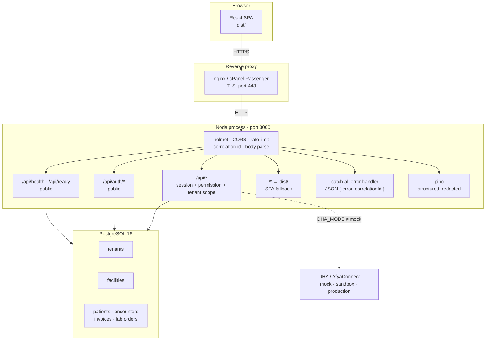

# Architecture overview

How JaliCare is put together, and why. The [README](../../README.md) covers
installation; this covers structure.

---

## The shape of the system

One Node process serves both the JSON API and the compiled React client, on one
port. That is a deliberate choice, not an accident of the template:

- a Kenyan facility often deploys on shared hosting with one process and one
  port available;
- there is no cross-origin configuration to get wrong, so no deployment
  silently breaks on a CORS preflight;
- one artifact to upload, one thing to restart, one log stream.

The cost is that the API and the SPA share a failure domain. That is accepted:
they are deployed together and a client that cannot reach the API cannot work
anyway.



If the diagram does not render, the same thing in text:

```
Browser → TLS → reverse proxy → Node :3000
                                   ├─ helmet            security headers
                                   ├─ CORS              origin allowlist
                                   ├─ correlation id    validate or issue
                                   ├─ rate limit        auth failures only, broad ceiling
                                   ├─ body parse        1 MB
                                   ├─ /api/health       liveness   (public)
                                   ├─ /api/ready        readiness  (public)
                                   ├─ /api/auth/*       sign-in    (public)
                                   ├─ /api/*            clinical   (session + permission + scope)
                                   ├─ /*                React SPA from dist/
                                   └─ catch-all         JSON error + correlation id
                                            │
                                            └─ pg pool → PostgreSQL 16
```

---

## Layers

| Layer | Where | Responsibility |
|---|---|---|
| Entry | `server.ts` | Reads `PORT`/`HOST`, starts HTTP, handles `SIGTERM` |
| App | `src/app.ts` | Middleware, gates, SPA fallback, error handler. No routes. |
| Routes | `src/routes/` | One router per domain; `index.ts` mounts them in order |
| Services | `src/*/​*.service.ts` | Business rules: billing, maternity, laboratory, auth |
| Data | `src/db/` | `schema.ts` and `queries.ts` are barrels over `schema/` and `queries/`; `index.ts` is the pool |
| Client | `src/App.tsx`, `src/components/` | React SPA |
| Cross-cutting | `src/middleware/`, `src/logging/` | Security, scoping, structured logging |

The direction is one way: routes call services, services call the data layer.
A service does not import a router, and the data layer does not import a
service.

---

## Two axes of scope: tenant and facility

A **tenant** is an organisation — a hospital group, a county, a single
private facility. A **facility** is one site within it: a hospital, a clinic,
a dispensary.

Both matter, and they answer different questions:

- `tenant_id` isolates customers from each other. A facility in Tenant A must
  not see Tenant B's records under any circumstances.
- `facility_id` scopes staff to their own site. A nurse at Facility 1 does not
  see Facility 2's patients, even though both belong to the same tenant.

Scoping is applied **in the `WHERE` clause**, so a database without access to
a row never returns it. Filtering after the read would put the row in memory,
one early `return` away from disclosure.

`src/tests/vitest/tenant-isolation.db.spec.ts` proves the property against a
real PostgreSQL: two tenants, per-facility tariffs with the same code at
different prices, duplicate keys refused, and cleanup scoped to the two
synthetic tenants it created.

### The exception

Superadmin routes operate across tenants. They are marked as such in the
source, and they are the only place a query may omit a tenant filter. Adding a
new one requires a permission code that ordinary roles do not hold.

---

## Request lifecycle

```
1. helmet             security headers before anything else
2. CORS               allowed origins only
3. correlation id     inbound validated, or a fresh UUID; echoed in
                      X-Correlation-Id; attached to every log line
4. rate limit         /api/auth counts failures; /api has a broad ceiling
5. body parse         1 MB, JSON
6. health / ready     unauthenticated
7. /api/auth/*        unauthenticated
8. ──── session ────  every route below requires a valid session
9. permission check   role → permission code
10. handler           tenant and facility scope applied in the query
11. response          JSON
12. error handler     any unhandled error → { error, correlationId }
```

Two ordering decisions are load-bearing and easy to get wrong:

- **Correlation id before the body parser.** Placed after, a client sending
  malformed JSON receives an empty correlation id, and the operator has
  nothing to search for.
- **Health and readiness before the session check.** A load balancer and a
  container probe cannot authenticate. Moving these behind auth turns every
  readiness probe into a 401 and the container never becomes ready.

---

## Errors

Every unhandled error becomes:

```json
{ "error": "An internal error occurred. Quote the correlation id when reporting it.",
  "correlationId": "3f2a…" }
```

Never the message, never the stack, never a file path. The detail goes to the
log, where the correlation id joins it to the request line.

A 4xx is logged at `warn` (the client's problem). A 5xx is logged at `error`
with the stack (ours). A malformed body is a 400 — answering 500 for it sends
whoever is on call looking for an outage that does not exist.

---

## Logging

Pino, JSON, in every environment. Development does not get a pretty-printer,
so a log statement that reads badly in production is noticed before
deployment.

Redaction is central, not per-call-site, because a call site that forgets is
a leak:

- **credentials** — password, token, secret, api key, cookie, session
- **patient identity** — national id, phone, date of birth, name, email

Both are treated the same way, because a log file is a copy of patient data
with none of the database's access control: it lands in journald, cPanel logs,
support bundles and hosting retention.

Where a log genuinely needs to correlate two events about one patient,
`patientRef()` returns a keyed HMAC — stable per installation, reversible by
nobody holding only the log.

Request lines omit the query string for the same reason: `?nationalId=...` is
a national identity number in a log file.

---

## Data

- **Migrations** are plain SQL in `drizzle/`, with a journal at
  `drizzle/meta/_journal.json`. The application never migrates on start.
- **Encryption at rest** for patient identifiers, using
  `FIELD_ENCRYPTION_KEY`. Losing the key loses the data; rotating it is a data
  migration, not a config edit.
- **Audit trail** records clinical and billing actions. It is not optional and
  must not be disabled.
- **Idempotency keys** on anything that moves money, so a retried request does
  not create a second charge.

---

## External systems

DHA / AfyaConnect (the Social Health Authority's integration platform) is
reached in one of three modes:

| Mode | Behaviour |
|---|---|
| `mock` | Local fixtures, no network calls, every result marked simulated. **Default.** |
| `sandbox` | Real HTTPS to the DHA UAT gateway, with issued credentials |
| `production` | Live, and refuses to run unless `DHA_ALLOW_PRODUCTION=true` |

`mock` is the default so that a development environment cannot accidentally
submit a real claim, and so a demo does not depend on a gateway being up.

---

## Where the rough edges are

Stated plainly, because a buyer should learn this here and not after
handover:

- **The three monoliths are split, as of this revision.** `src/app.ts` went
  from 3,416 lines to 468 and registers no routes at all; the forty-one
  handlers moved verbatim into eleven routers under `src/routes/domains/`,
  mounted by `src/routes/index.ts` after the facility-module gates, which is
  where they sat when they were inline. `src/db/schema.ts` went from 4,373
  lines to a 1,010-line barrel over ten modules in `src/db/schema/`, and
  Drizzle's generated SQL is byte-identical before and after. `src/db/queries.ts`
  went from 3,933 lines to a 42-line barrel over eleven modules in
  `src/db/queries/`.
- **Measured test coverage is still low** - about 20% of statements - because
  the legacy suites assert on source text rather than executing code. The
  splits tightened that text where they could (a slice that walked to the next
  `export function` is now brace-matched), but the underlying shape has not
  changed. See [`docs/quality/BASELINE.md`](../quality/BASELINE.md).
- **Concentrated logging.** The data layer still uses `console.error` in
  places where a Pino module logger already exists. This is a consistency
  defect, not a missing capability.
