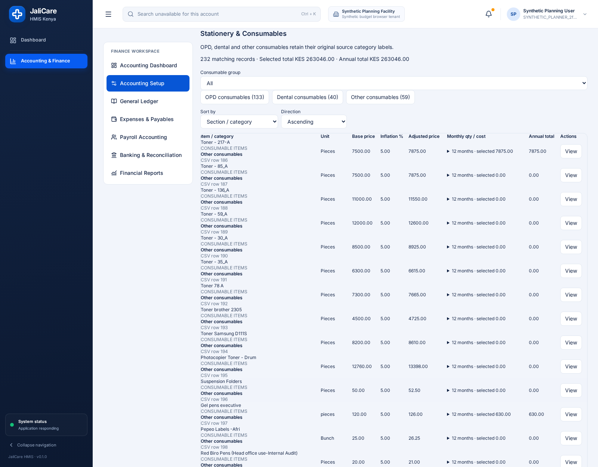
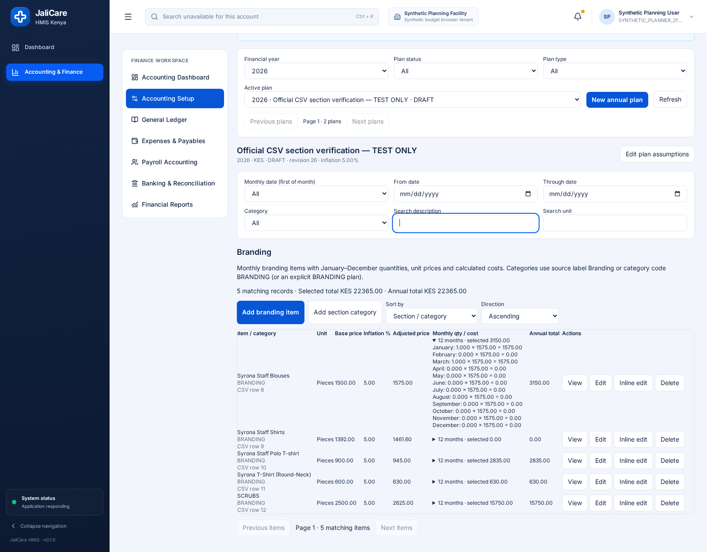
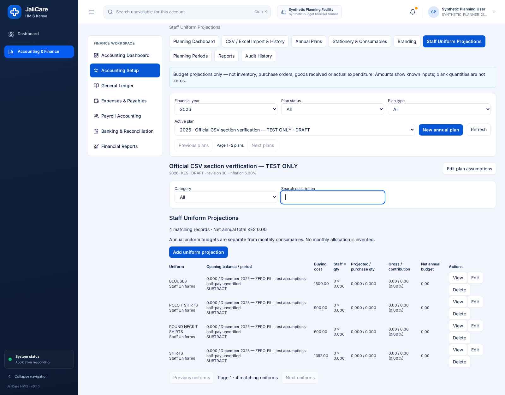

# Budget & Procurement Planning — actual UI verification

## Result

**PASS in the disposable test environment:** the actual built React application now has separate **Stationery & Consumables**, **Branding**, and **Staff Uniform Projections** sections. Authenticated Chromium tests navigated the real application and completed Create → View → Edit → Save → Delete in **each** section. This is browser evidence, not merely backend CRUD testing.

**Not production certification:** no production database was connected, migrated, imported into, or modified. No commit or push was performed for this task. The prior production deployment HOLD remains in effect.

## Screenshots of the three sections

These are real application screenshots from a disposable synthetic tenant/facility using the supplied CSV source records, explicit test KES currency, and ZERO_FILL test assumptions. They are not production screenshots.

### 1. Stationery & Consumables

- 232 imported source rows: **133 OPD**, **40 dental**, **59 other consumables**.
- Dedicated group buttons/filter, original category/source-row labels, case-insensitive description search, unit/category/date filters, sorting and pagination.
- Separate View, Edit, Inline edit and Delete actions on eligible drafts.
- Browser verified both original cotton-wool source rows remain searchable; duplicate names are not merged.

### 2. Branding

- Five imported monthly branding rows, accessible directly without selecting a category first.
- Expandable January–December quantities × effective unit prices = calculated monthly costs; selected and annual totals remain separate.
- Existing full-year editor and inline editor reused; saved detail view shows all twelve quantities, prices and costs.
- Browser additionally saved an inline edit while filtered to February, then verified the complete twelve-month record and unchanged months were retained.

### 3. Staff Uniform Projections

- Four imported uniform source rows in a distinct table, not combined with monthly branding items.
- View/Edit expose existing balance and reference period, buying cost, staff count, quantity per staff, contribution percentage and opening-balance treatment.
- Search/category filtering, separate totals and local pagination. Browser verified an imported POLO projection and the category filter.
- Original blank uniform source inputs are zero-filled test assumptions, not verified real balances/staff counts. Source half-pay amounts have **not** been invented as percentages.

## Browser acceptance evidence

**41 checks passed; zero browser runtime errors; no failed planning API requests.**

| Section                   | Imported records visible        | Create + View | Edit + Save                            | Delete eligible draft |
| ------------------------- | ------------------------------- | ------------- | -------------------------------------- | --------------------- |
| Stationery & Consumables  | 232, including OPD/dental/other | Passed        | Passed                                 | Passed                |
| Branding                  | 5 monthly source rows           | Passed        | Passed, including filtered inline edit | Passed                |
| Staff Uniform Projections | 4 source rows                   | Passed        | Passed                                 | Passed                |

Creation/edit/deletion used clearly named new test records; the imported source records were retained. The browser captured successful POST (201), PATCH (200), and DELETE (200) responses for each section and read back persisted values after saves. Deleted test records were absent from active results and retained as audited inactive records.

Concrete calculation checks:

- Each new monthly test item: base price 100, configured 5% inflation, quantities 1 through 12 → **8,190.00** annual cost.
- Both monthly editors: base 120, January quantity 3, December quantity 4, unchanged other months → **9,072.00**.
- Branding inline edit: base 130, January quantity 5 with the remaining saved months retained → **10,101.00**.
- Uniform creation: opening balance 2, staff 10, per-staff quantity 2, buying cost 1,000, contribution 50%, explicit SUBTRACT → **9,000.00** net budget.
- Uniform edit: opening balance 4, staff 12, per-staff quantity 3, buying cost 1,200, contribution 25% → **28,800.00** net budget.

A separately authenticated read-only user could view all three sections but had no create/edit/inline/delete controls. A 390px mobile Branding check found no document-level horizontal overflow. The only expected HTTP failures were pre-login session 401 responses and the read-only account's unrelated dashboard-overview 403, enforcing its deliberately limited permissions.

Additional saved screenshots:

- [Stationery detail](planning-sections-ui-evidence/04-stationery-view.png)
- [Branding detail with saved calculations](planning-sections-ui-evidence/05-branding-view.png)
- [Uniform detail](planning-sections-ui-evidence/06-uniform-view.png)
- [Stationery after Save](planning-sections-ui-evidence/07-stationery-saved.png)
- [Branding after Save](planning-sections-ui-evidence/08-branding-saved.png)
- [Uniform after Save](planning-sections-ui-evidence/09-uniform-saved.png)
- [Mobile Branding](planning-sections-ui-evidence/10-branding-mobile.png)

Machine-readable evidence: [browser-results.json](planning-sections-ui-evidence/browser-results.json). Human-readable run: [browser-checks.txt](planning-sections-ui-evidence/browser-checks.txt).

## What was fixed

1. Split the combined Branding/Uniform experience into independent navigation entries and tables, while reusing existing workspace, editors, APIs, permissions and calculations.
2. Added explicit source-category grouping for stationery and automatic monthly-branding partitioning. Original descriptions/category labels are not rewritten.
3. Corrected the existing HTTP projection's `all=true` query handling. Previously the service required a boolean but the URL supplied a string, which silently restricted the UI to the first 20 items before section classification. Local section pagination now operates over the complete scoped projection. An HTTP regression verifies 232 rows with `all=true` versus 20 without it.
4. Fixed new-item default category selection when the category filter is an empty string. Monthly creation choices are scoped to the current section; no active compatible category produces setup guidance instead of a broken add form.
5. Added saved January–December calculation detail and explicit draft delete actions. Deletion remains the existing audited soft-removal, not destructive database deletion.
6. Clear incompatible filters on section changes, preserve stable input focus while loading, cancel obsolete requests, debounce live-search requests, and prevent draft mutation actions while the current projection is updating. The debounce addresses an actual rapid-typing rate-limit failure observed during verification; the final run had no planning errors, without weakening rate limits.

No schema migration, new backend module, permission relaxation, calculation rewrite, auth change, approval bypass, or audit bypass was introduced. The sole API adjustment is normalization of the existing projection flag. Existing reporting/import/lifecycle paths remain in place.

## Fresh automated validation

| Check                                                  | Result                                                  |
| ------------------------------------------------------ | ------------------------------------------------------- |
| Authenticated real-browser verification                | **41 passed**                                           |
| Six targeted test files, database required             | **71 passed, 0 skipped**                                |
| TypeScript typecheck                                   | Passed                                                  |
| Client production build                                | Passed; existing large-chunk advisory remains           |
| Server build                                           | Passed                                                  |
| ESLint on all task-touched source/test/scripts         | Passed, no diagnostics                                  |
| Prettier check on all task-touched source/test/scripts | Passed                                                  |
| Migrations in a new disposable test database           | 97 applied; **not production**                          |
| Preservation check                                     | 1,390 baseline files present; no baseline files deleted |

The six test files cover existing planning calculations, database/API isolation and lifecycle protections, official-source imports/reports, ZERO_FILL/default traces, strict source reconciliation, existing inline UI behavior, and seven new dedicated-section regressions. Full-repository tests/lint were not rerun for this focused UI task.

Logs: [tests](planning-sections-ui-evidence/unit-and-db-tests.txt), [typecheck](planning-sections-ui-evidence/typecheck.txt), [client build](planning-sections-ui-evidence/client-build.txt), [server build](planning-sections-ui-evidence/server-build.txt), [scoped ESLint](planning-sections-ui-evidence/scoped-eslint.txt), [preservation inventory](planning-sections-ui-evidence/preservation-check.json).

## Remaining limitations / missing functionality

- **No missing core three-section CRUD functionality was observed in this disposable acceptance run.** That does not establish production deployment or correctness of unreviewed real-world assumptions.
- Section classification uses explicit category name/code `BRANDING` or a dedicated BRANDING plan, not guesses from item descriptions. OPD and Dental recognize their existing names/codes, including source spelling `DENTAL CONSUABLES`; other non-branding categories fall under Other. A facility with differently named categories must configure the appropriate category code. No existing plan was silently recategorized.
- Monthly section pagination uses the existing complete, scoped projection with the existing **5,000 matching-item** guard. This is not server-side section pagination for arbitrarily large plans.
- Source issues remain: missing prices/quantities were zero-filled with traceability, stationery source totals have the previously documented **2,665.50** discrepancy, and uniform half-pay/balance semantics still need facility review. The UI does not turn these into verified business facts.
- Production target, migration authorization, facility/currency/active uploaded letterhead and reviewed live import remain prerequisites under [the existing production HOLD](SYRONA_PRODUCTION_DEPLOYMENT_GATE.md). This task does not authorize or perform them.

## Reproduction

Use a **new, authorized, disposable loopback PostgreSQL test database only**; never a production or patient database. Build the current application and apply the repository migrations to that disposable database. Set the repository's SQL variables to that database.

1. Run `BUDGET_BROWSER_SYNTHETIC=YES npx tsx scripts/seed-budget-planning-browser.ts`.
2. With `SYRONA_SOURCE_DIR` pointing to the supplied CSV folder, run `BUDGET_BROWSER_SYNTHETIC=YES npx tsx scripts/seed-planning-sections-browser.ts`. The scripts enforce loopback/synthetic safeguards. They create random synthetic identities and store temporary credentials in the ignored `.tmp-tools` directory; do not publish that file.
3. Start the built application against that disposable database (default verification port 4193).
4. Set `CHROME_EXECUTABLE_PATH` to an installed compatible Chromium and run `BUDGET_BROWSER_SYNTHETIC=YES node scripts/verify-planning-sections-browser.mjs`. Optional `BUDGET_BROWSER_BASE_URL`, `BUDGET_BROWSER_ARGS`, and `PLANNING_SECTIONS_EVIDENCE_DIR` configure the loopback test runner.
5. Run the six test files with `JALICARE_REQUIRE_DB=1` and the same source-folder variable. The official-source database tests must not be skipped.
