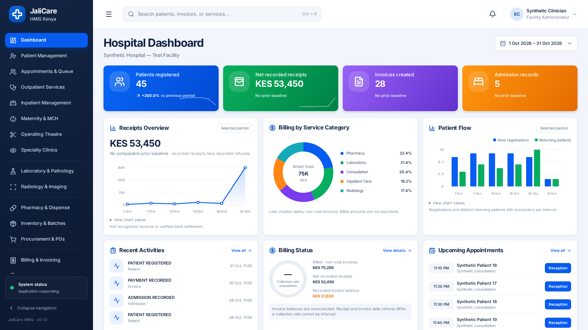

# JaliCare hospital dashboard redesign — implementation report

**Status:** implemented and locally verified with synthetic data; not deployed or accepted for clinical/financial production use.

**Verification date:** 31 October 2026 (Africa/Nairobi).

**Working branch:** `arena/dc192c99-afyahub-hmis-kenya`, based on the merged PR #27 baseline. This dashboard work has not been deployed. No production migration or external-provider transaction was performed.

## 1. What changed

The facility dashboard follows the supplied hospital-dashboard reference: full-height dark navigation, a compact session-aware header, facility and date selection, four coloured KPI cards, three analytics cards, and three lower operational cards. The layout adapts to desktop, tablet and mobile; the mobile rail opens as a drawer and the desktop rail can collapse. Chart values are also available as text through expandable chart details.

- `src/components/Sidebar.tsx`, `src/components/Header.tsx`, `src/App.tsx`, `src/index.css`: shared authenticated shell, responsive navigation, actual session identity, facility/organization selection, health status, search, notifications status, and profile/sign-out.
- `src/components/modules/HospitalDashboard.tsx`: facility dashboard, panel states, actions, and expandable access to the pre-existing operational dashboard. The separate platform super-admin dashboard remains separate.
- `src/components/dashboard/DateFilter.tsx` and `Charts.tsx`: calendar controls, exact monetary formatting, line, doughnut and bar charts, and text alternatives.
- `src/components/modules/DashboardModule.tsx`: retained operational dashboard; API requests and quick actions now honor relevant enabled/hidden module settings. Failed operational data is signalled rather than silently presented as an empty queue or report.
- `src/context/HmisContext.tsx` and `src/components/modules/PatientRegistrationModule.tsx`: hand off a selected search result to the existing patient directory; facility and session changes clear the handoff. Existing patient, billing, appointment, clinical, accounting, insurance and inventory modules remain the systems of record.
- `src/dashboard/{date-range,dashboard.types,dashboard.service,dashboard.routes,money}.ts`: typed dashboard contracts, calendar rules, scoped queries and exact decimal helpers. `src/api/clients/dashboard.client.ts`, `src/api/client.ts`, and `src/routes/index.ts` integrate the endpoints into the existing client and server.

The header search can find authorized facility patients by name/MRN, invoice numbers and configured service tariffs. Selecting a patient opens the existing directory with the MRN; selecting an invoice opens billing, not a falsely claimed direct invoice drill-down. Service results identify configured tariffs. Search terms are submitted in a POST body rather than a URL. Search state is reset on a user/facility change, and late responses are aborted/ignored. The notification button explicitly states that no persistent notification inbox/unread count is configured. The system indicator reports only whether the application health endpoint responded `healthy`; it is **not** proof of database, bank, SHA, insurer or all-system readiness.

## 2. API and data contracts

Both endpoints are mounted at `/api/dashboard` after the existing staff-session and authorization middleware. Responses are JSON and use `Cache-Control: private, no-store` for successful dashboard requests.

| Endpoint                                                                      | Contract                                                                                                                                                                                                                                                                                             |
| ----------------------------------------------------------------------------- | ---------------------------------------------------------------------------------------------------------------------------------------------------------------------------------------------------------------------------------------------------------------------------------------------------- |
| `GET /api/dashboard/overview?facilityId=<id>&start=YYYY-MM-DD&end=YYYY-MM-DD` | Inclusive range, maximum 366 days. Returns `facilityId`, `range`, an equal-length `previousRange`, and independently gated `registrations`, `receipts`, `invoices`, `admissions`, `flow`, `activity`, and `appointments` panels. Each panel is `{status: "ok", data: ...}` or `{status: "restricted" | "disabled" | "error", message: ...}`. |
| `POST /api/dashboard/search`                                                  | Body `{facilityId, term}`; 2–80 characters, no control characters. Returns limited `patients`, `invoices`, `services` and an `available` object indicating which categories the session may search. Literal SQL wildcard characters are escaped.                                                     |

Invalid facilities, dates and queries are rejected; expired/missing sessions and unauthorized facility scopes do not receive dashboard data. The backend resolves tenant/facility scope independently of the browser, and a global `SUPER_ADMIN` is not granted facility clinical/financial dashboard access merely by its platform role. Database queries are parameterized and scoped by tenant/facility, with scoped joins. Patient search results create existing `patient_record_access_logs` entries; returned audit activity excludes free-text audit details. A patient registered at a different facility is masked in an appointment result. Search request and panel error logging do not include search terms, SQL parameters, or patient names.

| Panel                                             | Required permission(s)                                         | Required enabled, non-hidden facility module(s)     |
| ------------------------------------------------- | -------------------------------------------------------------- | --------------------------------------------------- |
| Registrations                                     | `patients.read`                                                | `registration`                                      |
| Recorded receipts; invoices and billed categories | `billing.read`                                                 | `finance`                                           |
| Admission records                                 | `inpatient.read`                                               | `inpatient`                                         |
| Patient flow                                      | `patients.read`, `clinical.read`                               | `registration`, `opd`                               |
| Recent activity                                   | `audit.read`                                                   | `audit`                                             |
| Upcoming appointments                             | `appointments.read`, `patients.read`                           | `reception`, `registration`                         |
| Search patients / invoices / services             | respectively `patients.read` / `billing.read` / `tariffs.read` | respectively `registration` / `finance` / `finance` |

The overview route additionally requires at least one of the dashboard's recognized read permissions. Missing permissions and disabled/hidden modules do not become zeros. A per-section query or data-quality failure is reported as an error for that section; a transport failure produces a page-level retry/error state. A real zero is displayed only after a successful query returns zero. The existing JSON client detects HTML returned with HTTP 200 (for example an SPA fallback) and reports an API routing error instead of parsing it as data. Existing client session-expiry handling is retained.

## 3. Metric definitions and source tables

All ranges below are inclusive calendar dates. Comparisons use the immediately preceding **equal number of days**, not necessarily the previous named calendar month; a percentage is unavailable when its prior baseline is zero or negative. Charts divide the chosen range into at most six contiguous buckets. Values are based on stored records, not on example values in the reference image.

| Display                         | Exact definition and caveat                                                                                                                                                                                                                                                                                                                                                  | Existing source                                           |
| ------------------------------- | ---------------------------------------------------------------------------------------------------------------------------------------------------------------------------------------------------------------------------------------------------------------------------------------------------------------------------------------------------------------------------- | --------------------------------------------------------- |
| **Patients registered**         | Patients whose registration record `created_at` falls in the selected period and whose registration facility is the selected facility. This is **new registration records**, not all unique patients treated or total patient population. The API also exposes a count through the period end; it is not the KPI displayed.                                                  | `patients`                                                |
| **Net recorded receipts**       | Sum of recorded `billing_payments.amount` by `payment_date` **minus** recorded, manually confirmed `billing_refunds.amount` by refund `created_at` in the period. Receipts remain in the historical receipt stream even if their invoice is subsequently voided. Invalid, unconfirmed, or inconsistent recorded refund/payment data makes this panel unavailable for review. | `billing_payments`, `billing_refunds`, `billing_invoices` |
| **Invoices created**            | Count of invoice records created in the range, excluding rows marked `Void` or with `voided_at`. Includes unfinalized invoices.                                                                                                                                                                                                                                              | `billing_invoices`                                        |
| **Admission records**           | Count of admission records by their `created_at` in the range; this is not bed occupancy, inpatient days, discharges, or necessarily the manually entered clinical admission date.                                                                                                                                                                                           | `admissions`                                              |
| **Receipts Overview**           | Time buckets of the net recorded receipts definition above; not recognized revenue or verified bank settlement.                                                                                                                                                                                                                                                              | Same receipt/refund records                               |
| **Billing by Service Category** | Sum of recorded billing line totals by `item_type`, for lines created during the period on non-void invoices. The doughnut is **billed lines**, not cash allocated to each service. Five leading categories plus Other are shown when there are more than six; invalid/negative chart inputs require review.                                                                 | `billing_items`, `billing_invoices`                       |
| **Patient Flow**                | Per bucket: new facility registrations and distinct patients with non-cancelled facility encounters who were not newly registered at that facility in that same bucket. A returning patient may appear in more than one bucket.                                                                                                                                              | `patients`, `encounters`                                  |
| **Recent Activities**           | Up to four latest facility audit records in the selected period, restricted to safe action/resource identifiers; no raw audit details or narrative are rendered.                                                                                                                                                                                                             | `audit_logs`                                              |
| **Billing Status**              | Billed total and **current recorded balance** for the non-void invoice-creation cohort, plus receipts/refunds occurring in the selected period. Invoice/receipt cohorts differ; balance is not a historical as-of snapshot and is not independently reconciled. Consequently the collection-rate indicator is deliberately **unavailable**, not an invented ratio.           | `billing_invoices`, payments and refunds                  |
| **Upcoming Appointments**       | Up to five future `Scheduled`, `Confirmed`, or `Booked` appointments within the chosen dates, using supported ISO-style text timestamps and Nairobi current time. Future days display their date. Invalid candidate calendar/time values make the panel an error. Other stored formats are not included and must be reviewed in reception.                                   | `appointments`, scoped `patients`, `practitioners`        |

Amounts are summed as PostgreSQL numeric values and combined with integer-cent/`bigint` helpers. The dashboard does not allocate receipt cash across service lines or infer payer attribution. A claim, invoice, insurer approval, payment-request acknowledgement, accounting journal, bank balance, or GL reversal is **not** treated as a recorded receipt. Only existing billing receipt/refund records contribute to the receipt figure; a manual refund record is not proof of an external money transfer. Accounting recognition, controlled journal reversals, payer settlement, reconciliation and independently approved refunds remain separate workflows. The retained operational summary uses its legacy invoice paid/balance fields, labelled unreconciled, and is not the same metric as net recorded receipts.

Appointment buttons open reception for review; the dashboard does **not** check anyone in. The existing reception check-in flow does not yet establish a safe atomic appointment-status transition and duplicate-check-in prevention; this remains a separate follow-up.

## 4. Calendar and timezone assumption — important limitation

Presets use the **Africa/Nairobi calendar**: today, yesterday, complete Monday–Sunday week, complete current month, previous calendar month, or a validated custom range. The source schemas use PostgreSQL `timestamp without time zone` for many event fields, and appointment/admission dates also include legacy text fields. Selected dates are compared with the **stored calendar dates**, not converted from known UTC instants. The UI displays this limitation. Audit activity is formatted from its stored wall-clock components without inventing an offset.

For reliable Nairobi-day reporting, the facility/operator must verify that the application, PostgreSQL session/default timezone, data importers, and historical records consistently represent the intended Nairobi wall time. For future records, coordinate server/Node `TZ` and PostgreSQL session settings with the hosting team; changing timezone configuration does **not** retroactively identify the timezone of existing naive timestamps. Review historical data before interpreting period boundaries. A migration to timezone-aware instants would require a separately planned, backed-up reconciliation; this change does not silently alter timestamps or claim to solve historical timezone ambiguity.

## 5. Verification evidence

The database used below was a **new, isolated synthetic PostgreSQL 16 database**, not a production database. The existing 43-migration history was applied there only, including the previously authorized destructive statements in historical migration 0002. `npm run db:status:all` subsequently reported all 43 recorded and the checked baseline structures present. No migration was added for this dashboard and no production database was accessed.

| Check                                                                                        | Result                                                                                                                                                                                                                                                                                                                                                                                                                 |
| -------------------------------------------------------------------------------------------- | ---------------------------------------------------------------------------------------------------------------------------------------------------------------------------------------------------------------------------------------------------------------------------------------------------------------------------------------------------------------------------------------------------------------------- |
| `npm test` with coverage and `JALICARE_REQUIRE_DB=1` against the isolated synthetic database | **186 files, 1,720 tests passed**, no skipped tests reported. Aggregate coverage: 60.28% statements, 54.72% branches, 61.82% functions, 61.32% lines. Coverage is evidence of exercised code, not proof of clinical or financial correctness.                                                                                                                                                                          |
| Dashboard/transport/operational and browser-guard regressions                                | Included in the full suite: 6 PostgreSQL/HTTP dashboard cases; 6 calendar/money cases; 8 dashboard/header UI cases; 2 operational module/error cases; 1 HTML-as-JSON case; and 6 synthetic-harness guard cases. Tests cover scoped facilities/tenants, permissions, expired sessions, disabled/hidden modules, refund/void examples, empty/error/zero states, invalid dates and unsafe appointment values.             |
| `npm run typecheck`, `npm run format:check`                                                  | Passed.                                                                                                                                                                                                                                                                                                                                                                                                                |
| `npm run lint`                                                                               | Passed with **0 errors and 73 warnings**; warnings remain in the repository and are not represented as a clean-warning result.                                                                                                                                                                                                                                                                                         |
| `npm run build:deploy`                                                                       | Passed: Vite production frontend and six Node 22 server/script bundles built. Vite warned that the main minified client chunk is over 500 kB (about 1.48 MB, 333 kB gzip); code splitting remains a performance improvement.                                                                                                                                                                                           |
| `npm run verify:deploy`                                                                      | Passed with the synthetic environment configured: simulated migration dry-run checks reported zero writes, and 11 deployment tests passed. An earlier invocation without required DB configuration failed as expected; it was rerun with the isolated settings. The simulated dry run is not a production migration assessment.                                                                                        |
| Dashboard production-build Chromium smoke                                                    | Passed with a real authenticated synthetic facility user: JSON overview, actual scoped search and directory handoff, date change, desktop collapse/expand, mobile drawer, and no document-level horizontal overflow at 1568×882, 1024×900, and 390×844. This is automated Chromium evidence, not human acceptance or cross-browser certification.                                                                      |
| Existing `npm run test:browser:synthetic`                                                    | Passed on the production build with isolated fixtures: login, pharmacy/retry and FEFO, patient registration/DOB and triage, laboratory specimen/result, manual refund recovery, finalization/print, split-payment recovery, inventory, inpatient, reviewed ledger posting, staff and patient portals, and sign-out. Zero uncaught browser errors; the initial unauthenticated session probe returned the expected 401. |

Test definitions: `src/tests/integration/dashboard.db.spec.ts`, `src/tests/vitest/dashboard-calculations.spec.ts`, `dashboard-client.spec.ts`, `hospital-dashboard-ui.spec.tsx`, `operational-dashboard-gating.spec.tsx`, and `synthetic-browser-guard.spec.ts`. The existing browser smoke was updated for the renamed navigation labels and facility location without removing its functional assertions.

## 6. Actual screenshots — synthetic data only

Screenshots were captured from the production build in Chromium after authenticating against the isolated synthetic database. Names, facility, transactions and dates shown are synthetic, not patient or production data.

- [Desktop, 1568×882](screenshots/desktop-synthetic.png)
- [Tablet, 1024×900](screenshots/tablet-synthetic.png)
- [Mobile, 390×844](screenshots/mobile-synthetic.png)
- [Mobile, scrolled to lower cards](screenshots/mobile-lower-synthetic.png)

`scripts/dashboard-browser-synthetic.mjs` creates only additive synthetic fixtures, uses the existing secure bootstrap, generates credentials and encryption material in memory, and does not print them. It refuses to run without an explicit synthetic acknowledgement, a loopback host, a synthetic/test-named database, a database user and a Chromium executable. The name/loopback checks are safeguards, **not proof** that a database is disposable: an operator must independently verify the target, use a new isolated synthetic database, and never point a local tunnel at production. The existing setup pattern and prerequisites are in `docs/testing/SYNTHETIC_BROWSER_SMOKE.md`; this dashboard script requires a production build and the same connection/browser environment, with `BROWSER_SMOKE_SYNTHETIC=YES`. Each run adds synthetic records rather than resetting or deleting a database.

## 7. Remaining limitations and acceptance work

1. **Timezone:** historical naive timestamps and imports are not guaranteed to be Nairobi wall time; verify and reconcile before relying on day boundaries.
2. **Financial interpretation:** the dashboard is not a GL, bank, payer or external settlement reconciliation. Invoice balances are current recorded fields and unfinalized invoices are included; the collection rate is intentionally unavailable. No claim/payment provider was contacted.
3. **Appointments and notifications:** unsupported legacy appointment time formats are omitted and must be reviewed in reception; atomic safe check-in/duplicate prevention and a persistent notification inbox/unread count are not supplied by this dashboard.
4. **Accessibility/performance/browser coverage:** accessible names, keyboard search, text chart values and responsive Chromium smoke are present, but a full accessibility audit, additional browsers/devices, large-data load testing and bundle splitting remain outstanding.
5. **Operational context:** validate facility module configuration, permissions, actual tariffs, historical records and period semantics with authorized facility staff. Production rollout requires independent security/finance review, backup and migration planning, and human visual/clinical acceptance. Existing externally blocked provider onboarding, SHA/private-insurance verification, reconciliation and accounting limitations from `docs/audits/FINAL_ENGINEERING_COMPLETION_REPORT.md` remain open.
